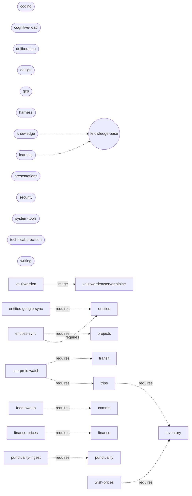

# Sjel Architecture

> Auto-generated by tools/generate-architecture.sh. Do not edit manually.
> Generated: 2026-11-04T19:03:42Z | Source: sjel.toml + upstreams.toml + systems.toml + capabilities/ + Packs/

See the [engineering doctrine](CONTRIBUTING.md#engineering-doctrine) this generated view reflects.

## Capabilities

| Capability | What | Service | Port |
|---|---|---|---|
| `agent` | The coding agent as a capability: one loop from `crates/sjel-agent`, a plugin tool set, and the sessions, stream and approvals a front end needs. | — | `8108` |
| `assistant` | An OpenAI-compatible chat client for GPUI Ask. | — | `8100` |
| `backup` | Every capability's backup contract: the run, the surface that manages it, and the record of what each attempt did. | — | — |
| `calendar` | Sjel's personal calendar layer: the source of truth for what time means on any given day — availability windows for travel, on‑site work, remote‑work blocks, busy periods, events you're attending, rhythms that materialize those blocks, and (later) day‑planning detail. | — | `8087` |
| `capability-auth` | `sjel capability call` sent no credential, so every gated route answered `invalid or missing authentication token` to a caller with no browser session. | — | — |
| `civil-date` | Howard Hinnant's civil-from-days pair, written once. | — | — |
| `claude-code-config` | Applies and checks the user-level Claude Code settings file — `~/.claude/settings.json`, or `$CLAUDE_CONFIG_DIR/settings.json` when that is set. | — | — |
| `comms` | General observed-information intake for Sjel, plus reviewed mail triage. | — | `8083` |
| `containment` | Agent containment by provider: macOS seatbelt profile generator and loopback egress proxy. | — | — |
| `content-item` | The `content-item-v2` reader contract in Rust. | — | — |
| `cv` | One master CV, tagged by profile and priority, built into one-page variants per profile or per application, plus the full CV that LinkedIn mirrors. | — | — |
| `devices` | Registry for device pairing, public keys, signed-request replay protection and revocation. | — | `8098` |
| `documents` | Sjel's local document library. | — | `8104` |
| `entities` | Canonical registry for people, organisations, places and the operator's own context. | — | `8097` |
| `extraction` | One home for **turning a fetched document into text**, and for the question of who gets to read which kind of document. | — | — |
| `finance` | Journal-backed cash flow, reviewed bank imports and subscriptions with append-only price and state history. | — | `8090` |
| `host-net` | What this host exposes to the network, read without sudo. | — | — |
| `import` | Sorts a folder to the capability that owns each file and records every file's outcome. | — | `8107` |
| `inference` | One home for **which model answers which job on this machine**. | — | — |
| `interior` | Checks apartment layouts against measured room geometry, clearance rules and inventory items. | — | `8092` |
| `inventory` | Household inventory for owned, wanted and retired items. | — | `8101` |
| `libsql-auth` | Mint the JWT a libSQL server (`sqld`) authenticates, and hold the Ed25519 pair it is signed with. | — | — |
| `markdown-root` | A declared markdown root, and the only way to get a file out of it. | — | — |
| `media` | Exact-byte ingest gate and integrity ledger for media libraries on mounted volumes. | — | `8102` |
| `operator-profile` | Sjel's private, versioned source for durable operator preferences, principles, boundaries, and interaction style. | — | `8099` |
| `places` | Canonical place registry, geocode cache and geographic layers shared by Finance, Trips, Transit and Entities. | — | `8093` |
| `projects` | Sjel's record store for projects, tasks, notes and their attachments. | — | `8103` |
| `pseudonymize` | Reversible bidirectional session tokenization for cloud evaluators and agents (PRD §6.2c, Q112, Slice P1). | — | — |
| `punctuality` | How reliable a German train actually is, measured rather than predicted. | — | `8085` |
| `route-manifest` | A self-describing HTTP surface. | — | — |
| `runtime` | Per-device runtime admission, separate from capability installation, agent permissions and privacy policy. | — | — |
| `scouting` | A generic opportunity-discovery pipeline: scrape a source (events, CFPs/scholarships, ...), normalize into one shared `Opportunity` type, score it against a configurable "interest profile" via embeddings/cosine similarity, rank, persist, and optionally cross-reference against existing notes. | — | `8084` |
| `sjel-agent` | One agent loop. | — | — |
| `sjel-cli` | Unified command interface, maintenance engine, and operator tooling for Sjel as one Rust binary. | — | — |
| `sjel-config` | Shared overlay/config resolution for Sjel's Rust capabilities: tilde expansion, overlay paths (`SJEL_PERSONAL_ROOT`), the store's location, the deployment's home timezone, and the runner's port contract (`SJEL_PORT` first, capability escape hatch second, config file third, shipped default last). | — | — |
| `sjel-credentials` | Provider-neutral credential references and secret operations for Sjel's operator tools. | — | — |
| `sjel-http` | One home for **outbound HTTP**: the blocking client, the user-agent every Sjel request carries, and the timeout no caller can forget. | — | — |
| `sjel-mcp` | Sjel's capabilities as an MCP server, and the registration of that server in the agent harnesses on this machine. | — | — |
| `sjel-server` | The one way a capability server comes up: `resolve_port` (re-exported from `sjel-config`: `SJEL_PORT` from the runner first, capability escape hatch second, config third, shipped default last), a loopback-only bind, **the inbound authentication gate**, uniform startup logging, and a named single-line exit on bind failure instead of a panic backtrace. | — | — |
| `sjel-status` | Local status and lifecycle gateway for enabled capabilities. | — | `8082` |
| `sjel-store` | One home for **how a capability opens the shared database, and when its migration runs**. | — | — |
| `sjel-turso` | The LibSQL storage engine for Sjel: an async local database with native vector search. | — | — |
| `skill-metadata` | The `SKILL.md` frontmatter contract, read in one place. | — | — |
| `software` | The apps, leftovers and command-line tools on this Mac: what each holds on disk, when it was last opened, and what the operator decided about it. | — | `8106` |
| `soundscape` | Generative audio that follows what you are doing. | — | `8088` |
| `station-time` | Timezone-correct arithmetic for station-local times. | — | — |
| `storage` | `df` answers "am I full". | — | — |
| `summarize` | One home for **how much digest a thing is worth**. | — | — |
| `transit` | HAFAS journey search, split-ticket solving, rail ticket extraction, journey reliability scoring, and fuzzy trip-search sessions. | — | `3000` |
| `traveler` | Personal travel profile containing hard constraints, destination and journey ranking weights, interests, pace, anchors and provenance for each field. | — | `8096` |
| `trips` | Persistent user intent and itinerary state for Sjel's cross-capability Trips workspace. | — | `8086` |
| `vault` | Reads an Obsidian vault as data. | — | `8094` |
| `web-links` | A local-first launcher for web destinations the operator returns to: social accounts, communities, work tools and service pages. | — | `8109` |
| `archive` | The archive holds unsorted source material awaiting import into its owning capabilities. | — | — |
| `container-refresh` | The daily pull of every image this machine declares, and the recreate for the ones whose digest moved. | — | — |
| `entities-google-sync` | The scheduled Google Contacts sync for [`capabilities/entities`](services/entities-google-sync/../entities/). | — | — |
| `entities-sync` | The scheduled Journal sync for [`capabilities/entities`](services/entities-sync/../entities/). | — | — |
| `feed-sweep` | The scheduled source collector for [`crates/comms`](services/feed-sweep/../../crates/comms/). | — | — |
| `finance-prices` | The nightly market-price fetch. | — | — |
| `foundation-models` | Apple's on-device model, served over the OpenAI chat-completions shape on loopback. | — | `8091` |
| `host-patch` | The daily upgrade of this machine's tools, and the audit that follows it — over this repository, the private overlay, and the software those tools installed outside the checkout. | — | — |
| `host-watch` | The machine's own vital signs, checked hourly, reported only when something crosses a line. | — | — |
| `knowledge-base` | The vault, as a thing that gets backed up. | — | — |
| `macmon` | Apple Silicon hardware metrics served by the adopted [`macmon`](https://github.com/vladkens/macmon) binary. | — | `9911` |
| `packs` | What Sjel has deployed into each agent harness on this machine, and the proof that it did. | — | — |
| `people-registry` | Rung 0's known-person registry, refreshed from `capabilities/entities` every six hours. | — | — |
| `punctuality-ingest` | The scheduled producer for [`capabilities/punctuality`](services/punctuality-ingest/../punctuality/). | — | — |
| `sparpreis-watch` | The Sparpreis price watch (travel PRD R4). | — | — |
| `sqld` | The database server other devices hold an [embedded replica](services/sqld/../../libs/sjel-turso/README.md) of. | — | `8089` |
| `store` | The one SQLite file every capability's tables live in. | — | — |
| `vaultwarden` | Reusable Vaultwarden runtime contract. | vaultwarden/server:alpine | — |
| `wish-prices` | The daily price refresh for wish comparisons. | — | — |

## Libs

Spine-owned shared code with no domain of its own — statically linked into capability
binaries at compile time. See [Three architectural nouns](CONTRIBUTING.md#three-architectural-nouns).

| Lib | What |
|---|---|

## Packs

| Pack | Description | Skills | Drives |
|---|---|---|---|
| `coding` | Engineering craftsmanship: systems-grade Rust and native GPUI desktop development. | effective-rust, gpui, prior-art | — |
| `cognitive-load` | Shape agent output for a constrained reader: the ADHD output style, which leads with the next action and restates state every turn, and ASD-STE100 controlled language for strings an agent must parse without ambiguity. | attention-control, asd-ste100 | — |
| `deliberation` | Five ways to work a decision: produce candidate options when there are none, crystallize an unstructured mess into a precise document, convene a council that debates the options, red-team the proposal that wins, and root-cause the failure when one happens anyway. | diverge, crystallize, council, red-team, root-cause | — |
| `design` | UI craftsmanship across Sjel's web and native interfaces, with coherent cross-device experiences, typography, and mechanical sympathy. | ui-craftsmanship | — |
| `gcp` | Use Google Cloud CLI tools for authenticated project and service operations. | gcp | — |
| `harness` | Keep the agent system and its repository in shape: operate and change Sjel, propose the skills the recorded work actually needs, shrink what loads into every session, and keep every harness in step with the Packs that feed it. | sjel, suggest-skills, trim, harness-sync | — |
| `knowledge` | Knowledge work on the Obsidian vault as the one durable surface — vault ops under the vault contract, the wiki layer, research, and clean web capture. | obsidian, defuddle, research | — |
| `learning` | Teaching and practice that grow the Obsidian vault — probe the edge of understanding, teach one step at a time with interactive figures, and practice on claims already taught. | teach, practice | — |
| `presentations` | Build, check, render and readiness-check slide decks as .pptx from a Python module, with talk-genre profiles (DSR/qualitative defence, empirical-CS talk), a role-based theme, and a contact-sheet verification loop. Renders Mermaid diagrams to themed figures from the same palette. | slide-deck, diagrams | — |
| `security` | Guard secrets and credentials from agent visibility, and supply them where the agent legitimately needs one. Pi agent extensions that block reading .env, .secrets, and Bitwarden items at the tool-call boundary while allowing commands that use those secrets, and that give providers their API keys from the login keychain instead of the environment. Ships a Claude Code secrets-guard skill for the same doctrine. | secrets-guard | — |
| `system-tools` | Discover and use system-level CLI tools for shell operations, package management, process control, and system administration. | system-tools | — |
| `technical-precision` | Apply concise, evidence-backed, technically precise reasoning and writing for research, debugging, evaluation, comparison, recommendations, architecture, and technical documents. | technical-precision | — |
| `writing` | What an agent produces for a human reader, and how the agent's own skills get authored: human-voiced prose with a CI-gateable tell linter, academic drafting and cite-checking with an adversarial multi-skeptic review pass, code and web UI stripped of AI tells, and the meta-skill that authors and audits agent skills. | skill-creator, human-writing, academic-writing, unslop | — |

## State mounts

Where tools actually persist data — Sjel records where a tool already writes, it never
relocates the directory (see [State mounts record reality](CONTRIBUTING.md#state-mounts-record-reality)).

**Not tabulated here.** The `[[state_mount]]` registry moved from `sjel.toml` into
`<overlay>/config/machine.toml` on 2026-07-26, because those paths describe one machine
and this file is the shared repo snapshot — a generated public document cannot carry a
second machine's home directory. Run `tools/doctor` to see this machine's
mounts and whether each path exists. See
schemas/machine.toml.example.

## Upstreams by verdict

- **adopt**: python-eval-image, unicode-normalization, mcp-audit, lopdf, gitleaks, osv-scanner, grype, vaultwarden, bitwarden-cli, r2d2, sha2, exiftool, rusqlite, r2d2_sqlite, libsql, libsql-server, bun, bun-security-scanner, mermaid-rs-renderer, openfreemap, nominatim-api, open-meteo-api, interceptor, bottom, apfel, macmon, tabler-icons, typst, yaml_serde, yq, vibecoded-design-tells, human-voice, home-assistant, pihole, stevenblack-hosts, tailscale, pi-coding-agent, debian, deutsche-bahn-data, arrow-rs, xberg, ar5iv, multilingual-e5-base-mlx, bge-reranker-v2-m3-mlx, yahoo-finance-chart, ecb-data-portal, frankfurter-api, pi-subagents, pi-web-access, obsidian-web-clipper, obsidian-local-rest-api, yaml-js, smol-toml, defuddle, rcgen, rustls, kitinerary, ripgrep, signal-hook, proptest, vercel-labs-skills, github-actions-artifacts, anatomy, portable-pty, alacritty-terminal
- **overlay**: academic-researcher
- **inspiration**: meta-harness, schema-harness, lifeos, rust-analyzer, tigerbeetle, iai-personal-memory-engine, local-llm, paperless-ngx, dolphin, ocrs, awesome-selfhosted, colibri, exo, mlx, llama-cpp-rpc, mcpserver-audit, telekom-mcp-security, scout, trek-travel, tripit, betterbahn, besser-bahn, plan-bahn, asd-ste100-skill, nvidia-skills, pi-ai-auth, slm-finetuning-talk, pascal-editor, yfinance, open-intelligent-ui, cc-intelligent-ui
- **quarry**: oberskills, academic-writing-agents, research-paper-writing-skills, pengsida-research-notes, learnharness, event-horizon
- **reject**: hledger, docling, semgrep, trivy, rules_rust, postgres, r2d2_postgres, grafeo, indradb, platforms, rules_shell, graphify, presidio, auge, stop-slop, skills-best-practices, esphome, mosquitto, netbird, apple-container, multilingual-e5-small-mlx, stooq, tradegate, extism
- **watch**: turso, accordion, gpui, gpui-kit, gpui-mobile, nimble, clm, db-rest, motis, beancount, firefly-iii, radicale, sqlite-vec, fastembed-rs, beszel
- **evaluate**: maplibre-native-rs, clm-mlx-community
- **adapt**: i-have-adhd

## Systems

| System | Kind | Local | Why |
|---|---|---|---|
| `axon` | project | yes | The public core: reusable contracts, capabilities and deployment tooling; private state is injected from the selected overlay. |
| `backup-target` | service | yes | Remote backup role, separate from each source host so one node failure cannot remove both live state and recovery data; coordinates live in the selected overlay. |
| `pi-agent` | project | yes | Minimal open-source coding agent, extendable from core; one of three swappable harness targets for Packs/skills. |
| `opencode` | platform | yes | Open-source coding agent CLI (MIT); third swappable harness alongside Claude Code and pi, and a Packs/skills port target. |
| `knowledge-base` | project | yes | Private knowledge store with its own sync lifecycle, connected through explicit capability contracts rather than treated as an Sjel-wide database. |
| `obsidian-local-rest-api` | service | yes | Obsidian plugin (MIT) serving the open vault over loopback HTTP; the only route by which capabilities/vault writes into the vault. URL and key file come from the overlay's config/knowledge.toml. |
| `mach-mono` | project | yes | Swift monorepo of macOS/iOS quality-of-life utilities; plugin-first, extendable from core. |
| `lifeos` | platform | yes | Personalization and tooling layer under the agent runtime, and the ancestor of Sjel's public-core-plus-private-overlay shape. Sjel consumes nothing from it now; upstreams.toml's [lifeos] entry owns the verdict. |
| `ollama` | tool | yes | Portable local-model runner holding the `embedding` and `summarization` inference roles. It loads chat models at 4096 tokens and silently truncates an over-window prompt from the front, so a chat role must name a model built with an explicit `PARAMETER num_ctx` covering `sjel_summarize::worst_case_prompt_tokens()`. |
| `omlx` | tool | yes | Apple-Silicon inference server behind an API-key-enforced OpenAI-compatible endpoint. It stays host-native because Metal/ANE are unavailable inside the Linux runtime; endpoint and model selection are deployment facts. |
| `macmon` | tool | yes | Sudoless Apple Silicon performance monitor: CPU/GPU temp, power, memory, utilisation over HTTP/JSON for the GPUI Systems view. |
| `apple-natural-language` | platform | yes | OS-managed native embedding comparator for Comms, not the production relevance backend: it scored 3/6 and 4/6 useful top-1 on the frozen DE/EN corpus. The harnesses stay for future macOS revisions; E5-base through oMLX remains selected. |
| `apple-vision` | platform | yes | The OS framework rung 2 of the extraction ladder stands on, reached through tools/visocr: 100.0% prose recall but 58.8% notation recall on the frozen DE/EN corpus, which is why the ladder has a third rung. Record: libs/extraction/eval/results/2026-09-02-apple-vision-baseline.md. macOS-only; absent on Linux hosts. |
| `opencode-zen-go` | service | no | OpenAI-compatible hosted inference, a paid fallback behind nvidia-nim; not free despite the tier name. It buys context: several models carry 1M-token windows. Key via Vaultwarden and tools/materialize-inference-key. |
| `gemini` | service | no | Free-tier hosted inference behind the comms `cloud_gemini_content_analysis` role. The free tier allows 20 requests per day per project per model, so `max_requests_per_day` must not be set above 20. Key via Vaultwarden and tools/materialize-inference-key. |
| `groq` | service | no | Free-tier hosted inference, the second public-tier role behind Cloudflare, for redundancy rather than throughput. Limits are per model and per organisation: `qwen/qwen3.8-27b` allows 1000 requests and 2M tokens per day but only 8K tokens per minute, so a burst falls over to the next rung. `tools/model-check --probe` reads the real ceiling. |
| `cohere` | service | no | Free trial-key inference through Cohere's OpenAI-compatible endpoint, the third public-tier role. Trial keys allow 1000 calls per month, so the role declares 30 requests per day (30 x 31 = 930) to stay inside it. |
| `cloudflare-workers-ai` | service | no | Free-tier hosted inference behind the comms `cloud_cloudflare_content_analysis` role. The free tier is 10,000 Neurons per day, about 80 digests of the current model, so the request cap is an approximation to re-measure when the model changes. |
| `nvidia-nim` | service | no | Free-tier hosted inference (OpenAI-compatible, nvapi- key, 1000 credits, 40 req/min, no card), an optional cloud fallback when local model quality is not enough. Dev, research and eval terms only, not a production SLA. |

## Dependency graph

Generated from the same manifests as the tables above — each Pack's declared
`capabilities` (drives) and `links` (systems its skill actually talks to), plus
every capability's pinned upstream image. This shows what's wired, not full
inventory — see the Capabilities/Packs/Systems tables above for that.

