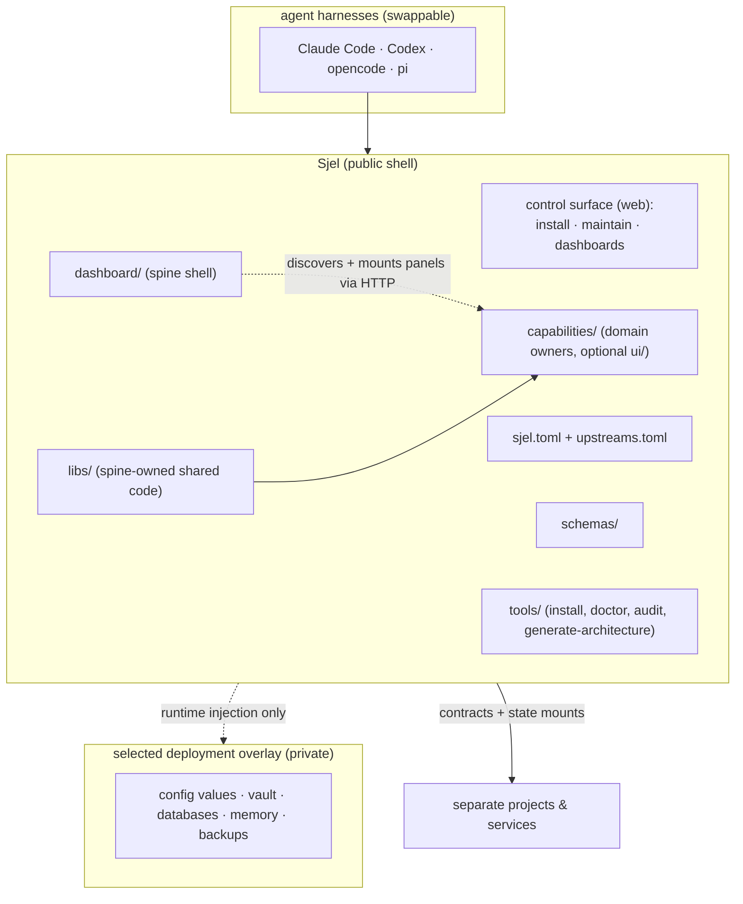

# Contributing to Sjel

Sjel accepts changes that improve the reusable public shell. Personal data and deployment state
stay in a private overlay. The same boundary covers credentials, private host details, and
operator-specific policy.

## Before writing code

Name the consumer and the outcome. An interesting technology without a concrete Sjel consumer
remains an idea, not an implementation commitment.

Use GitHub Issues for concrete work that a maintainer or contributor can test or complete.
Name the consumer, outcome, and acceptance check. Use `type:idea` for experiments that may conclude not to build. Keep temporary plans with the active task; remove them when the work ends.

The existing ISA is a transition backlog, not a task list. Keep only unresolved claims with a
probe that could falsify them. Move enduring behavior into code, tests, or the owning docs, then
remove the resolved claim. Comments explain local invariants, not dated decisions; Git keeps the
history.

Before external code or adopted design influence enters the tree, record its canonical source in
`upstreams.toml`. Record the license and verdict there too, then state precisely what Sjel
adopts. No version: the register holds none since 2026-09-02, because every dependency tracks its
upstream's latest release (#patch-first).

## Work on one change

Start from current `main` and create a branch named for the change: `<area>-<short-slug>`. Keep
the diff inside one coherent boundary. Put reusable code and doctrine in Sjel; use synthetic fixtures for
data-shaped tests. Never copy an active overlay or secret value into public work. Workstation paths
and private logs must also stay out of commits and GitHub text, including screenshots and test
failures.

Run `tools/doctor` before editing and record unrelated or machine-only failures separately. A
fresh source checkout does not need a real private overlay for CI; repository tests use synthetic
configuration where a machine contract is required.

## Validate the changed boundary

Run the nearest tests and checks declared by the package you changed. Then inspect the focused
diff, `git diff --check`, and `git status --short` before committing. Common repository checks
are:

~~~sh
cargo test --workspace --locked
bun test
tools/check-publication-hygiene.sh
tools/isa-hygiene.sh
~~~

Rust packages are members of the root `Cargo.toml` workspace and share the
root `Cargo.lock`. Keep each package's direct dependencies in that package's
manifest; do not add a nested lockfile. For a Rust change, verify the workspace
view and the build:

~~~sh
cargo metadata --locked --no-deps --format-version 1
cargo fmt --all --check
cargo clippy --workspace --all-targets --all-features --locked -- -D warnings
cargo check --workspace --locked
cargo test --workspace --locked
~~~

Run the format and Clippy commands from the repository root. They use the channel and
components `rust-toolchain.toml` names -- `stable`, so the release rustup last fetched;
CI resolves the same file, not a literal held somewhere else. Do not replace a finding
with a workspace-wide allowance. A narrow allowance belongs beside the affected
item and must explain the invariant that makes the lint inapplicable.

That command needs no database service and no environment variable. The
database-backed suites are `db_tests::` — one module name across the workspace,
which is what makes them selectable — and each test opens a temp SQLite file of
its own. Run them alone with:

~~~sh
cargo test --workspace --locked -- db_tests::
~~~

A performance claim is proved by a probe this repository can re-run, not by a scratch program
outside the checkout: an ignored test beside the code it measures, or a script under `tools/`. The
comment or README that states the number names that probe, so the next person can repeat it on
their own machine and see whether it still holds.

Run `bun run check` and `bun run build` in `dashboard/` when dashboard code changes. The
check does not compile a template; the build does. A package that `tools/discover-ui-packages`
reports is checked and built the same way in CI, so run both there too. Manifest or
generated-architecture changes also require:

~~~sh
tools/generate-architecture.sh
tools/check-architecture-fresh.sh
~~~

Do not describe a skipped or unavailable check as passing.

**`SJEL_DB_PATH` isolates the database only.** Vault projections (`comms`, `finance`, `trips`)
resolve their roots from overlay configurations. When testing against a copy, export isolated
projection roots as well: `SJEL_TRIPS_EXPORT_ROOT`, `SJEL_FINANCE_DECISIONS_ROOT`, and a
scratch `SJEL_COMMS_CONFIG`.

**Do not `cargo build --release` in a worktree sharing the root `target/`.** That build overwrites
`target/release/<bin>`, which is the binary supervised by `tools/service-runner.sh`. When testing
from a worktree, build debug binaries or set an isolated `CARGO_TARGET_DIR`.

Assertions requiring platform-specific resources (`/dev/full`, container runtimes) must use
`skippable` from `tools/lib/test-support.sh`: skippable tests print omitted coverage locally and fail
in CI.

## Open the pull request

Open a draft pull request first. State the outcome, then bound the exact scope. List every
completed validation command with its result and name the known limits. Keep separable follow-ups
out of the pull request rather than widening it. A merge should land one coherent change and
remain easy to review or revert.

Security findings follow [SECURITY.md](SECURITY.md); never report one in a public issue or pull
request.

## License and sign-off

The project is licensed under the GNU Affero General Public License, version 3 only
([LICENSE](LICENSE)). Anyone who runs a changed version as a service for other people must
offer those people its source. Code that `Packs/` vendors from other projects keeps its own
license; each such Pack reproduces the upstream notice in its `LICENSE` file.

Every commit carries a Developer Certificate of Origin sign-off
([developercertificate.org](https://developercertificate.org/)): a `Signed-off-by:` line that
states you have the right to submit the change under this license. `git commit -s` adds it.
A sign-off does not transfer copyright: a contributor keeps it in their change. A later license
change (README, open question O2) therefore needs the consent of every contributor whose code
remains, or a contributor license agreement introduced before outside contributions arrive.

Releases before 2026-09-26 were published under the MIT license and stay available under it.

---

# Engineering doctrine

The rules below govern every change to this repository. Detailed procedures live in the linked
technical documents; each rule has one owner. Code comments and READMEs link to that owner.

## Product rules

Every change keeps to these. Rules 1, 4 and 5 describe the target behaviour; the README's
[State](README.md#state) table shows how much of it is built.

1. A task runs on the best model the device can reach: its own Apple model, then the Mac's, then
   deterministic rules. The result shows which one answered.
2. A paired device's key admits its requests. Every connection type carries the same signed
   requests.
3. Sjel detects what the devices can do and chooses the defaults. Other options are under
   Advanced.
4. C2 data leaves the owner's devices only end-to-end encrypted, with keys on those devices, or
   pseudonymized. A cloud request carries only the fields its task needs (Staab et al.); ambient
   metadata, protocol headers, and extraneous history are stripped. A test proves each path. A
   failing test closes the path.
5. Summaries and labels appear without a confirmation. Confirmations protect only while they are
   rare enough to be read (Akhawe and Felt); frequent prompts cause habituation and click-through.
   A reversible change applies by itself only after a frozen test set shows it is reliable. A change
   that leaves Sjel, or cannot be undone, asks. The prompt rate on routine flows is measured and
   kept at zero.
6. Screens and assistant tools come from the typed data.
7. A statement about the system cites the file, command or measurement that proves it.

## Start here

Sjel supports macOS and Linux. The guided installer detects the platform, creates or connects a
private deployment overlay, writes the local machine manifest, and leaves existing state alone.

Follow [the shell-only installation workflow](docs/operations/index.md#install-a-shell-only-node)
for prerequisites, source setup, capability selection, authentication, build, startup and reboot
verification. The installer reports missing tools rather than installing them silently.
Contributors who only need source and tests can skip operating setup and start at
[Before writing code](#before-writing-code).

## Operating values

These are design tests, not aspirations. A value only counts when it changes a placement,
contract, install, or review decision.

1. **Lean runtime, growing monorepo.** A fresh install enables a small useful core. The repo
   may hold far more — optional capabilities, Packs, public reference projects — and none of
   that may become a runtime prerequisite.
2. **One feed, many views.** Capabilities keep domain ownership, but publish typed events with
   provenance, time, confidence and state. The dashboard sorts and connects those events; it
   does not become another data silo.
3. **Data and mechanism never blur.** Sjel owns public code, schemas, renderers and explicitly
   public first-party datasets. The active private overlay owns private content, secrets, machine
   configuration and history. Both sides use the same bounded
   contracts: data may select an allow-listed behavior, never become executable code.
4. **Evidence before automation.** Every surfaced claim keeps its source, evidence boundary and
   decision state. Agents rank and explain; anything irreversible still goes through the
   capability contract, and leaves a trace.
5. **Security is continuous observation.** An audit gate is a start, never the property itself.
   Dependencies track their upstream's latest release ([Patch first](#patch-first)). Bun/npm
   packages maintain a 24-hour resolution window to mitigate rapid publish-compromise attacks.
   Egress, access and agent touches stay observable; telemetry lives in the private overlay.
6. **Replaceable edges, stable contracts.** Agent harnesses, model providers, visual renderers
   and deployment substrates are adapters. Adopt first and record why. Re-open the call when
   its stated flip condition comes true.
7. **Self-hosted by default, distributed when earned.** One home-server deployment should serve
   phone and desktop clients. Kubernetes, WASM or a native shell enter only for a measured
   portability, isolation or performance need.
8. **English is the shared surface.** Sjel-authored interfaces, documentation, prompts,
   summaries, explanations and errors default to English. Source material and explicitly
   locale-specific capabilities may remain multilingual; accepting multilingual input must not
   silently change Sjel's output language.

### Principles cited by number

Code and READMEs cite "Principle N" by the number the frozen PRD gave it. Those principles bind
like the values above:

- **Principle 1, cheapest mechanism first.** Logic, then algorithms, then ML, then AI. A rule
  beats a model. Each capability names the lowest rung that does its job and justifies a higher
  one.
- **Principle 2, privacy by data class.** What the data is decides its route, not whoever wrote
  the call site. See [Data classes](#data-classes).
- **Principle 3, one fact, one owner.** Each field is maintained by hand or derived, and has a
  declared owner. A fact stated in two places without one is drift.
- **Principle 5, evidence before automation.** Operating value 4.
- **Principle 8, human-readable at rest.** Markdown, JSON, YAML and plaintext journals are the
  ground truth. A database is a rebuildable index, never the only copy.
- **Principle 9, cut what stopped earning its place.** A folder, field, capability or rule that
  stopped earning its place is removed, not documented around. When it conflicts with another
  principle, this one wins.

## Feed, Scouting, and Obsidian boundaries

“One feed” means one general observation stream, not one opportunity engine. A feed item is
anything the operator may need to notice: a security advisory, system or package update,
change in a watched repository, news item, useful article, scholarship, hackathon, event, or a
future source that fits the same typed observation contract. Each item keeps its source,
observed time, evidence link, kind and decision state. The originating capability keeps any
domain-specific payload.

`comms` currently supplies the feed store, manual link ingest and mail triage. A new source
belongs in the general feed when its first job is awareness or reading.

Mail triage uses deterministic rules with an optional local model fallback over unresolved threads.
It reads the sender's domain, redacted subject, and preview, refusing Secret mail before prompt
assembly. Proposals that would raise a mail's data class are held for operator review.

Personal relevance is a Feed annotation, not a new ownership boundary. Comms scores items
against explicitly configured focus notes, storing matches separately and labeling whether the
comparison was semantic or lexical. Sorting combines focus fit, upcoming travel, freshness, and
operator keep/dismissal history. Ranking inputs re-evaluate from stored matches rather than
re-prompting models. `/feed/[id]` provides a unified dynamic reader across all item kinds.

The dashboard shows passive intake and active discovery as two views of one `/feed` workspace.
That is a UI integration and never a database merge: each capability keeps its own contract and
provenance.

Narrower by design, `scouting` searches for and scores opportunities such as scholarships,
hackathons, events, calls for papers, or travel deals against an interest profile.

Obsidian is an external personal writing surface, not a second Sjel-wide database. Each
capability owns its own explicit vault contract: `comms` discovers links in configured headings,
`scouting` reads opportunity notes, and `trips` synchronizes trip plans. Integrations share schemas
and contracts, but never mutate another capability's notes by implication.

Lineage: Sjel's public-core and private-overlay separation draws inspiration from upstream AI-operator
patterns (see `upstreams.toml` [lifeos]).

## Architecture and ownership

### Public core and private overlays

Sjel contains public code, schemas, renderers, and engine logic. Private data, vault contents,
backups, and deployment configuration live in the active overlay. See [docs/architecture/security.md](docs/architecture/security.md).

Mechanism stays in Sjel; instance inventory and values stay in the overlay.
`tools/check-publication-hygiene.sh` gates against committed workstation paths and deployment
markers. `tools/isa-hygiene.sh` sweeps tracked documentation for machine-private references.

### What the installer owns in an agent harness

Agent configuration directories (`~/.claude`, `~/.codex`, `~/.pi`) belong to the operator.
Installer authority is strictly additive:
- `tools/claude-code-config/claude-code-config` merges Sjel baseline settings into `settings.json` without
  removing or clobbering existing operator keys. Refuses unparseable files rather than overwriting.
- Drift is detected and reported via `sjel claude check`.
- Packs are offered rather than force-linked during installation.

### What survives a harness swap

A harness is an adapter (operating value 6), so a swap must keep everything below:

| Must survive | Where it lives |
|---|---|
| The operator's preferences and principles | `capabilities/operator-profile` |
| Long-term memory | The vault |
| Skills and know-how | `Packs/` |
| Tool contracts | `schemas/` and capability manifests |
| Conversation history | Agent state outside the harness |
| Scheduled jobs | Sjel, never the harness |

A swap may lose the chat UI, the exact prompt format and provider-specific caching.

### Integrate-first topology

Personal and self-authored components integrate into Sjel by default. Standalone repositories are
reserved for independent products with distinct lifecycles, external collaborators, or distinct
overlays. Integration occurs via declared contracts and state mounts.

### Three architectural nouns

Sjel organizes all code into three nouns:

- **Spine**: The core runtime and developer surface: root manifests, `schemas/`, `tools/`, `libs/`,
  and the `dashboard/` shell.
- **Capability**: Autonomous domain units under `capabilities/<name>/`, declared via `service.toml`.
- **Pack**: Modular agent know-how and workflows under `Packs/<name>/`.

See [docs/architecture/index.md](docs/architecture/index.md) for full topology and boundary rules.
Shared utilities belong in `libs/`; contracts belong in `schemas/`; operator tools belong in `tools/`.
Do not introduce unstructured `utils/` catch-alls.

### Schemas and dependency direction

`schemas/` defines shared contracts: import them, never redefine them. Dependencies point downward:
Packs -> Spine -> Capabilities -> Libraries (`libs/`).
Capabilities interact with other capabilities via loopback HTTP contracts and declared schemas, never
via direct database mutation.

The dashboard is strictly presentation: it mounts capability surfaces but owns zero domain state.

## Dependencies and build

### Upstream-first

Choose in this order: adopt, contribute upstream, configure or adapt existing source, then
build. Decide explicitly whether Sjel consumes an upstream product or maintains an adaptation.
Use the upstream installer for a product Sjel only consumes. A locally maintained adaptation
belongs in Sjel when its behavior and integration are part of Sjel's work; preserve provenance,
licenses, the reviewed upstream revision and the reasons for local changes in its owning README.
Review upstream changes selectively and preserve local behavior during upgrades.

Discovery does not authorize adoption. Offer unselected extensions and skills as optional
upstream installs; do not copy or enable them merely because they were found. Conversely, an
explicit decision to maintain source locally is authorization to improve it here, not a demand
to replace it with a stock installation. The harness Pack records the current ownership choices.

### Cargo and bun are the build path

`cargo` builds and tests the Rust workspace: one root workspace, one `Cargo.lock`, with each member
manifest managing its own direct dependencies. A service manifest declares its `target/release` binary,
and `tools/service-runner.sh` compiles it on demand. `bun` powers TypeScript tooling and UI bundles.
Freshness of generated artifacts is enforced via `tools/check-architecture-fresh.sh`.

Operator machinery is unified in `tools/sjel-cli` and `tools/storage` in Rust for fast parallel execution,
with lightweight wrapper scripts maintaining stable paths.

Build artifacts are ephemeral. `sjel storage target` bounds debug-to-release ratio (`target/debug` within
3× of `target/release`), verified by `tools/doctor`. Space is reclaimed via `sjel storage reclaim --repo`.

### Implementation languages and intelligence

New backend logic defaults to Rust. Choose the lowest rung that can solve the problem and justify
every move upward: heuristic, algorithm, classical machine learning, local AI, cloud AI. A model is
not a substitute for a deterministic baseline it has not beaten.

### One manifest per concern

Configuration has one owner per concern (see [docs/capabilities/manifest.md](docs/capabilities/manifest.md)):

| Manifest | Owns |
| --- | --- |
| `sjel.toml` | Shared platform defaults and the shipped overlay fallback; never machine-specific state |
| `sjel.local.toml` | This checkout's active overlay location; gitignored and written by the installer |
| `upstreams.toml` | External code and adopted influence: url, verdict, license and why. No version — every entry tracks its upstream's latest |
| `toolchain.toml` | Host executables Sjel commands assume, with requiredness, scope and install hints |
| `systems.toml` | Systems, services and projects that have a role in the setup |
| `<overlay>/config/machine.toml` | OS, container runtime, enabled capabilities and state mounts for this machine. An overlay owning several machines uses `<overlay>/config/machines/<name>.toml` instead, selected by `sjel.local.toml` or the hostname |
| `<overlay>/config/deployment.env` | facts true of the whole deployment rather than one machine or one capability — the home timezone, and `SJEL_INBOUND_TOKEN_FILE`, the reference to the shared secret every capability server authenticates inbound requests against (`libs/sjel-server/README.md`). Declared once because several capabilities need it and independent copies drift silently (`schemas/deployment.env.example`) |

`tools/lib/toml.sh` is the parser for single-line scalar and array fields. More complex TOML goes
through the shared Bun parser; no caller grows another partial parser or duplicates manifest data.
Event sources follow the same pattern: declared configuration, never values spread through code.

Host requirements are scoped, not global. `toolchain.toml`'s `needed_by` says where an entry
applies: absent means every machine, `workflow:<name>` means only when that workflow is asked
about, and `capability-field:<field>` derives from the enabled set so the requirement follows the
capability when it moves host. A runtime node is therefore never told to install a scanner it has
no path to invoke, and a tool that is out of scope is reported as `n/a` naming what would pull it
in rather than omitted. Run the scoped check after changing what a machine is enabled to do, and
run it for a workflow before invoking one:

```sh
tools/toolchain-check                    # this machine: core + enabled capabilities + runtime
tools/toolchain-check --workflow restore # before a restore, not after it holds a service down
```

### State mounts record reality

Sjel does not relocate an adopted tool's data directory. The active machine manifest records where
the tool really persists data, its class, sync policy and direction. Backup and monitoring walk
that registry. Dotfiles and shell configuration are state mounts with injection direction, not
special cases.

## Security and data

### Dependency verdicts and provenance

Every consumed external dependency gets a verdict in `upstreams.toml` first. **No entry, no
entry.** The manifest records, per upstream, the URL, the verdict, the licence and the `why` that
argues for it — four fields and nothing else. The consuming README also records what Sjel
adopted: runtime, idea, architecture, algorithm, code or asset. A local clone or archive path is
never durable provenance.

**The register records no version.** `pin` stood on 86 rows until 2026-09-02, when Q77
deleted it. Every dependency here tracks its upstream's latest release, and the field had stopped
describing anything a machine was running: `capabilities/host-patch` moves brew, uv and rustup
nightly, `capabilities/container-refresh` moves the images daily, Dependabot moves the Cargo and
Bun manifests, and both workflows install `latest`. What it actually recorded was the date an
audit was written, which is a fact that belongs in the `why` where it cannot be mistaken for a
claim about a host. Deleted lines stay in the manifest's git history.

What changed on 2026-09-02 (Q74, then Q77) is who checks what, and how fast a fix lands. What
is required — a verdict, a licence and an argument, before consumption — is unchanged.

| Question | Answered by |
|---|---|
| Is there a verdict, a licence and a reason? | `upstreams.toml` itself, read by a human at review time |
| Is a newer release out? | Dependabot version updates — `.github/dependabot.yml`, one grouped pull request per ecosystem per day; Cargo/actions use 0 days, Bun uses the Q109 one-day window |
| Is a locked dependency known-vulnerable? | Dependabot alerts and security updates, and `osv-scanner` in `.github/workflows/security.yml` and in `tools/audit` |
| Is software installed outside this checkout known-vulnerable? | `tools/audit`'s second `osv-scanner` pass: the full global npm tree as a CycloneDX SBOM, plus each installed crate's own published `Cargo.lock` (the resolution `cargo install --locked` uses). Nothing else covers it — Dependabot reads lockfiles in this repository, and `osv-scanner`'s `directory` plugin extracts nothing from installed software on this host (measured 2026-10-03 on 2.6.0) |
| Is there a CVE in a declared capability image? | `grype registry:<image>:<tag>` in `security.yml`, weekly. Findings are report-only and land in the run summary; the job goes red only if it discovered no image to scan. No container runtime and no local pull |
| Is there a secret in this repository? | GitHub secret scanning, with push protection — and `gitleaks` in `tools/audit`, which reads history the push protection never saw |
| Is there a secret in the private overlay? | `tools/audit` alone. GitHub charges for secret scanning on a private repository, and this repository's CI cannot reach the overlay, so this is the one scan that has to be local |
| Is there a flaw in the code as written? | CodeQL — `.github/workflows/codeql.yml`, `security-extended` over rust, javascript-typescript, python and actions |
| Is a host package behind? | `sjel update` — every class of software installed outside this checkout, with the owner of each named and the stale ones listed. `capabilities/host-patch` moves `brew`, `uv` and `rustup` daily; `sjel update apply` moves the two classes nothing else owns (`cargo install`ed crates, global npm packages) |
| Is a running container behind its channel? | Nothing asks. `capabilities/container-refresh` pulls every declared image every day and recreates what moved |

`upstreams.toml` is documentation, and only documentation. Nothing enforces its fields, and since
Q77 no script reads one: `tools/agent-integrations.sh` drove an upstream's own installer at a
recorded version and now takes its latest, `tools/sysmon` printed a recorded version in its
install advice and now names none, and `tools/self` publishes name and verdict into
`self.json`. A human reads a verdict before adopting a dependency, which was always the actual
rule.

`pin_kind`, `tracked_by` and `installed_probe` were deleted on 2026-09-02 under Q74. Each existed
to describe an opt-out from `renovate.json5`'s release watch, and that file went with the
cooldown. `installed_probe` named how to ask *this* machine what it really has, and under
patch-first the answer is "whatever brew installed last night" — the question stops being askable
rather than stopping being asked.

**Two gaps, named rather than left to be inferred from a green check.** Shell is scanned by
nothing: CodeQL has no shell extractor, `semgrep` was retired with the rest of the set, and
0.44 MB of `tools/` is the largest hand-written surface here. A malicious release is not
covered uniformly: Q109 adds Socket's scanner to the two Bun UI trees, while every other
install path relies on its own ecosystem controls, lifecycle-hook blocking where Bun applies,
and the observation that happens outside this repository. The scanner is network-backed and its free mode is not a
substitute for that hold — see [Patch first](#patch-first) for the trade.

### Patch first

Take upstream patches under the [patch policy](docs/operations/index.md#patch-first), including
the Bun/npm age window, update ownership, receipts, and accepted risks.

### Secrets

Secret values live in Vaultwarden, never in this repository or an overlay note. A capability may
materialize a real value only into its gitignored runtime environment because the service consumes
plaintext environment variables. Creating or changing one requires the user to run
`tools/setup-secret.sh` interactively after explicit, specific approval. A general “continue” is
not authorization. A pre-Vaultwarden bootstrap exception must be argued when a real need exists;
none exists today.

### Data classes

Follow the [data-class and model-admission policy](docs/architecture/security.md#data-classes).
The shared admission functions own the gate; labels and callers must agree with it.

### Backups before migrations

No data migration starts without a tested 3-2-1 backup. Follow the
[recovery rehearsal](docs/architecture/storage.md#backups-before-migrations) before changing live
state. Delivery receipts alone do not prove recovery.

## Tooling conventions

### Portable shell

Shell scripts remain compatible with macOS Bash 3.2. Do not use associative arrays, `mapfile`,
`readarray` or another Bash 4-only feature unless the script owns and verifies a newer runtime.

### Language tooling

Use `uv` for Python and `bun` for TypeScript. Do not add `pip`, `npm` or bare `node` commands to
Sjel code, launchers or documentation. The runtime choice belongs in `toolchain.toml`; an external
package consumed as code also belongs in `upstreams.toml`.

### Capabilities are data

A container-backed capability is a `service.toml` consumed by the shared service runner and
watchdog, not a new lifecycle script. Before adding a command, ask whether the behavior belongs in
the manifest. A user-facing command shipped by one capability lives with and is named after that
capability; implementation helpers stay off `PATH`.

### Dynamic paths and current facts

Resolve repository, overlay and platform facts through `tools/lib/paths.sh` and
`tools/lib/platform.sh`. Do not duplicate absolute paths or personal directory names. The only
unavoidable bootstrap is the initial `SJEL_ROOT` shell setting before any shared resolver can be
found.

Ports, enabled capabilities, health, issue state, test counts, graph size and machine state come
from manifests and tools at runtime. Prose may keep historical measurements and constants that are
part of an argument, but it must not claim a changing count that no gate verifies.

### Public CLI

`sjel` is the public command interface for humans and agents. Run `sjel help` to discover
operations and `sjel search <task>` to narrow the current capability and Pack surface without an
installed agent skill. Repository policy lives in `AGENTS.md`; command help and capability or Pack
contracts own operational detail.

There is deliberately no separate CLI reference. `docs/sjel-cli.md` was one, and every row of it
restated something `sjel help` already prints — a command table, the harness names, the discovery
instruction `AGENTS.md` carries verbatim. A second copy of a generated surface is the kind of doc
that rots first and is believed longest. `tools/install.sh` owns the installation contract: it
links `~/.local/bin/sjel` to the tracked launcher, never overwrites a non-Sjel command at that
path, and reports the exact shell-path action when `~/.local/bin` is absent from `PATH`.

## Releases

### The release line

The public spine versions with SemVer, not CalVer. A tag is `vMAJOR.MINOR.PATCH` with all three
components present — `tools/release` refuses any other shape — and `tools/lib/version.sh` orders
tags with `sort -V`.

- **major** — a public contract or architectural shape changes such that an existing overlay needs
  edits to keep working.
- **minor** — a capability or operator-visible feature lands.
- **patch** — fixes only.

Judge a change against those three before opening a pull request. A contract change that ships as a
patch is what breaks an overlay on an update it was told was safe.

Deployment overlays stay untagged. An overlay is deployment state rather than a public release
line, and its commit identity stays independent of the Sjel version it runs against.

### Cutting and consuming a release

Tags are created through `tools/release`, never by hand. It gates on a clean tree, on `main`, not
behind `origin/main`, and a passing `tools/doctor`, then generates notes from the manifest-aware
delta in `tools/lib/delta.sh` — the same view `tools/update.sh` shows a consumer, so release notes
and the incoming preview cannot drift apart.

A checkout moves along the line with `tools/update.sh`: fetch, fast-forward, re-run `tools/doctor`.
It never resets, rebases or force-pushes; a checkout that is both ahead and behind is left alone
with instructions rather than silently repaired.

### Getting onto the line

`bootstrap.sh` clones a release and hands off to `tools/install.sh`. The `usage` profile uses
`--depth 1 --branch <tag>`; `development` keeps full history. Fetch the bootstrap by a chosen
release tag rather than executing a moving branch. `tools/bootstrap.test.sh` exercises both
clone shapes, installer handoff, refusals and truncated downloads against a local test remote.

A usage checkout can become a development checkout without reinstalling. Restore the branch
fetch specification before deepening the tag-only clone:

~~~sh
git config remote.origin.fetch '+refs/heads/*:refs/remotes/origin/*'
git fetch --unshallow origin
~~~

Both profiles retain the source tree: tools resolve `SJEL_ROOT` from it. The bootstrap chooses
the clone shape; it does not provide prebuilt services or complete authentication and startup.

**A release tarball instead of a clone was rejected.** `tools/update.sh` updates by fetch and
fast-forward. A tarball would require a second update mechanism, including removal of files
deleted upstream. Historical clone measurements do not establish the current installation size;
use the [footprint method](docs/operations/index.md#installation-footprint).

Source checkouts retain Git for release identity, updates and repository metadata. The consumer
distribution target is now prebuilt apps and a minimal node, with optional capability packages;
it must not require Git or build tooling on the user's machine. `distribution.json` and the
release catalogue carry the packaged runtime's identity. The remaining acceptance probes live
in the ISA; [release preparation](docs/operations/index.md#release-preparation-and-later-testing)
does not establish that the source-free installation is ready.

The agent-readable install page is the primary route and the one-liner is the terminal alternative.
Sjel's install contains real decisions — overlay location, container runtime, capability selection,
secrets — and an agent walking those with a permission gate per step beats a script asking the same
questions blind. Both land in the same `tools/install.sh` prompts.

## Packs and agent harnesses

### Harness-neutral Packs

`Packs/<name>/pack.toml` plus `skills/` is the neutral source for a togglable agent bundle. Harness
adapters translate that source into their own installation format; harness-specific metadata never
changes the neutral manifest or forks the canonical `SKILL.md`.

### Public skills

Skills stay public and contain no host, IP address, key, personal path or private preset. They
resolve instance values from the active overlay at runtime.

### Skills drive capabilities

A skill is a thin workflow over capability code and contracts. It may teach discovery and safe
operation; it does not embed a second implementation or a static copy of the capability registry.

### Adapter-owned deployment

Each harness adapter owns its wiring and may remove only installations it can prove it owns.
Codex deployment is materialized and drift-checked; destination edits are never overwritten
silently. Other adapters may use a different mechanism, but no installed copy becomes the editing
source.

### Native Claude Code plugin marketplace

`tools/generate-marketplace.ts` reads every `Packs/<name>/pack.toml` and generates
`.claude-plugin/marketplace.json` plus one `Packs/<name>/.claude-plugin/plugin.json` per pack, so
this repo is directly addable as a Claude Code marketplace (`claude plugin marketplace add
/path/to/Sjel`) and each Pack installs as a native plugin. `tools/check-marketplace-fresh.sh`
gates staleness in CI, the same way `tools/check-architecture-fresh.sh` gates ARCHITECTURE.md —
never hand-edit the generated JSON.

This is a second Claude-facing install path alongside `tools/packs-claude` (which copies a Pack
into `~/.claude/skills`), not a replacement for it. A Pack enabled through both at once can
double-load its skills; pick one path per Pack. A dedicated `deployer` still excludes a Pack here
too, for the same reason it excludes it from `tools/packs-claude`. Only this repo's own `Packs/`
is read — an overlay Pack is private and never appears in the committed marketplace.

### Pack documentation and attribution

Every Pack has a README and SPDX license field. Adapted material names its canonical upstream,
license and adopted influence. Preserve required notices and nearby lineage comments
where Sjel's changes would otherwise obscure origin.

## Documentation

### Documentation stays owned and current

Keep one README per capability or Pack, the root README, manifests, schemas and code. A new document
earns its place only when a workflow or executable consumer needs it. Do not add hand-maintained
status, session or fleet files; `tools/doctor`, Git and the self-model already own that state.

Capability and Pack READMEs explain what the thing solves, its verdict, tradeoffs, provenance and
honest experience. A README may precede implementation when defining the capability is itself the
current work.

The [technical docs](docs/README.md) route readers by task: understand the architecture, build a
capability, or operate an installation. Keep commands and interface contracts in their references;
explain entry points and invariants beside the owning code. This organization draws on
[TigerBeetle's documentation](https://docs.tigerbeetle.com/) and
[rust-analyzer's architecture guide](https://rust-analyzer.github.io/book/contributing/architecture.html),
recorded as documentation influences in `upstreams.toml`.

Report vulnerabilities through the private route in [SECURITY.md](SECURITY.md), never through
a public issue.

### Document size and modularity

Aim for fewer than 500 lines per hand-maintained document. At 500–800 lines, review whether it
still serves one reader task. Keep new documents below 800 lines. Existing longer documents
may stay while they are cleaned up; avoid further growth by removing duplication or extracting
a cohesive section when that section changes. Apply this through review before introducing a
CI limit. Generated files and vendored upstream documentation are outside this limit.

Split by subject and ownership, with a short entry point linking to the details. Move a rule
to one canonical location and update its references; do not copy it into several documents.
Use existing READMEs and `docs/` sections before adding another guide. Keep `AGENTS.md` a short
bootstrap that routes to the shared rules and relevant skills. A separate repository-rules
file earns its place only when it replaces an existing body of rules and simplifies navigation.

### Generated architecture

`ARCHITECTURE.md` is generated from manifests and the tracked tree. Never edit it directly or
maintain a second diagram that can drift. Change its source or generator, regenerate with
`tools/generate-architecture.sh`, and verify with `tools/check-architecture-fresh.sh`.

Graphify is the optional file-and-symbol view. Its local output remains ignored because node IDs
encode the scan path. The committed self-model fuses only reproducible layers with that local graph
and must state when a layer cannot be checked on a fresh clone.

### Decisions live with their owner

Implemented decisions live in code; reasoning needed to change them lives beside it. Rejected
alternatives use `## Considered and declined` in the affected README; capability-wide choices
use `## Why this shape: <topic>`. Doctor validates that structure and any declared absent paths.
Repository-wide doctrine lives here. Do not create a detached decision-log directory.

### Scratch is not documentation

`to-integrate/` is ignored pre-git scratch and may never be cited by permanent files. Unjudged
external leads belong in the owning README or relevant `docs/` section. When a lead becomes a
concrete experiment someone can run, track it in a `type:idea` issue. Adopted dependencies and
influences pass through `upstreams.toml` and the consuming owner.

### Quarries and one-way migration

Legacy tooling and LifeOS-mono archives are quarries, not dependencies. Migrate
material into Sjel deliberately, redact it, verify the new owner, and leave the source until the
user explicitly approves removal. Never bulk-import their history or treat an archive location as
permanent provenance.

### Issues and the ISA transition

Use GitHub Issues for discrete work that someone can test or complete. State the consumer,
outcome, and acceptance check. `type:idea` marks an experiment that may end without an
implementation. Issues remain open to outside reports as well.

Keep the existing ISA organization while it is retired incrementally. An ISA entry is for an
unresolved claim with an owner and a probe, not ordinary work or completed history. When its
probe passes or the principal withdraws it, move any lasting contract to code, tests, or the
owning docs, then remove the entry. Git keeps history.

[`PLAN.md`](PLAN.md) is the one ordered plan: it orders the tracks and links their ISA claims and
issues, and it holds no task list of its own (decided 2026-10-23). It is not a source of truth.
Code and tests own implemented behavior. Comments explain local invariants, not dated decisions.
Shipped interfaces belong in the owner's technical manual and are verified by its doctor or
self-test.

## Placement guide

| Adding | Goes in | Boundary |
| --- | --- | --- |
| Bounded domain, external system or data store | `capabilities/<name>/` | Register an upstream verdict before consuming external code |
| User-facing command for one capability | `capabilities/<name>/<name>` | The shell discovers commands by capability name |
| UI serving one capability | `capabilities/<name>/ui/` | Serve it through that capability's HTTP surface |
| Shared code with no domain | `libs/<name>/` | Requires a second consumer and its own crate in the Cargo workspace |
| Shared contract | `schemas/` | Import it; do not redefine it |
| Agent workflow | `Packs/<pack>/skills/<name>/` | Public and runtime-configured through the overlay |
| System or project Sjel connects to | `systems.toml` | Private URLs go in the overlay extension |
| Host executable required by Sjel | `toolchain.toml` | Add `upstream = <id>` only when it is also consumed code |
| Machine fact or private state | Active overlay | Resolve it dynamically; never copy it into public prose |
| Shared operator logic | `tools/lib/` | Source it from every caller |
| Technical manual & specs | `docs/` | Bounded interface specifications and architecture diagrams |
| Interesting unjudged lead | Owning README or relevant `docs/` section | Track a runnable experiment in a `type:idea` issue; apply the provenance gate before adoption |
| Concrete work someone can test or do | GitHub Issue | State the consumer, outcome, and acceptance check |
| Unresolved claim that needs a falsifiable probe | Owning ISA during transition | Move lasting truth to code, tests, or owner docs, then remove the claim |

## Control surface

One web app is the visible form of the gluing layer: **installer, maintainer, and dashboard**.

- **Install/maintain**: guided flows to pick plugins, run the audit gate, apply updates, and
  see doctor results as UI.
- **Dashboards**: system status plus tabs embedding the UIs of integrated services: home
  automation, home-server services, printer, transit, finance, the public daemon profile, ...
  one place, all of it.
- It is presentation only: every action goes through the same Rust services and manifests
  (`sjel.toml`, `upstreams.toml`) that the CLI and agents use. No logic lives in the UI.

## Layout

| Path | Holds |
|---|---|
| `sjel.toml` | Sjel manifest: platform name, the release-tag pattern, default overlay root. Tracked and shared, so nothing machine-specific lives here |
| `sjel.local.toml` | this machine's overlay root, and optionally which of that overlay's machines this is. Gitignored, one per machine, written by `tools/install.sh` (`sjel.local.toml.example` is the template) |
| `<overlay>/config/machine.toml` | this machine's identity: os, container runtime, enabled capabilities, state-mount registry. One file per machine once an overlay holds more than one, under `config/machines/` |
| `<overlay>/config/deployment.env` | this deployment's shared facts, resolved by `libs/sjel-config` and `libs/sjel-server` for every capability that needs one. A capability may still override, but may not silently disagree |
| `profiles.toml` | named Pack sets (`tools/packs-codex use <profile>`). Tracked and shared: a profile says which Packs belong together, while which machine deploys them stays in the overlay |
| `upstreams.toml` | every external project: url, verdict, license, why |
| `README.md` | human-facing architecture and durable repository doctrine |
| `docs/` | technical documentation hierarchy: architecture, capabilities, and operations manuals |
| `AGENTS.md` | minimal cross-harness bootstrap that routes assistants into the `sjel` skill |
| `CLAUDE.md` | Claude Code adapter; imports `AGENTS.md` and adds no second doctrine |
| `ARCHITECTURE.md` | generated snapshot of capabilities/Packs/upstreams/systems — never hand-edited, see `tools/generate-architecture.sh`. State mounts are machine-local and deliberately absent; `tools/doctor` reports those |
| `capabilities/<name>/` | one dir per capability: curated README + its code as it lands; optional `ui/` panel served over its own HTTP surface |
| `dashboard/` | the spine's shell — discovers installed capabilities via their manifests and mounts their panels (installer, doctor UI, service dashboards); owns no domain, no data |
| `libs/<name>/` | spine-owned shared code with no domain of its own — statically linked into capability binaries at compile time, own crate in the Cargo workspace from day one |
| `schemas/` | shared contracts; import, never redefine |
| `tools/` | install (bootstrap + capability selection), capability (enable/disable, requires-resolution), update (interactive maintainer), doctor (health + version), audit (gitleaks + osv-scanner behind one verb), host-patch (the daily host upgrade job), container-refresh (the daily image pull + recreate), storage (disk classes from the overlay policy, plus `target` for PRD §9's R6 and `reclaim --repo` for the checkout — a Cargo member, see `tools/storage/README.md`), generate-architecture, graphify, agent-integrations (each upstream's own harness integration, at its latest release), mini-tools |

`ARCHITECTURE.md`'s tables and its Mermaid dependency graph (Packs → capabilities they drive →
the upstream image each declares) are derived straight from
`sjel.toml`/`upstreams.toml`/`systems.toml`/`Packs/*/pack.toml` — that's the live, generated
view. Don't hand-edit it, and don't hand-maintain a second diagram somewhere else that it could
drift from. `tools/check-architecture-fresh.sh` catches drift (fails if a manifest changed and
nobody regenerated); `tools/generate-architecture.sh` fixes it. For a real,
file-and-function-level code graph rather than the manifest-derived one, `tools/graphify.sh` —
output stays local and git-ignored (`graphify-out/`), never embedded here, since its node ids are
slugified from this machine's absolute path.

Graphify's semantic pass defaults to the same authenticated oMLX server as Comms and maps it
onto graphify's pinned OpenAI-compatible backend. The script reads oMLX's key from its own
settings file at call time and falls back to the AST-only update when the local server is not
reachable; Ollama is an explicit compatibility backend, no longer a second default runtime.

Every capability dir carries a **curated, opinionated README**: what this solves, the verdict
and why-not-the-alternatives, links worth having, and honest personal experience including
mistakes (`upstreams.toml`'s `[local-llm]` entry is the style bar this is measured against).
The README can exist long before any code does; a capability may BE its README.

The layering below is the fixed conceptual shape and won't change when a capability is added
or removed — for what's actually wired right now, see `ARCHITECTURE.md`'s generated graph
instead.


