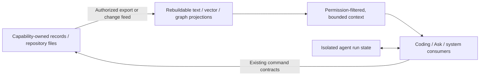
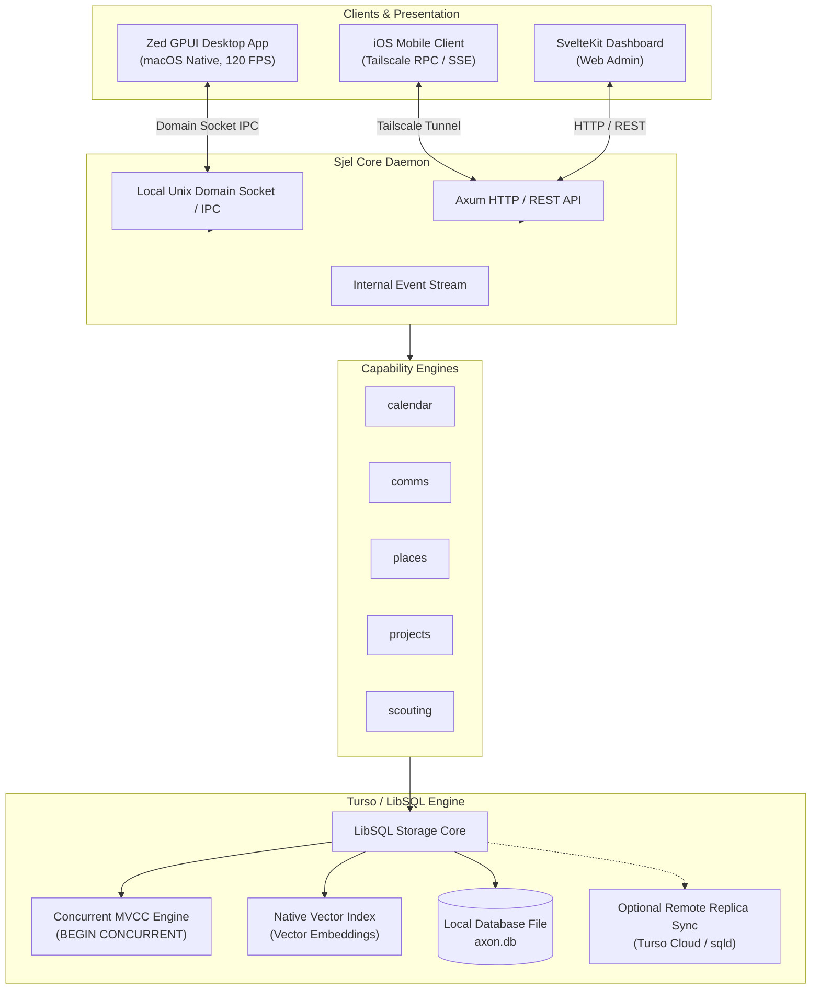
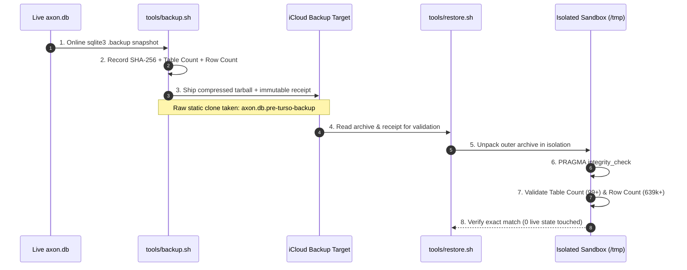
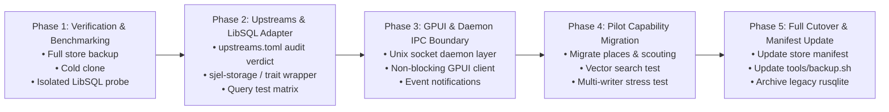

# Sjel plan

The one ordered plan for Sjel (decided 2026-10-23). It puts the tracks in order and records
the decisions that shape them. It is not a task list. Concrete work goes to GitHub Issues,
unresolved claims stay in [`ISA.md`](ISA.md), and a decision moves to its owner's README when
it is built.

## Order

| # | Track | Why it is here | Detail |
|---|---|---|---|
| 1 | GPUI universal app and standalone iPhone | The current priority in [`AGENTS.md`](AGENTS.md). Finish the foundational native and standalone iOS work before expanding the storage platform. | [`apps/gpui/PORTING_PLAN.md`](apps/gpui/PORTING_PLAN.md) |
| 2 | Turso for agent state and service-owned stores | After the GPUI/iOS foundation, pursue efficiency and simplicity through isolated per-agent or per-service databases, with broader sync later. | [Track 2](#track-2-turso-for-agents-and-services) |
| 3 | Data into Sjel: import routes, the rest of the vault, the journal | Every file has one owner and one way in. | [Track 3](#track-3-data-into-sjel) |
| 4 | Restructure, with the comment and documentation sweep in the same pass | Each file changes once. | [Track 4](#track-4-restructure-and-sweep) |
| 5 | Data formats: conversion and enrichment | Needs the owners from track 3. | [Track 5](#track-5-data-formats) |
| 6 | Operator settings surface: inference and credentials | Small and decided, and it answers the "which model, which key" question the other tracks keep asking of a file. Its client half rides Track 1's Settings tab rather than adding a surface. | [Track 6](#track-6-operator-settings-surface) |
| — | Knowledge out of the vault | Deferred until it hurts (operator, 2026-10-23). The vault stays the knowledge base. | — |

## Track 1: GPUI and standalone iPhone

- The route matrix and work packages are in `apps/gpui/PORTING_PLAN.md`. A concurrent session
  created it on 2026-10-23 and it is not committed yet. It folds into this file after that.
- Fix when it folds in: its matrix names `capabilities/context`, `capabilities/people` and
  `capabilities/travel`, and none of them exist (capability list, 2026-10-23).
- Track 1 includes only storage work required to deliver the GPUI/iOS milestones. The broader
  Turso adoption in Track 2 starts after the foundational standalone iOS workflows are usable:
  local reads and writes, notes, tasks, capture, and the offline queue/sync path.
- Open claims: DOC-4, DOC-5, IMP-2, DIST-1 to DIST-4, and "Capture from the phone" in `ISA.md`.

## Track 2: Turso for agents and services

**Decision — 2026-10-23:** after the foundational GPUI and standalone iOS work, make Turso a
measured platform upgrade for Sjel agents and services. Target one database per agent or service,
with broader synchronization later. Do not turn this into one catch-all database: service-owned
records remain behind their capability contracts, and agent state stays isolated until an explicit
sync contract says otherwise. The driver is a simpler, more efficient system, not adopting every
feature Turso offers.

### Candidate capabilities

Evaluate these as separate uses of the same local-first database substrate. None is approved for
production solely because Turso documents a recipe:

| Candidate | Sjel use | Gate before adoption |
|---|---|---|
| AgentFS (Rust SDK and MCP) | Per-agent filesystem/KV state, tool-call trace, and copy-on-write workspaces | AgentFS is marked beta. Verify crate/API maturity, licensing, isolation, filesystem semantics, audit coverage, and that its database lifecycle fits the overlay and backup contracts. MCP exposure must be allowlisted; do not expose unrestricted filesystem tools. |
| AI memory | Durable, task-relevant agent memories with retrieval and correction history | Measure retrieval usefulness, stale/wrong-memory correction, retention, and data-class handling against current Sjel context sources. |
| Code indexing | Incremental symbol/chunk index with keyword, vector, or hybrid search | Compare quality, update cost, and storage against existing Graphify and GPUI search; adopt only if it fills a measured gap. |
| Content caching | Per-session content hashes and diffs to avoid rereading unchanged files | Measure tokens and latency saved; retain session isolation, invalidate on change, and never let a cache suppress a required security or freshness check. |
| Secrets vault | Secret metadata, controlled use, and access audit | Keep secret values in the OS Keychain by default. Any database-backed value store needs a separate security decision covering encryption-key custody, process access, replication, backups, output scrubbing, and intentional exfiltration limits. |

### Sequence and gates

1. **Finish Track 1 first.** Do not let speculative Turso features displace the native GPUI work or
   the standalone iOS foundation.
2. **Reconcile the storage facts before expanding.** The detailed proposal below is historical
   where it describes embedded replicas as active or one database as the target. The current
   `libs/sjel-turso/README.md` says replica support was removed; confirm dependency status,
   unresolved advisories, the `sqld` role, backup/restore behavior, and the supported local engine
   before choosing an implementation path.
3. **Run isolated agent pilots.** Evaluate AgentFS and the memory, indexing, and caching patterns
   in separate per-agent databases. Compare each to Sjel’s existing tools and record a baseline,
   safety boundary, recovery path, and success threshold before integration.
4. **Keep secrets a distinct security decision.** A local encrypted database is not safe merely
   because it is encrypted at rest: the unlock key, access path, subprocess environment, replicas,
   backups, and logs all need explicit controls. Preserve Keychain as the value store unless a
   reviewed design demonstrates a better end-to-end boundary.
5. **Expand to service-owned stores selectively.** Move a capability only when it reduces measured
   contention or operational friction and preserves ownership, backups, data classes, and recovery.
   Do not make a workspace-wide database migration a prerequisite for agent features.
6. **Consider broader sync last.** Start with local-only databases. Add synchronization only after
   defining per-database identity, authorization, conflict behavior, revocation, freshness, and
   data-class admission. Phone offline capability remains governed by Track 1 and its own
   acceptance tests.

### Agent data backbone: Turso and graph integration

**Planning proposal, 2026-10-24; consumer and engine selection remain open.** The target is
smaller, fresher, source-backed context for coding, productivity, and system reasoning. Keep
Track 1's implementation priority. Planning and public-data measurements can proceed without
migrating a live store or changing the phone's offline contract.

#### Ground truth and engine distinctions

- `Cargo.toml` selects `libsql 0.10.0` with only `core`. `libs/sjel-turso/src/lib.rs` opens a
  local database and starts writes with `TransactionBehavior::Immediate`. Its README records
  replica removal. The current adapter does not demonstrate concurrent MVCC writers merely
  because its description says so; measure contention before promising a concurrency gain.
- [Turso Database](https://github.com/tursodatabase/turso) is the newer Rust engine; libSQL is
  the SQLite fork currently linked by Sjel. Evaluate compatibility, recursive queries, search,
  concurrency, and recovery against the exact engine selected. Neither API similarity nor a
  product feature list establishes interchangeability.
- `libs/agent` already serves the coding CLI and `capabilities/assistant` with different tools.
  `capabilities/knowledge-graph` serves Graphify output, with a cache keyed by path and mtime.
  Graphify owns extraction; changing a query engine need not replace that extractor.
- `capabilities/sjel-status/src/status/search.rs` already searches several domain tables in
  the shared database. Its direct table reads are a coupling to resolve before splitting those
  stores. A future cross-domain index needs owner-approved exports or contracts.
- [Grafeo](https://github.com/GrafeoDB/grafeo) advertises embedded persistent LPG/RDF storage,
  declarative query languages, graph algorithms, and vector/text retrieval. Treat language
  coverage and query correctness as acceptance tests. Its
  [server](https://github.com/GrafeoDB/grafeo-server) documents Bolt, gRPC and REST in different
  build tiers; protocol availability does not establish compatibility with every Neo4j tool.
  [IndraDB](https://github.com/indradb/indradb) documents programmatic multi-hop queries,
  JSON properties, gRPC, and pluggable stores, including RocksDB and separate Postgres/sled
  projects. Backend maintenance and native dependencies require separate review.

#### Consumers and useful questions

| Consumer | Example question | Sources and boundary |
|---|---|---|
| Coding agent | If this storage contract changes, which callers, tests and rules matter? | Repository source, manifests, self-model and Graphify; preserve source locations and working-tree revisions. |
| Productivity agent / Ask | Which tasks and source notes prepare me for this meeting? | Authorized projects, calendar and entity contracts; keep personal context local and respect each owner's access rules. |
| Sjel system automation | Which dependents are affected by this failed service, and what changed? | Declared dependencies plus timestamped health/change evidence; topology alone cannot establish the cause of a failure. |
| Later specialist agents | What evidence connects this source, claim and project? | Reviewed domain exports; specialists use the same identity and provenance contracts with narrower permissions. |

#### Proposed ownership and retrieval contract



Keep authoritative domain records with their capability. A graph is a disposable relationship
projection; it must be possible to rebuild it without losing a task, note or decision. Agent
databases hold isolated run state, cursors and caches. Repository rules remain in the repository;
an agent memory entry cannot become an alternative source of doctrine.

Use namespaced identities such as `(owner, kind, id)`. Retrieval results carry the source
reference and revision, observation time, data class, access scope, and whether a relationship
was extracted or inferred. Inferred links remain suggestions until an owner accepts them.
Content hashes support deduplication and invalidation; they do not replace stable identities.

Authorize seed selection and every expansion before ranking or returning context. Derived
snippets, embeddings, relationships and caches inherit source restrictions; joins must not
reveal a restricted source through an otherwise visible neighbor. C3 never enters the index.
Return evidence paths, freshness and truncation within a caller-supplied budget. A stale graph
must say so, and execution must revalidate current owner state.

If SQL and a graph engine coexist, avoid application writes to both as independent authorities.
Where an owner supports it, commit a change event with its record, then project through an
idempotent consumer with a per-owner cursor. Otherwise use revisioned snapshots with explicit
freshness. Exercise deletes, revocation, replay and interrupted rebuilds. No global transaction
or cross-owner ordering is implied. The phone keeps local domain reads and queued writes; a
Mac graph must not become a dependency for offline capture, notes or tasks.

#### Integration candidates to narrow together

These are different starting points, not five commitments. No option has been kept or rejected
by the operator yet. Select a primary pilot; defer the others with a reason.

| Option / generator | Candidate | Cheapest useful test |
|---|---|---|
| A / elimination | Keep SQL as the only database; index typed edges and use bounded recursive queries. | Compare known dependency/path answers with existing Graphify and self-model results on the selected SQL engine. |
| B / recombination | Add a rebuildable embedded Grafeo projection beside owned SQL stores. | Import the same public graph fixture; compare query answers, update/rebuild cost and recovery with A. |
| C / inversion | Start with a context broker over existing tools; optimize retrieval without adding storage. | Return a small evidence bundle for real coding questions and measure avoided reads and prompt size. |
| D / extreme scale | Partition indexes by project or permission scope, querying only relevant partitions. | Change one project's fixture and measure invalidation work, query fan-out and isolation. |
| E / analogy | Project state transitions into a temporal graph for workflow and system reasoning. | Replay synthetic task/service events; distinguish current dependencies from historical evidence. |

**Measured, 2026-10-24: A covers the coding consumer.** The
[graph-store spike](research/benchmarks/graph-store/README.md) ran A and B on Graphify's
37,200-node repository graph. Both answered all 60 impact and connection queries exactly.
Bounded impact queries were equal. Grafeo beat a recursive CTE about 8× on open-ended paths, and
a BFS in code over the same SQL edges beat Grafeo about 4×. Keep typed edges in the owning SQL
store and walk open-ended paths in code. Grafeo and IndraDB are `reject` in `upstreams.toml`,
with revisit conditions: graph algorithms, hybrid graph+vector plans, or a graph too large for
in-memory adjacency. Updates, recovery and the Turso Database rewrite remain unmeasured.

#### Sjel questions over documents: a small GraphRAG

**Consumer added, 2026-10-24 (operator):** `sjel-agent` answers questions about Sjel itself
from its documents ("how does session recovery work", "which rule owns this decision"). The
spike above measured code impact, not this. Its storage result carries over, because this
graph is smaller. Its retrieval result does not, because the open question is answer quality.

What exists (`graphify-out/graph.json`, built at `aaf300e7`): 2,908 document section nodes,
each with a source file and line, 995 concept nodes and 230 rationale nodes. They are linked by
`contains` (2,546), `references` (794), `rationale_for` (230) and `cites` (9) edges, plus
import and call edges into code. All of them come from Graphify's structural pass
(`_origin: ast`). There is no section text, no embedding and no extracted claim.

Proposed retrieval path, all in the SQL engine already linked:

1. Read each section's text from the repository at the graph's commit. The repository stays
   the authority, and the index is a rebuildable projection.
2. Embed sections through the existing `embedding` role in `libs/inference`, and store them as
   `F32_BLOB` with a `libsql_vector_idx` index.
3. Answer with `vector_top_k` seeds, then a 1–2 hop expansion over `contains`, `references`,
   `rationale_for` and doc-to-code edges, walked in code. Return a budgeted evidence bundle in
   which every item carries `path:line` and the commit.

Baselines it must beat on evidence coverage: grep plus `sjel search`, and vector top-k without
the expansion. If the expansion adds nothing over vector-only, drop it. LLM entity extraction
and community summaries (Microsoft GraphRAG style) stay out until the structural graph
measurably misses evidence, because they add model cost and go stale with every document edit.

**Measured, 2026-10-24: drop the cross-document graph for now.** On the D01–D04 corpus, graph
expansion found 18 of 24 required sections against 17 for vector-only search at the same 10-hit
budget. Every section the expansion added came from a neighbouring heading in the same file;
cross-document references added none
([retrieval result](research/benchmarks/agent-harness/README.md#retrieval-alone-2026-10-24-graph-expansion-does-not-beat-vector-search)).
Keep vector search with same-file section context. Revisit cross-document edges when a larger
question set shows evidence that only a link reaches.

This is the "proposed Sjel context tools" retrieval in cells B and D of the comparison table
below. It is built after the live adapters give cells A and C a baseline. The current eight
cases contain one Sjel-source question (C01), so the suite needs more Sjel-document questions
with answer keys before this path can be scored.

IndraDB remains a comparator if a consumer needs its programmatic storage model. Adding it
alongside SQL requires a measured benefit over A's edge tables. AgentFS is a separate run-state
experiment; it does not supply cross-capability semantics or authorize shared memory.

#### Broader harness scope and factual precision

**Scope clarified, 2026-10-24:** the operator wants several use cases, including coding,
autonomous research and experimentation, precise writing, and legal/administrative work.
Factual precision is a shared requirement. The storage proposal above supplies evidence and
state to that harness; database speed alone cannot establish agent quality.

Propose one shared runtime with task-specific tool permissions and completion checks. Reuse
`libs/agent` and its extension boundary where they fit. A profile does not require a new agent
process; introduce delegation only when a task benefits and its cost and authority are explicit.

| Profile | Representative use case | Evidence and completion check |
|---|---|---|
| Coding | Repair a bug or change a cross-capability contract. | Reproduce the failure, identify the owning code/rules, apply the change, pass relevant tests and inspect the diff. Tests must exercise behavior beyond matching the implementation. |
| Research and experiments | Investigate a technical claim, compare conflicting sources, or test an integration hypothesis. | Preserve source passages and retrieval times; separate hypotheses from observations; record a falsifying test, reproducible method and negative results. Give autonomous runs explicit scope, cost/time limits and stopping rules. |
| Precise writing | Draft a sourced technical explanation, report or formal message. | Check material factual claims against evidence, preserve dates/numbers/qualifiers, and satisfy the requested structure and voice. Style scores cannot substitute for factual review. |
| Legal and administrative | Assemble an application, analyze a document, or draft correspondence with deadlines. | Identify jurisdiction, effective date and document version; distinguish quoted requirements from interpretation; verify names, calculations, attachments and deadlines against authoritative sources. Missing decisive facts block a definitive conclusion. Drafting and external submission have separate authority. |
| Productivity and system operations | Prepare a meeting, schedule tasks, or diagnose a service dependency. | Read authorized current owner state, distinguish historical evidence from present state, check scheduling/action preconditions, and verify the resulting state. A dependency path is evidence of possible impact, not proof of causation. |

Record material claims with source locators and the passages that support them. A citation must
support the associated claim, not merely mention the topic. Track contradictions and corrections
without overwriting their supporting observations. Separate observed facts, source assertions,
inferences and unknowns; a retrieved assertion is not automatically an established fact.

Use executable checks for arithmetic, schemas, interface behavior and observable outcomes.
Validate the premises separately: a successful program or a history-consistent model cannot
prove that an external factual or legal assertion is true. Where the evidence is incomplete,
narrow the conclusion or abstain. Evaluate answer coverage too, so refusing every task cannot
win a factuality score. User corrections affect future behavior only with provenance and scope;
they do not silently rewrite an authority or a repository rule.

#### Two improvement loops, with different authority

The evidence, evaluation limits and canonical links for Meta-Harness and Schema live in
[`research/assistant-harness.md`](research/assistant-harness.md#can-the-harness-improve-through-code-and-experiments).
Its [source index](research/assistant-harness.md#source-index) also connects the supplied papers
and project pages to the SQL, agent-state and graph-engine candidates. These are design
references; transfer to Sjel's profiles remains unmeasured.

Meta-Harness motivates the outer loop of proposing and evaluating harness-code changes with a
fixed model. Schema motivates the inner loop of executable hypotheses, history checks and
execution interrupted by a prediction mismatch. Keep those loops separate in implementation
and evaluation.

For Sjel, the proposed inner loop is observe, hypothesize, test, act and verify. A prediction
must name its observable check. A failed check interrupts dependent actions and returns the
counterexample for diagnosis. Research may test claims and competing explanations without a
complete world simulator; writing may use claim checks without generating executable prose.

The proposed outer loop works on versioned candidates in an isolated experiment workspace.
Allow edits to specified retrieval, context assembly or task-planning components. Keep evaluators,
final-test data, permissions, egress rules and authoritative observations outside the candidate's
write boundary. The proposer may inspect authorized development traces, never hidden final-test
answers/results. Candidate code executes under enforced filesystem, process and network limits;
a prompt telling the candidate to respect limits is insufficient.

Save candidate source/diffs and exact model/configuration with tool requests/results, verification
outcomes, errors, cost and elapsed time. Save observable evidence rather than requiring access
to hidden model reasoning. Keep original evidence separately from compacted conversation state:
`libs/agent/src/session.rs` can overwrite a compacted session, so current session persistence
alone does not establish an immutable experiment history. Private traces stay in the overlay,
subject to data-class admission, redaction and retention; durable public rules stay in the repo.

A candidate proposes a production change only after independent checks. Proposed promotion
requires correctness and permission gates, no critical profile regression, a reviewable diff and
a rollback path through the normal repository change process. Autonomous hypothesis testing
does not authorize autonomous changes to policy or the evaluation criteria. Scheduled optimization
and automatic promotion remain undecided. Reset/isolate run memory, retrieval caches and learned
artifacts between evaluation splits so evidence cannot leak through persistent state.

#### Sequence: plan now, compare with Pi after the evaluation contract exists

**Decision, 2026-10-24:** the operator selected coding and autonomous research/experiments as
the first evaluation profiles and accepted planning before running the comparison. Establish
representative fixtures and independent acceptance checks, then compare with Pi. Defer the
earlier proposed database race until a measured retrieval bottleneck justifies it. This order
tests source-grounded work and executable verification together while preserving Track 1's
implementation priority. No model jobs, paid evaluations or live-store changes are launched by
this planning step.

1. Define a small development suite across all five profiles. A proposed seed is four cases per
   profile: ordinary success, conflicting evidence, missing/stale evidence, and an incorrect or
   unauthorized action. Twenty cases expose design gaps; they cannot establish production
   reliability. Start the controlled comparison with the selected coding and research/experiments
   pair; the other profiles remain in scope for later evaluation.
   The first pair now has a [development specification](research/benchmarks/agent-harness/README.md), twelve cases with the D-case extension,
   with frozen inputs, expected evidence and evaluator checks. Independent agent review has
   corrected label and scoring gaps; human review remains pending. The
   [offline evaluator and OrbStack path](research/benchmarks/agent-harness/README.md#offline-evaluator-and-orbstack-execution)
   validate tool boundaries and candidate artifacts. These are preparation, not model results
   or an untouched final-test set.
2. Specify untouched final-test tasks separately, grouped by repository/project, source family
   or administrative matter to prevent near-duplicate leakage. Fix the scoring rubric and name
   who adjudicates ambiguous answers before optimizing. Use deterministic checks where valid
   and blinded human source review for claims/quality they cannot decide; a model judge is
   supporting evidence. Separate correctness from writing preference.
3. Capture Pi's current configuration as the practical baseline and `sjel-agent` as the candidate.
   Record model/revision, reasoning settings, tools, permissions, initial state, source snapshots,
   limits and costs. Use paired tasks and repeated runs for stochastic outcomes; include failures
   and timeouts. Run an additional best-available comparison only if useful, labeled separately
   from a controlled same-model harness comparison.
4. Isolate the cause of any gain with the comparison below. Add self-improvement only after a
   runnable baseline and reproducible traces exist; optimize on development tasks, freeze the
   candidate, then evaluate once on the untouched suite. If final-test feedback informs another
   candidate, retire that suite from its untouched role. Choose iteration/spend caps before runs.
5. Evaluate each profile separately. Reject fabricated references, critical factual errors and
   permission violations; measure supported-claim precision, required-evidence coverage,
   contradiction detection and appropriate abstention alongside task completion. Track human
   corrections, tokens, tool calls and elapsed time. Efficiency gains count only after quality
   gates pass. Establish thresholds and acceptable uncertainty before seeing candidate results;
   the earlier 30% token/2x latency numbers were proposals, not measured targets or commitments.

| Comparison cell | Harness | Retrieval | What comparison can isolate |
|---|---|---|---|
| A | Pi | Existing workflow | Practical baseline. |
| B | Pi | Proposed Sjel context tools | B vs A tests retrieval while keeping the harness fixed. |
| C | Sjel | Equivalent existing evidence/tools | C vs A tests the harness only to the extent tools and model settings match. |
| D | Sjel | Proposed Sjel context tools | D vs C tests retrieval in Sjel; D vs B tests the harness with shared retrieval. |

Expose the same bounded retrieval tool through each harness's supported extension/MCP interface
where feasible; record integration gaps rather than calling unequal conditions controlled.
Store/query microbenchmarks follow a measured retrieval bottleneck and remain distinct from
end-to-end correctness. Choose SQL edges or a Grafeo projection only when that comparison shows
the need. Ordinary experiment files plus a small SQL run index may be sufficient; neither paper
requires a graph database. Review backend/license verdicts and recovery before runtime adoption.

#### Pi daily use and managed configuration

**Decision, 2026-10-24:** Pi remains usable as the daily agent while the Sjel harness is evaluated.
Its settings, extension configuration and deployment lifecycle must be managed through Sjel,
like the other supported harness configuration. An experimental integration is opt-in and
removable; evaluating `sjel-agent` does not require replacing Pi or its existing sessions.

**Built, 2026-10-24 (`6eef2c79`):** `sjel pi plan|apply|check|rollback`
([`tools/sjel-cli/src/pi_config.rs`](tools/sjel-cli/src/pi_config.rs)) owns the keys in
[`tools/templates/pi/settings.base.json`](tools/templates/pi/settings.base.json) plus an optional
overlay fragment: telemetry and analytics off, cache warming off, cache-miss notices on. It was
applied to this Mac's `~/.pi/agent/settings.json` after a backup, a hand edit was reported as a
conflict (exit 3), and rollback restored a JSON-equal file. The baseline is applied again for
daily use. `pi_settings.rs` still manages Pack-owned `skills`, `extensions` and `packages`
registrations. Model selection and keybindings are not yet owned keys.

Credentials and model registries stay outside `sjel pi`. On 2026-10-24, with the operator's
approval, Pi's `~/.pi/agent/models.json` was pointed at the stores Sjel already reads instead of
literal keys: oMLX's own `~/.omlx/settings.json` for `omlx`, and the Keychain item
`com.sjel.credential.inference-deepseek` for `deepseek`. Backups sit beside the file.

The deployment contract, met for the owned settings above:

- Keep reusable defaults and the ownership definition in Sjel. Keep private provider/model
  choices, machine paths and personal overrides in the active overlay. Credentials remain in
  their existing protected store; never copy authentication files or render secret values as
  dotfiles. Verify supported Pi settings against its installed interfaces before defining keys.
- Merge only explicitly owned keys, including the selected model/reasoning, context-management,
  UI/keybinding and extension preferences where Pi supports them. Preserve unrelated fields and
  user-managed packages; do not replace or symlink Pi's entire state directory.
- Provide a reviewable plan, apply and drift-check lifecycle through Sjel. Record which owned
  values changed and their prior state. A change made interactively in Pi must be reported as
  drift or deliberately accepted into its owning configuration, not silently overwritten.
- Test disable/removal and rollback of owned configuration. Restore a prior value only when the
  current value still matches what Sjel applied; report concurrent edits as conflicts. Removing
  integration settings must not remove sessions or undo unrelated work. File/domain changes an
  agent made require their own recovery path.
- Keep evaluation configuration separate from daily-use settings. Capture the selected baseline
  and launch isolated SDK sessions without ambient skills, extensions or history. No benchmark
  should change the operator's normal defaults or authentication as a side effect.

Still open: model and keybinding keys, and an opt-in Pi integration for the retrieval tool once
it earns a place.

#### Where this work is recorded

Track 2 owns the direction and rollout order. Supporting research, fixtures and implementation
stay with the owners below; their tests and interfaces establish what works. This table links
the active work without creating a separate plan or task backlog.

| Boundary | Owner | What it establishes |
|---|---|---|
| Research and source links | [Harness research](research/assistant-harness.md) | Meta-Harness, Schema, existing Pi comparison and limits on transfer. |
| Development cases and evaluation contract | [Agent benchmark](research/benchmarks/agent-harness/README.md) | Selected profiles, source fixtures, answer keys, human-review requirements and comparison design. |
| Offline evaluator and candidate sandbox | [Evaluator command](tools/agent-eval.ts), [sandbox](tools/lib/agent-eval-sandbox.ts) | Bounded virtual tools, oracle separation, tested OrbStack execution and explicit unsupported paths. |
| Daily Pi configuration and deployment | [Managed defaults](tools/templates/pi/settings.base.json), [harness Pack](Packs/harness/README.md) | The active settings-management implementation: plan/apply/check/rollback, ownership, private overrides and reversible adoption. |
| Live Pi/Sjel adapters | [Live adapters](research/benchmarks/agent-harness/README.md#live-adapters), [`agent-eval-live.ts`](tools/lib/agent-eval-live.ts), [`sjel-agent-eval`](libs/agent/src/bin/eval.rs) | One broker for both harnesses, manifest-gated `run`, `review` for the adjudicator, token usage from both, c0-attested tools for cloud roles. |
| Retrieval for Sjel questions | [GraphRAG section](#sjel-questions-over-documents-a-small-graphrag), [`agent-eval-retrieval.ts`](tools/lib/agent-eval-retrieval.ts), [result](research/benchmarks/agent-harness/README.md#retrieval-alone-2026-10-24-graph-expansion-does-not-beat-vector-search) | Vector and graph-expanded `retrieve` over a case's corpus; graph expansion did not beat vector search. |
| Graph engine choice | [Graph-store spike](research/benchmarks/graph-store/README.md), `upstreams.toml` `[grafeo]`, `[indradb]`, `[turso]` | SQL edges plus code cover the coding consumer; Grafeo and IndraDB rejected with reopening conditions. |
| Which model runs what | [Small local models](research/local-decision-models.md#small-local-models-specific-jobs-only-decided-2026-10-24), [comparison model](research/benchmarks/agent-harness/README.md#comparison-contract-before-launching-runs), `providers.toml` `[deepseek]` | Local models ≤4B do one Sjel job each; Pi vs Sjel runs on DeepSeek V4.1 Flash, c0 only. |

#### State at the end of 2026-10-24, and what comes next

Done: the evaluator, both live adapters, 12 development cases (C01–C04, R01–R04, D01–D04), the
graph-store spike, the retrieval check, Pi's managed settings, and two pipeline smoke runs on
local Qwen3.5-4B (C01/R04 8 of 8 finished; D01–D04 14 of 16, two Sjel attempts lost to a binary
rebuilt mid-run). Those runs are unscored and superseded by the DeepSeek decision. Private
traces and `review.md` files are in the overlay under `data/agent-eval/runs/2026-10-24-*`.

Blocked: the Keychain item `com.sjel.credential.inference-deepseek` holds a key DeepSeek
rejects (401, 2026-10-24). The operator stores a fresh one with
`security add-generic-password -U -s com.sjel.credential.inference-deepseek -a inference-deepseek -w`.
The Sjel role is `agent_eval_deepseek` in the overlay's `config/inference.json`: model
`deepseek-flash`, thinking disabled to match Pi's `off`, 200 requests a day, 65,536 input tokens,
and a `credit_expires_on` of 2026-11-30 that marks the end of this eval budget, not a known credit date.

Next, in order:

1. Rerun the manifest in `data/agent-eval/runs/2026-10-24-deepseek-c01-r04/` once the key works,
   then the same for D01–D04 (cells A and C).
2. Human review of the `review.md` files. Labels for all 12 cases are still unapproved, and the
   D-case keys have had no second review.
3. Cells B and D: the same D cases with `"retrieval": {"mode": "vector", "embedding_role":
   "embedding"}` in the manifest. Only a measured answer gain justifies porting retrieval into a
   Sjel capability on libSQL (`F32_BLOB`, `vector_top_k`), with same-file section context and no
   cross-document graph.
4. Cloud roles for real `sjel-agent` work need tools that can attest their data class. Today only
   the evaluator's proxy tools attest c0 (`Tool::data_class`, `libs/agent/src/lib.rs`).
5. Local candidates (Gemma E2B/E4B, Granite, Apple Foundation Models, CLM-style scorers) each get
   an `upstreams.toml` row and a measurement on the one job they would do.

Not decided yet: final-test fixtures, the adjudicator, editable components and promotion policy.
Concrete work goes to issues with acceptance checks; this plan keeps no second task backlog.

### Sources this work started from (2026-10-24)

- Meta-Harness, end-to-end optimization of model harnesses:
  [arXiv:2603.28052](https://arxiv.org/html/2603.28052v1), with the
  [TerminalBench-2 artifact](https://github.com/stanford-iris-lab/meta-harness-tbench2-artifact).
  How it applies here is in [`research/assistant-harness.md`](research/assistant-harness.md#can-the-harness-improve-through-code-and-experiments).
- Graph engines: [Grafeo](https://github.com/GrafeoDB/grafeo) and
  [IndraDB](https://github.com/indradb/indradb); verdicts in `upstreams.toml`. The vault note
  `Resources/Inbox/rust graphdbs.md` that raised them is an AI summary with redirect links, not a
  source.
- Small-model tool use: [TinyLLM, arXiv:2511.22138](https://arxiv.org/pdf/2511.22138) and
  [small-llm-tool-use-bench](https://huggingface.co/Manojb/small-llm-tool-use-bench), summarized in
  [`research/local-decision-models.md`](research/local-decision-models.md#small-local-models-specific-jobs-only-decided-2026-10-24).
- Not used yet: [learnharness](https://github.com/amosblomqvist/learnharness)
  ([video](https://www.youtube.com/watch?v=nfTDljFG2g0)), a learning harness that keeps a graph
  of propositions and reasoning chains. Its vault note `Resources/Inbox/Agent Harness for Learning
  Things.md` belongs to the `teach` skill, not to this track.

### Turso references

- [Agent databases](https://docs.turso.tech/guides/agent-databases)
- [AgentFS introduction](https://docs.turso.tech/agentfs/introduction), [Rust SDK](https://docs.turso.tech/agentfs/sdk/rust), and [MCP guide](https://docs.turso.tech/agentfs/guides/mcp)
- [AI memory](https://docs.turso.tech/guides/ai-memory)
- [Code indexing](https://docs.turso.tech/guides/code-indexing)
- [Content caching](https://docs.turso.tech/guides/content-caching)
- [Secrets vault](https://docs.turso.tech/guides/secrets-vault)

## Track 3: Data into Sjel

Measured 2026-10-23 with `sjel-import plan /Volumes/Extreme/archive` (25,348 entries) and the
documents library (7,154 records):

| What the router reports | What is there |
|---|---|
| 643 documents | All 643 already in Sjel (`present`) |
| 5,788 media | 5,297 are resources inside 12 Swift Playgrounds `.playgroundbook` bundles. About 490 are personal photos and audio, about 60 of them figures in paper and talk projects. |
| 3,009 notes | 2,074 are LifeOS and Claude agent state. 237 are Notability `.note` files. About 700 are other `.md` and `.txt` files. |
| 0 finance | No bank-statement CSV in the archive |
| 5,888 text records in documents | 2,149 copies of vault notes and 3,127 agent state. None was filed or categorized. |

Decisions:

1. **Media: check, then queue** (2026-10-23). The media library stays on the two mirrored
   external drives. Import hashes a photo or a recording and asks media whether a library holds
   it, through a new read-only route. A held file is `present`. A new file waits in a queue
   until a library drive is mounted, and `media ingest` then reads it from its source. Nothing
   is copied to the laptop.
2. **The vault keeps knowledge only, and the rest comes into Sjel.** The 2026-10-20 ruling
   already says this ([projects README](capabilities/projects/README.md#why-this-shape-sjel-owns-projects-tasks-and-habits)).
   Finance, Items, Interior, People, Events, Media, Reflections and Journal have moved. Open:
   Documents, Focus and Personal (`ISA.md`, projects item). `Atlas/Personal/Archive/Schule`
   (139 notes, 1,279 files): its notes go to the projects store and its PDFs and scans to
   documents.
3. **The journal gets its own capability, later** (2026-10-23). Today its 353 records are the
   `Journal/` domain of the projects store. The split moves them, with habits and daily
   metrics, to a `journal` capability.
4. **The old text records are archived, with their bytes kept** (2026-10-23), after their
   notes have an owner. Nothing is removed.
5. **Router fixes, from the measurement:** skip Swift Playgrounds bundles (`.playgroundbook`,
   `.playgroundmodule`, `.swiftpm`) and agent-state folders. Route `.key` (Keynote) to documents.
   Documents expects `.keynote`, which no file uses, so documents changes too.
6. **Finance** keeps its route. Its import contract waits for the first real bank export.

Open claims: IMP-1, DOC-1 to DOC-3, DOC-6, DOC-7, the media `To Sort/` item and the projects
item in `ISA.md`.

## Track 4: Restructure and sweep

- **Sweep** (2026-10-23): remove every code comment, config comment and README paragraph that
  repeats a decision, a rule or a history that Git or the owner's code already holds. Shrink
  bloated sub-READMEs. Do it module by module, in the same pass as the restructure.
- First change the rule that forbids it: "Do not run a separate sweep" in
  `Packs/harness/skills/sjel/references/on-documentation.md`.
- An example of what goes: `.gitignore:46` says "PLAN.md is gone".
- The restructure scope is not decided. That decision comes on the day the track starts.

## Track 5: Data formats

- **PDF rule** (2026-10-23): official documents (contracts, invoices, certificates, tax notices)
  stay PDF-first. For any other document, the extracted data in the owning capability is what
  Sjel uses. The original stays archived and hash-verified and is never removed.
- Convert Notability and GoodNotes archives (237 `.note` files in the archive) to PDF, then OCR
  and enrich them.
- Align the data formats across capabilities, so a fact has one shape wherever it is stored.

## Track 6: Operator settings surface

**Decision — 2026-10-24:** what the machine's inference backends, models and keys are is readable
and provable from one surface, and that surface is a section of the Settings tab rather than a new
client, a dashboard page, or a CLI verb set.

- Why it is here at all, measured: on 2026-10-24 `tools/graphify.sh` ran a full semantic pass on a
  model retired since 2026-08-07, because the only place that model was written down was a backend
  field no tool read and no surface showed. The fix took an afternoon; finding it took a failed run
  of 126 chunks and 455 missing files.
- The capability owns the domain: `capabilities/settings`, read plus probe first, writes later. It
  reads `inference.json` through `libs/inference`, which already parses backends, roles and key
  resolution — the surface re-implements none of it.
- The client half is a section inside the Settings tab GPUI already ports (`Tab::Settings`,
  `apps/gpui/PORTING_PLAN.md` route 18, which holds appearance, notifications and permissions). The
  tab bar and the sidebar's seat list do not change, so this adds no navigation.
- What it shows, in this order: each backend with the model a tool would send it, whether that
  model answers, and whether its key file is present; each role with the backend and model behind
  it; then the tool-level selection that no role names (`config/graphify.env`'s chain and model).
- Writes are deliberately not in the first delivery. `config/graphify.env` is gitignored machine
  state and `inference.json` is shared by every operator of the overlay, so a write needs a
  provider-side check before it lands and an undo path after — neither exists yet.
- Gates a hand-built capability misses, so it is built with them from the first commit: a
  `const ROUTES` manifest, because `tools/check-route-schemas.sh`'s baseline may only go down and a
  write-shaped probe needs `schema_of::<T>()` at birth; a `service.toml` port no other
  `service.toml` carries (the 81xx block holds 28 capabilities and ends at 8107); and regenerated
  `ARCHITECTURE.md` and `self.json`.
- Known obstruction, not part of the feature: secrets-guard refuses the tracked, published
  `tools/graphify.env.example` by filename, for reads and diffs alike. It is machine state's file
  naming colliding with a credential rule, and it blocks an agent from reading the very config the
  surface documents. It needs an issue of its own.
- Open claim: SET-1 in [`ISA.md`](ISA.md).

## Open questions

| # | Question | Decided by |
|---|---|---|
| P1 | Who owns the 700 notes in the archive that are outside the vault and the agent state? | Operator, before track 3 starts |
| P2 | What does the restructure change: crate layout, capability boundaries, or both? | Operator, when track 4 starts |
| P3 | In which track do F6, F9, B47, B48, B49, BKP-5, the traveler F4 item, the Packs/travel item and the host-patch item go? | Next planning round |
| P4 | **Answered 2026-10-23:** target one database per agent or service; exact service splits and later sync contracts remain open for Track 2. | Operator, before each migration or sync pilot |

## Historical storage proposal: SQLite to Turso/LibSQL

> This section preserves implementation evidence from the earlier storage proposal. It is not the
> current adoption sequence or topology decision. Track 2 above supersedes its claims that replica
> support is currently active or that one shared database is the long-term target. Re-verify all
> implementation and security claims against the current checkout before acting on this history.

---

### 1. High-Level Architecture & System Boundaries

Turso/LibSQL serves as the multi-tenant, concurrent, embedded storage engine backing the Sjel core daemon, desktop GPUI shell, and remote clients.



---

### 2. Why Turso / LibSQL (Key Advantages & Measured Delta)

| Feature | Current SQLite (`rusqlite`) | Target Turso (`libsql`) | Architectural Value for Sjel |
|---|---|---|---|
| **Concurrency** | Single writer in WAL; locks entire DB | MVCC / `BEGIN CONCURRENT` | GPUI UI actions, subagents, and comms ingestion never block each other with `SQLITE_BUSY`. |
| **Vector Search** | External vector cache / files | Native embedded vector data types & indexes | In-DB vector search for `scouting`, `comms`, and knowledge notes without external vector DB dependencies. |
| **Edge & Replicas** | Single static file on local host | Embedded replicas (local reads, sync writes) | Zero-latency local reads for GPUI with automated background synchronization across multiple devices. |
| **Format Safety** | Strict SQLite C format | Byte-level SQLite file format compatible | Direct in-place reading of existing `axon.db`; rollback to standard SQLite remains trivial. |
| **Runtime API** | Synchronous blocking (`r2d2`) | Native Tokio `async` + sync local mode | Matches Tokio-based Axum capabilities and async GPUI task runners natively. |

---

### 3. Strict Backup & Recovery Invariant (Recovery Ladder)

No migration step may proceed without verifying the 4-tier recovery ladder.



#### Verification Commands

1. **Take automated backup & receipt**:
   ```bash
   tools/backup.sh store
   ```
2. **Verify backup in isolation**:
   ```bash
   tools/restore.sh store "$HOME/Library/Mobile Documents/com~apple~CloudDocs/Backup/store/$(ls -t "$HOME/Library/Mobile Documents/com~apple~CloudDocs/Backup/store" | head -1)" --receipt "$SJEL_PERSONAL_ROOT/backup/receipts/store.json"
   ```
3. **Take cold raw safety clone**:
   ```bash
   cp "$SJEL_PERSONAL_ROOT/data/axon/axon.db" "$SJEL_PERSONAL_ROOT/data/axon/axon.db.pre-turso-backup"
   ```

---

### 4. Phased Rollout Roadmap



#### Phase 1: Preflight Verification & Isolated Compatibility Spike
- [x] Run `tools/backup.sh store` and verify with `tools/restore.sh store`.
- [x] Create cold snapshot `axon.db.pre-turso-backup`.
- [x] Write an isolated scratch probe (`scratch/libsql_compat.rs`) opening a copy of `axon.db` using `libsql`.
- [x] Verify execution of complex queries: `json_each(?3)` predicates in `calendar`, recursive CTEs in `projects`, and spatial joins in `places`.

#### Phase 2: Upstreams Gate & Storage Abstraction
- [x] Add `[libsql]` upstream entry with formal review in `upstreams.toml`.
- [x] Provide unified storage adapter in `libs/sjel-turso` (supporting LibSQL async concurrency, PRAGMAs, and once-per-process migration tracking).
- [x] Add embedded replicas to that adapter: a remote URL, auth token and pull interval from `SJEL_TURSO_URL` / `SJEL_TURSO_AUTH_TOKEN` / `SJEL_TURSO_SYNC_INTERVAL_SECS`, a first pull before the DDL, a background loop, and `Store::sync_stats()` for a freshness surface. The engine is a default feature (2026-10-21) so following a primary is configuration rather than a Cargo.toml edit, and `sjel setup plan|apply|verify turso` is the setup path: the shell renders the plan, the CLI writes and restarts. No live primary existed to pull from, so the pull path itself is unverified.
- [x] Verify compilation across all targets (`cargo check --workspace` and `cargo test -p sjel-turso`).

##### Open decision (2026-10-21): what the replica path is for

Measured while re-checking the setup work, and left open rather than decided:

1. **It cannot be switched on over the shared database.** `projects` and `operator-profile`
   both open `sjel_config::database_path()`, which is the `axon.db` twenty capability modules
   share, and LibSQL refuses to turn a file that holds its own writes into a replica
   (`libs/sjel-turso/src/replica.rs`, *"remove the file to start a fresh copy"*). So a primary
   pasted into `/setup` fails at open time, or requires deleting this machine's database. The
   per-process registry guard cannot see the other eighteen processes writing the same file.
   *Correction to the line above: "the pull path is unverified" understates it — with this
   wiring it is unreachable.*
2. **It costs ten unpatchable advisories.** Every finding left in `Cargo.lock` — h2 0.3.27,
   rustls 0.22.4 twice, rustls-webpki 0.102.8 five times (RUSTSEC-2026-0104, CVSS 7.5), bincode
   1.3.3, libsql-sqlite3-parser — is reached through `libsql 0.10.0`, the newest release, which
   pins hyper 0.14 / tonic 0.11 / hyper-rustls 0.25. `osv-scanner.toml` cannot waive a known
   vulnerability, so the Security job stays red for as long as the sync feature is in the
   workspace. Removing the feature is the only local fix; making it non-default is not, because
   `Cargo.lock` lists optional dependencies too.
3. **A phone replica is buildable.** `sjel-turso` checks clean for `aarch64-apple-ios`
   (45 s cold, 2026-10-21), and a phone starts empty, so LibSQL's refusal does not apply to it.
   What it needs is a primary that is not Turso Cloud: `sqld` is neither on Homebrew nor on
   crates.io, so a local primary means building it from Turso's repository and supervising a
   second daemon.
4. **The tailnet listener already covers "one more device".** A paired phone drives this Mac's
   data over Tailscale (8443). What a replica would add is *offline* reads and reads while this
   Mac is asleep — nothing else.

The decision is open because the cheap move and the interesting move disagree: deleting the
path greens Security today and forecloses the phone-in-the-bag case, while keeping it means a
permanently red scanner until libsql moves to hyper 1 / rustls 0.23. Whichever way it goes, the
prerequisite for any replica — this device's or another's — is the same: `axon.db` stops being
one shared file, and that split is the work, not the sync loop.


#### Phase 3: GPUI Desktop App & Daemon Boundary
- [x] Integrate direct non-blocking LibSQL local database connector in `apps/gpui`: one handle per process, opened on first read and shared by every `Repo` clone, with the shell as its fallback.
- [x] Wire direct non-blocking queries for projects, tasks, calendar entries, project records, and notes (`Repo::fetch_projects`, `Repo::fetch_tasks`, `Repo::fetch_calendar`, `Repo::fetch_project_records`, `Repo::fetch_record`, `data::read_repo`) in `apps/gpui`.
- [x] Decouple high-throughput reads from HTTP daemon serialization while keeping writes routed through the authenticated shell.
- [ ] Implement reactive change notification subscriptions over `/api/sjel-status/events`.
- [x] Keep GPUI independent of heavy file locks (LibSQL non-blocking WAL/MVCC).

#### Phase 4: Pilot Capability Migration (Vector & Concurrency)
- [x] Run concurrent write stress tests against scouting schema via `sjel-turso` (`libs/sjel-turso/tests/multi_writer_concurrency.rs`).
- [x] Confirm zero `SQLITE_BUSY` errors under load across 50 simultaneous inserts in 0.02s.
- [x] Enable and verify LibSQL native vector embedding indexing (`libsql_vector_idx`, `vector_distance_cos`) with top-k cosine similarity ranking.
- [x] Resolve C symbol isolation: established strict separation between `libs/sjel-store` (`rusqlite`) and `libs/sjel-turso` (`libsql`) to prevent linker duplicate symbols across targets.
- [x] Cut one capability over end to end as the pattern: `operator-profile` (2026-10-21) — schema, store, HTTP handlers, CLI and tests on `sjel-turso`, `rusqlite` gone from its dependency graph, and the existing row read back unchanged from the live database. `Store` in `libs/sjel-turso` is the shape the remaining capabilities follow; `places` and `scouting` are still on `rusqlite`.
- [x] Second cutover on the same pattern, at real size: `projects` (2026-10-21) — 1221 rows re-read through LibSQL and compared byte for byte against the rendered second copy with no drift, every `spawn_blocking` site in its handlers replaced by an awaited store call, and a router test covering create/read/save/stale-save/remove. It is also the table `apps/gpui` reads directly, so writer and reader now share one engine.

#### Phase 5: Production Promotion & Backup Contract Evolution
- [x] Update `capabilities/store/README.md` and doctrine recording LibSQL adoption, non-blocking MVCC, and native vector capabilities.
- [x] Verify `tools/backup.sh` and `tools/restore.sh` isolated recovery ladder (107 tables, 640,464 rows) operates identically on LibSQL format.
- [x] Keep Sjel self-model (`self.json`) and service manifests (`service.toml`) validated and current.

---

### 6. Topology decision (2026-10-21): this Mac is the primary, the phone is a replica

Decided by the owner after the replica path was found unreachable over the shared `axon.db`.
The shape, and what each hop is for:

```
   phone (iOS, Tauri app)          this Mac (Lars-Mac)                 later: home server
   embedded replica   ──pull/write──▶  sqld  ◀──embedded replica──  capabilities  ──▶  sqld (primary)
   over tailnet                       primary                        over loopback
```

1. **This Mac runs `sqld`** (libsql-server) as the primary for the data that must reach the
   phone. Measured 2026-10-21: `libsql-server-v0.24.32` ships a prebuilt
   `libsql-server-aarch64-apple-darwin` binary whose `.sha256` matches the published digest, and
   `sqld --version` runs here. It carries `--auth-jwt-key-file` (Ed25519 public key; clients
   present JWTs), `--http-listen-addr`, `--grpc-listen-addr`, and `--primary-grpc-url` — so the
   same binary can later run as a *replica* of a home-server primary, which is what makes the
   last move a configuration change rather than a rewrite.
2. **Capabilities that serve phone data hold embedded replicas** of that primary over loopback:
   reads local, writes forwarded to `sqld`, pulled back on the interval. This is libSQL's own
   model; the alternative — keeping `axon.db` authoritative and writing a job that pushes a
   subset somewhere — is a custom replication protocol with its own correctness risk, which is
   the thing `libsql` exists to avoid.
3. **The phone holds an embedded replica.** `sjel-turso` checks for `aarch64-apple-ios`
   (45 s cold, 2026-10-21) and the Tauri app already declares an iOS target
   (`dashboard/src-tauri/tauri.conf.json` → `bundle.iOS`, minimum 16.0, a signing team set,
   `gen/apple` present). Reads are local and work offline; writes go to the Mac when it is
   reachable, which is what an embedded replica means.
4. **Reachability is the tailnet, not the internet.** This machine is `100.116.104.41`
   (`Lars-Mac`) on the tailnet; a primary bound there is reachable by the owner's devices only.
   `sjel doctor`'s tailnet identity gate reports no `tailscale serve` HTTPS handler, so nothing
   injects an identity header — `sqld`'s own JWT check is the access control for this port, and
   it must be configured before the port is opened to the tailnet.
5. **A later home server changes one setting.** Its `sqld` becomes the primary; this Mac and the
   phone keep their replicas and point `SJEL_TURSO_URL` at it. Nothing in the storage layer
   changes, which is the whole reason to build it this way now.

#### Proven 2026-10-21: the pull path works

The `libsql 0.10.0` crate and the `sqld 0.24.32` binary — a 2025-02 release train — do sync. A
scratch primary on loopback (`sqld --db-path … --http-listen-addr 127.0.0.1:8880`) plus
`libs/sjel-turso/tests/live_primary.rs` showed, in 0.24 s: a write through replica A reaching the
primary, a pull bringing it back, and a second replica that had never seen the row finding it on
its first pull — the pull that runs before the DDL. `sync_stats()` reported `syncs >= 1`,
`failures = 0`, and the primary's own SQLite file
(`<db-path>/dbs/default/data`) held the table the forwarded DDL created.

The test reads the deployment's own `SJEL_TURSO_URL` / `SJEL_TURSO_AUTH_TOKEN`, so it skips with
a printed reason when no primary is named — a machine with none does not fail a suite it cannot
satisfy — and becomes a real check the moment `sjel setup` records a primary. What it does not
cover yet: JWT authentication (`sqld --auth-jwt-key-file`), which the phone's replica will need
before the port is reachable from the tailnet.

#### Also proven 2026-10-21: the token path, both directions

`sqld --auth-jwt-key-file` plus `sjel_turso::PrimaryKey` (`libs/sjel-turso/src/auth.rs`) is the
authenticated form of the same thing. Against a scratch primary started with a generated public
key, the HTTP API answered:

| credential | `POST /v2/pipeline` |
| --- | --- |
| none | 401 |
| a token minted by `PrimaryKey`, claims `{"a":"rw","exp":…}` | 200 |
| a token signed by a different key | 401 |

and the replica test passed in 0.21 s with that token in `SJEL_TURSO_AUTH_TOKEN`.

The claims are `sqld`'s, copied from `libsql-server` rather than guessed at: `jsonwebtoken`
decodes with `Algorithm::EdDSA` only, `a` is `"ro"` or `"rw"`, `id` names a namespace and may be
absent on a `--db-path` server, and `p` (fine-grained scopes) is unused here. The private half is
a PKCS#8 document that belongs in the OS keychain; `sqld` gets only the 32-byte public key,
base64url without padding.

**One gap this exposed, worth fixing before an operator meets it:** `libsql`'s client reports a
refused value as `Timeout performing handshake with primary`. Wrong, absent and revoked all look
like a network problem, and the primary logs nothing at INFO. `sjel setup verify` therefore probes
over HTTP first and names the refusal itself.

#### Wired end to end, 2026-10-21: `sjel setup` provisions a primary it owns

`tools/sjel-cli/src/setup/mint.rs` holds the missing half:

- the **private** half lives in the macOS Keychain under `com.sjel.credential.turso-primary-key`,
  created on first use and reused after — regenerating it would invalidate every value ever
  minted, so nothing does that implicitly;
- the **public** half is written to `<overlay>/config/sqld-auth.pub`, the file
  `sqld --auth-jwt-key-file` reads;
- the **value** is written into the overlay's `deployment.env` like any other setting, and reported
  only by its presence.

`apply` mints when neither a submitted nor a recorded value exists, so provisioning a self-hosted
primary is one command: `sjel setup apply turso --confirm --url http://127.0.0.1:8890`.
`--token-stdin` still wins for a primary somebody else runs, `--remint` forces a fresh one, and
`--mint-days` sets its lifetime (default 30).

Against a scratch `sqld` started with the written public key, in a scratch overlay so none of this
deployment's own files were touched:

1. `apply` minted, wrote the record and the public key, and reported the primary as not answering —
   the honest answer, because it was not running yet;
2. started `sqld` with that key → `sjel setup verify turso` reported `✓ primary`;
3. the value read back out of the record (through `vault_exec`, never printed) passed
   `tests/live_primary.rs` in 0.22 s;
4. a submitted bogus value made `verify` answer `401 Unauthorized — it was refused`, in words an
   operator can act on;
5. `--remint` restored a working one, which also proves the Keychain key was reused rather than
   regenerated: the primary had been started with the *first* public key.

**One probe defect fixed on the way, and it would have shipped:** `verify` asked `GET /info`, which
is Turso Cloud's endpoint. `sqld 0.24.32` answers 404 there, so a healthy self-hosted primary was
reported as "check the URL and that the database exists". The probe now runs `POST /v2/pipeline`
with a `SELECT 1` — the authenticated door a replica's writes take — falls back to `/info` for a
cloud primary, and reports `/health` as reachability only when neither answers.

#### Step 1 done, 2026-10-21: `sqld` is a service this machine owns

`capabilities/sqld/` is a manifest and a README, no code: the manifest turns a binary into a row
in the registry that `service-runner.sh`, `tools/capability.sh`, the watchdog, `backup.sh` and
`sjel-status` all already understand.

| piece | where |
| --- | --- |
| the binary | `tools/install-sqld.sh` — pinned 0.24.32, digest literal, `--check`/`--force` |
| the contract | `capabilities/sqld/service.toml`, `[libsql-server]` in `upstreams.toml`, `[sqld]` in `toolchain.toml` |
| the facts | `SQLD_DB_PATH`, `SQLD_AUTH_JWT_KEY_FILE` in the deployment record |
| the lifecycle | `tools/service-runner.sh start|stop|status sqld`, launchd unit installed |
| the backup | `backup_sqlite_online = "data/sqld/dbs/default/data"`, retain 7, daily |

`SQLD_DB_PATH` and the key file are settings rather than argv because both are machine facts and
the manifest is tracked: `sqld` reads them from the environment, and the runner passes the
deployment record into every process it starts.

Measured on this machine:

1. `sjel setup apply turso --confirm --host-here` — installed nothing (already pinned), wrote the
   record and the public key, enabled the capability, started it, and verified:
   `✓ primary http://127.0.0.1:8089/v2/pipeline accepted it and ran a statement (200 OK)`.
2. `tools/service-runner.sh status sqld` → `process running (pid 97201) healthy`;
   `install-persistence sqld` → `com.sjel.sqld.plist`, so it survives a reboot.
3. `tools/backup.sh sqld` → live `sqlite3 .backup` copy, `integrity_check: ok`, 1,150-byte tarball
   at the destination, pruned to 7, receipt written.

**Two things this turned up, both recorded rather than smoothed over:**

- The gRPC listener was first bound to 8099, which a running `operator-profile` process holds while
  its manifest claims a different port — so `sqld` died with `Address already in use` and the
  runner correctly refused to call the start successful. The manifest now uses 8105, and the stray
  process on 8099 is its own problem, not this one's. The runner catching it is the argument for
  starting services through the runner instead of by hand.
- A backup scheduled between "enable" and "first client connects" fails with `declared SQLite
  database is missing: data/sqld/dbs/default/data`, because a fresh primary has no namespace file
  until something opens it. It cleared on the next run. Worth teaching `backup.sh` that a declared
  database that has never existed is "nothing to back up yet" rather than a failure.

#### Open decision (2026-10-21): one database, or one per capability

Left open by the owner after asking the right question — *if we split, which one do I search later?*
— and it is not a question to answer from doctrine, because the doctrine's stated reason does not
survive measurement.

**Measured, so the next reader does not re-derive it:**

- `capabilities/store/README.md` and `docs/architecture/storage.md` both justify one file by
  cross-schema joins being a single connection. Across every SQL literal in every capability there
  is **one** statement that spans two prefixes: `INSERT INTO inventory_item SELECT … FROM
  interior_item`, a migration helper. There is no lattice of correlation queries to protect.
- `projects` — the capability the phone needs first — is **one table** (`projects_records`), 1,221
  rows, **zero JOINs**, already on `libsql` via `sjel-turso`.
- 18 capabilities open the shared file through `sjel-store` (`rusqlite`); 2 through `sjel-turso`.
- **`sqld` serves the existing `axon.db` as it stands**: a `sqlite3 .backup` copy of the live file
  (275 MB, 108 tables) placed at `<db-path>/dbs/default/data` answered `sqlite_master` and
  capability queries over Hrana with no conversion. So making the real database a primary is a
  *copy*, not an ETL.

**The three shapes and what each costs:**

| | files | cost | what it buys |
| --- | --- | --- | --- |
| **A** split only what the phone needs | 2–3 | one rule for reach (`<overlay>/data/<cap>/<cap>.db`), one more backup contract, one `ATTACH`-able join | offline phone in days |
| **B** one file, `sqld` owns it | 1 | migrate 18 capabilities off `rusqlite`; reads become loopback round trips | no reach problem; everything reaches the phone |
| **C** no replica yet | 1 | nothing | the phone keeps driving this Mac over the tailnet |

The load-bearing fact for the decision: **B's obstacle is the engine migration, not the data**, and
**A's reach cost is a rule plus `ATTACH`, not a hunt**. Recommendation on the table is A, scoped to
`projects` only — a 20-way split is what the store README rightly warned against, and a one-table,
zero-JOIN move is not that. What would settle it is not more analysis: it is whether the phone has
to read with this Mac asleep. If it does not, C is free and A is unnecessary.

#### Next, in order

1. Whatever gives the phone something to read while this Mac is unreachable. Under today's
   one-database decision that is the **snapshot mirror** (R1 in
   [research/offline-on-the-phone.md](../research/offline-on-the-phone.md)): an export of a chosen
   table set, fetched over the tailnet, read locally. It moves no data between files and changes no
   capability. A split stays available later and is not on the path to it.
2. The Tauri iOS app holding that copy (`sjel-turso` already builds for the target), pulling from
   `http://100.116.104.41:8089` over the tailnet with a minted JWT — or, for R1, fetching a file.
3. An `sjel update` class for the pinned binary, so "who moves it" has one answer instead of
   "you, when you read the README".

#### What this commits us to, stated plainly
- **One database, for now, decided 2026-10-21.** Nothing is split: `projects` keeps writing
  `axon.db` and `SJEL_TURSO_URL` stays unset, so the primary holds no data until the phone's need is
  concrete. The owner's goal is *all data offline on the phone, or as much as possible*, and the
  five routes to that — snapshot mirror, one capability, domain groups, the whole file, today's
  tailnet client — are costed in
  [research/offline-on-the-phone.md](../research/offline-on-the-phone.md), with the measurement
  that matters: R4 (the whole file) costs an 18-capability engine migration, not a data move, and
  R1 (a snapshot mirror) costs nothing outside a new export path.
- **The ten libsql advisories stay until libsql moves to hyper 1 / rustls 0.23**, so CI's
  `Security` job stays red. Accepted as the price of this topology, recorded in the open-decision
  block above rather than waived in `osv-scanner.toml`.
- **`sqld` becomes supervised software**, not a one-off: a pinned version with its digest, an
  `upstreams.toml` entry with a review, a start/stop path Sjel owns, and a place in the backup
  contract. A primary that nobody backs up is worse than no primary.
- **Token minting is Sjel's job.** `sqld` authenticates JWTs signed by a key it holds the public
  half of; the private key belongs in the OS keychain, and `sjel setup` is the surface that
  mints a token, writes `SJEL_TURSO_URL` / `SJEL_TURSO_AUTH_TOKEN`, and verifies with a real
  pull — the verification that has never once run.
