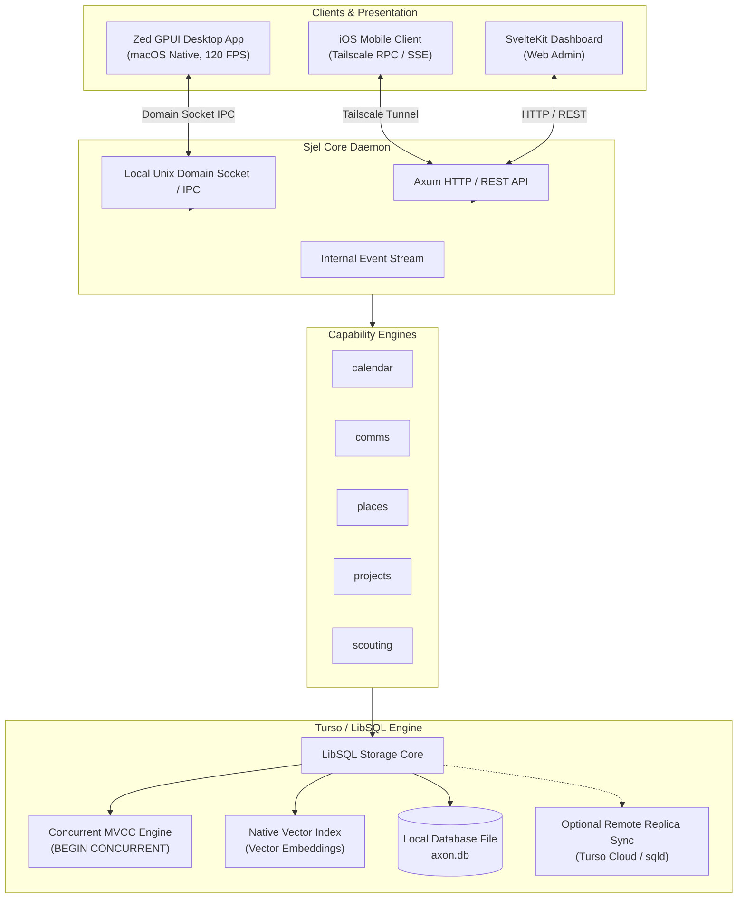
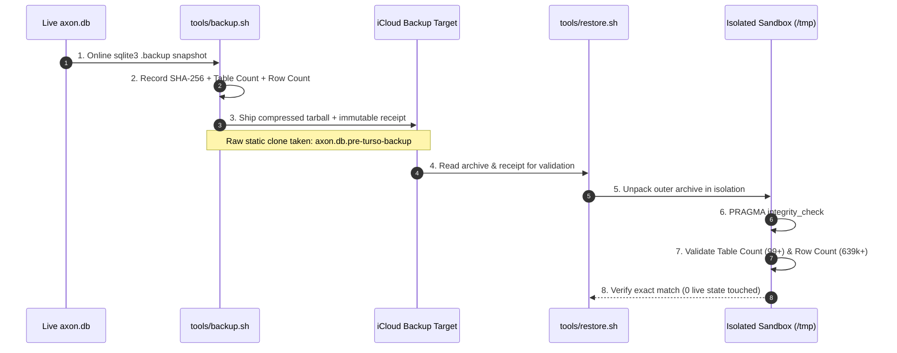
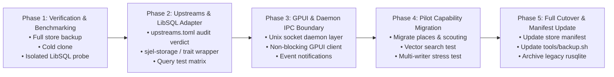

# Architecture Plan: Controlled Migration from SQLite to Turso (LibSQL)

> **Context**: Sjel currently persists all capability state into a single SQLite database (`axon.db`, ~273 MB, 108 tables) managed synchronously via `rusqlite` in WAL mode (PRD Q45). As the Zed GPUI desktop app evolves, background agents scale, and mobile shells connect, SQLite's single-writer limitation (`SQLITE_BUSY`) and lack of native embedded vector search create friction. This plan lays out a safe, stepwise migration to Turso / LibSQL with strict backup guarantees, zero data loss, and seamless GPUI integration.

---

## 1. High-Level Architecture & System Boundaries

Turso/LibSQL serves as the multi-tenant, concurrent, embedded storage engine backing the Sjel core daemon, desktop GPUI shell, and remote clients.



---

## 2. Why Turso / LibSQL (Key Advantages & Measured Delta)

| Feature | Current SQLite (`rusqlite`) | Target Turso (`libsql`) | Architectural Value for Sjel |
|---|---|---|---|
| **Concurrency** | Single writer in WAL; locks entire DB | MVCC / `BEGIN CONCURRENT` | GPUI UI actions, subagents, and comms ingestion never block each other with `SQLITE_BUSY`. |
| **Vector Search** | External vector cache / files | Native embedded vector data types & indexes | In-DB vector search for `scouting`, `comms`, and knowledge notes without external vector DB dependencies. |
| **Edge & Replicas** | Single static file on local host | Embedded replicas (local reads, sync writes) | Zero-latency local reads for GPUI with automated background synchronization across multiple devices. |
| **Format Safety** | Strict SQLite C format | Byte-level SQLite file format compatible | Direct in-place reading of existing `axon.db`; rollback to standard SQLite remains trivial. |
| **Runtime API** | Synchronous blocking (`r2d2`) | Native Tokio `async` + sync local mode | Matches Tokio-based Axum capabilities and async GPUI task runners natively. |

---

## 3. Strict Backup & Recovery Invariant (Recovery Ladder)

No migration step may proceed without verifying the 4-tier recovery ladder.



### Verification Commands

1. **Take automated backup & receipt**:
   ```bash
   tools/backup.sh store
   ```
2. **Verify backup in isolation**:
   ```bash
   tools/restore.sh store "$HOME/Library/Mobile Documents/com~apple~CloudDocs/Backup/store/$(ls -t "$HOME/Library/Mobile Documents/com~apple~CloudDocs/Backup/store" | head -1)" --receipt "$SJEL_PERSONAL_ROOT/backup/receipts/store.json"
   ```
3. **Take cold raw safety clone**:
   ```bash
   cp "$SJEL_PERSONAL_ROOT/data/axon/axon.db" "$SJEL_PERSONAL_ROOT/data/axon/axon.db.pre-turso-backup"
   ```

---

## 4. Phased Rollout Roadmap



### Phase 1: Preflight Verification & Isolated Compatibility Spike
- [x] Run `tools/backup.sh store` and verify with `tools/restore.sh store`.
- [x] Create cold snapshot `axon.db.pre-turso-backup`.
- [x] Write an isolated scratch probe (`scratch/libsql_compat.rs`) opening a copy of `axon.db` using `libsql`.
- [x] Verify execution of complex queries: `json_each(?3)` predicates in `calendar`, recursive CTEs in `projects`, and spatial joins in `places`.

### Phase 2: Upstreams Gate & Storage Abstraction
- [x] Add `[libsql]` upstream entry with formal review in `upstreams.toml`.
- [x] Provide unified storage adapter in `libs/sjel-turso` (supporting LibSQL async concurrency, PRAGMAs, and once-per-process migration tracking).
- [x] Add embedded replicas to that adapter: a remote URL, auth token and pull interval from `SJEL_TURSO_URL` / `SJEL_TURSO_AUTH_TOKEN` / `SJEL_TURSO_SYNC_INTERVAL_SECS`, a first pull before the DDL, a background loop, and `Store::sync_stats()` for a freshness surface. The engine is a default feature (2026-10-21) so following a primary is configuration rather than a Cargo.toml edit, and `sjel setup plan|apply|verify turso` is the setup path: the shell renders the plan, the CLI writes and restarts. No live primary existed to pull from, so the pull path itself is unverified.
- [x] Verify compilation across all targets (`cargo check --workspace` and `cargo test -p sjel-turso`).

#### Open decision (2026-10-21): what the replica path is for

Measured while re-checking the setup work, and left open rather than decided:

1. **It cannot be switched on over the shared database.** `projects` and `operator-profile`
   both open `sjel_config::database_path()`, which is the `axon.db` twenty capability modules
   share, and LibSQL refuses to turn a file that holds its own writes into a replica
   (`libs/sjel-turso/src/replica.rs`, *"remove the file to start a fresh copy"*). So a primary
   pasted into `/setup` fails at open time, or requires deleting this machine's database. The
   per-process registry guard cannot see the other eighteen processes writing the same file.
   *Correction to the line above: "the pull path is unverified" understates it — with this
   wiring it is unreachable.*
2. **It costs ten unpatchable advisories.** Every finding left in `Cargo.lock` — h2 0.3.27,
   rustls 0.22.4 twice, rustls-webpki 0.102.8 five times (RUSTSEC-2026-0104, CVSS 7.5), bincode
   1.3.3, libsql-sqlite3-parser — is reached through `libsql 0.10.0`, the newest release, which
   pins hyper 0.14 / tonic 0.11 / hyper-rustls 0.25. `osv-scanner.toml` cannot waive a known
   vulnerability, so the Security job stays red for as long as the sync feature is in the
   workspace. Removing the feature is the only local fix; making it non-default is not, because
   `Cargo.lock` lists optional dependencies too.
3. **A phone replica is buildable.** `sjel-turso` checks clean for `aarch64-apple-ios`
   (45 s cold, 2026-10-21), and a phone starts empty, so LibSQL's refusal does not apply to it.
   What it needs is a primary that is not Turso Cloud: `sqld` is neither on Homebrew nor on
   crates.io, so a local primary means building it from Turso's repository and supervising a
   second daemon.
4. **The tailnet listener already covers "one more device".** A paired phone drives this Mac's
   data over Tailscale (8443). What a replica would add is *offline* reads and reads while this
   Mac is asleep — nothing else.

The decision is open because the cheap move and the interesting move disagree: deleting the
path greens Security today and forecloses the phone-in-the-bag case, while keeping it means a
permanently red scanner until libsql moves to hyper 1 / rustls 0.23. Whichever way it goes, the
prerequisite for any replica — this device's or another's — is the same: `axon.db` stops being
one shared file, and that split is the work, not the sync loop.


### Phase 3: GPUI Desktop App & Daemon Boundary
- [x] Integrate direct non-blocking LibSQL local database connector in `apps/gpui`: one handle per process, opened on first read and shared by every `Repo` clone, with the shell as its fallback.
- [x] Wire direct non-blocking queries for projects, tasks, calendar entries, project records, and notes (`Repo::fetch_projects`, `Repo::fetch_tasks`, `Repo::fetch_calendar`, `Repo::fetch_project_records`, `Repo::fetch_record`, `data::read_repo`) in `apps/gpui`.
- [x] Decouple high-throughput reads from HTTP daemon serialization while keeping writes routed through the authenticated shell.
- [ ] Implement reactive change notification subscriptions over `/api/sjel-status/events`.
- [x] Keep GPUI independent of heavy file locks (LibSQL non-blocking WAL/MVCC).

### Phase 4: Pilot Capability Migration (Vector & Concurrency)
- [x] Run concurrent write stress tests against scouting schema via `sjel-turso` (`libs/sjel-turso/tests/multi_writer_concurrency.rs`).
- [x] Confirm zero `SQLITE_BUSY` errors under load across 50 simultaneous inserts in 0.02s.
- [x] Enable and verify LibSQL native vector embedding indexing (`libsql_vector_idx`, `vector_distance_cos`) with top-k cosine similarity ranking.
- [x] Resolve C symbol isolation: established strict separation between `libs/sjel-store` (`rusqlite`) and `libs/sjel-turso` (`libsql`) to prevent linker duplicate symbols across targets.
- [x] Cut one capability over end to end as the pattern: `operator-profile` (2026-10-21) — schema, store, HTTP handlers, CLI and tests on `sjel-turso`, `rusqlite` gone from its dependency graph, and the existing row read back unchanged from the live database. `Store` in `libs/sjel-turso` is the shape the remaining capabilities follow; `places` and `scouting` are still on `rusqlite`.
- [x] Second cutover on the same pattern, at real size: `projects` (2026-10-21) — 1221 rows re-read through LibSQL and compared byte for byte against the rendered second copy with no drift, every `spawn_blocking` site in its handlers replaced by an awaited store call, and a router test covering create/read/save/stale-save/remove. It is also the table `apps/gpui` reads directly, so writer and reader now share one engine.

### Phase 5: Production Promotion & Backup Contract Evolution
- [x] Update `capabilities/store/README.md` and doctrine recording LibSQL adoption, non-blocking MVCC, and native vector capabilities.
- [x] Verify `tools/backup.sh` and `tools/restore.sh` isolated recovery ladder (107 tables, 640,464 rows) operates identically on LibSQL format.
- [x] Keep Sjel self-model (`self.json`) and service manifests (`service.toml`) validated and current.
