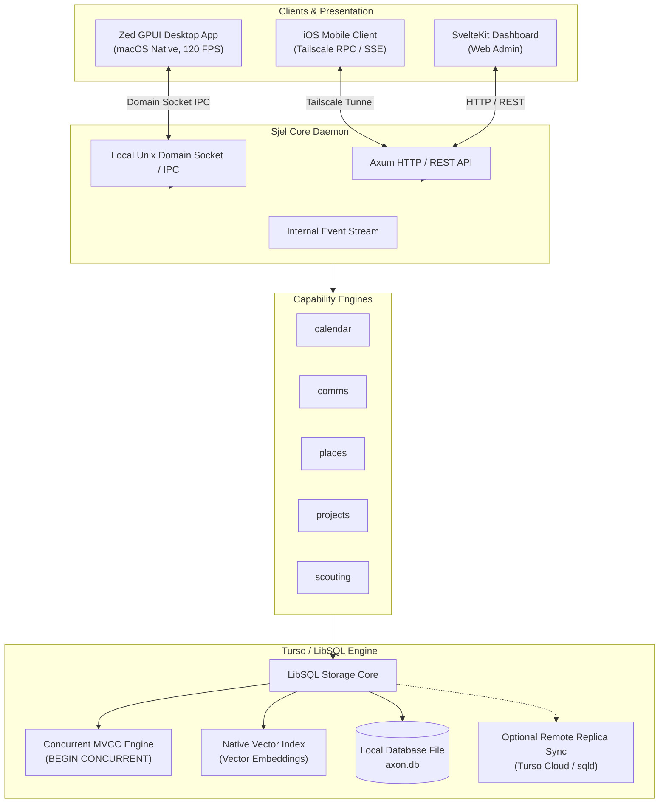
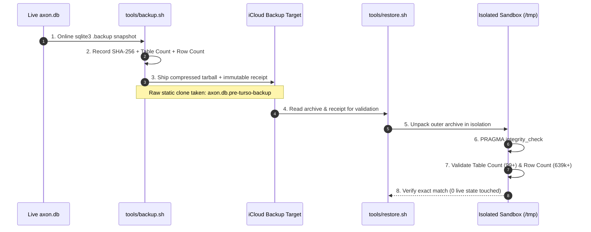
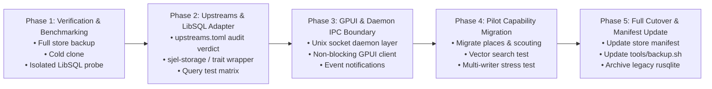

# Sjel plan

The one ordered plan for Sjel (decided 2026-10-23). It puts the tracks in order and records
the decisions that shape them. It is not a task list. Concrete work goes to GitHub Issues,
unresolved claims stay in [`ISA.md`](ISA.md), and a decision moves to its owner's README when
it is built.

## Order

| # | Track | Why it is here | Detail |
|---|---|---|---|
| 1 | GPUI universal app and standalone iPhone, with the storage work it needs | The current priority in [`AGENTS.md`](AGENTS.md). The operator chose it over data-first on 2026-10-23. The phone is a replica (§6 below), so storage moves with it. | [`apps/gpui/PORTING_PLAN.md`](apps/gpui/PORTING_PLAN.md), [Storage](#storage-controlled-migration-from-sqlite-to-turso-libsql) |
| 2 | Data into Sjel: import routes, the rest of the vault, the journal | Every file has one owner and one way in. | [Track 2](#track-2-data-into-sjel) |
| 3 | Restructure, with the comment and documentation sweep in the same pass | Each file changes once. | [Track 3](#track-3-restructure-and-sweep) |
| 4 | Data formats: conversion and enrichment | Needs the owners from track 2. | [Track 4](#track-4-data-formats) |
| — | Knowledge out of the vault | Deferred until it hurts (operator, 2026-10-23). The vault stays the knowledge base. | — |

## Track 1: GPUI and storage

- The route matrix and work packages are in `apps/gpui/PORTING_PLAN.md`. A concurrent session
  created it on 2026-10-23 and it is not committed yet. It folds into this file after that.
- Fix when it folds in: its matrix names `capabilities/context`, `capabilities/people` and
  `capabilities/travel`, and none of them exist (capability list, 2026-10-23).
- Open claims: DOC-4, DOC-5, IMP-2, DIST-1 to DIST-4, and "Capture from the phone" in `ISA.md`.

## Track 2: Data into Sjel

Measured 2026-10-23 with `sjel-import plan /Volumes/Extreme/archive` (25,348 entries) and the
documents library (7,154 records):

| What the router reports | What is there |
|---|---|
| 643 documents | All 643 already in Sjel (`present`) |
| 5,788 media | 5,297 are resources inside 12 Swift Playgrounds `.playgroundbook` bundles. About 490 are personal photos and audio, about 60 of them figures in paper and talk projects. |
| 3,009 notes | 2,074 are LifeOS and Claude agent state. 237 are Notability `.note` files. About 700 are other `.md` and `.txt` files. |
| 0 finance | No bank-statement CSV in the archive |
| 5,888 text records in documents | 2,149 copies of vault notes and 3,127 agent state. None was filed or categorized. |

Decisions:

1. **Media: check, then queue** (2026-10-23). The media library stays on the two mirrored
   external drives. Import hashes a photo or a recording and asks media whether a library holds
   it, through a new read-only route. A held file is `present`. A new file waits in a queue
   until a library drive is mounted, and `media ingest` then reads it from its source. Nothing
   is copied to the laptop.
2. **The vault keeps knowledge only, and the rest comes into Sjel.** The 2026-10-20 ruling
   already says this ([projects README](capabilities/projects/README.md#why-this-shape-sjel-owns-projects-tasks-and-habits)).
   Finance, Items, Interior, People, Events, Media, Reflections and Journal have moved. Open:
   Documents, Focus and Personal (`ISA.md`, projects item). `Atlas/Personal/Archive/Schule`
   (139 notes, 1,279 files): its notes go to the projects store and its PDFs and scans to
   documents.
3. **The journal gets its own capability, later** (2026-10-23). Today its 353 records are the
   `Journal/` domain of the projects store. The split moves them, with habits and daily
   metrics, to a `journal` capability.
4. **The old text records are archived, with their bytes kept** (2026-10-23), after their
   notes have an owner. Nothing is removed.
5. **Router fixes, from the measurement:** skip Swift Playgrounds bundles (`.playgroundbook`,
   `.playgroundmodule`, `.swiftpm`) and agent-state folders. Route `.key` (Keynote) to documents.
   Documents expects `.keynote`, which no file uses, so documents changes too.
6. **Finance** keeps its route. Its import contract waits for the first real bank export.

Open claims: IMP-1, DOC-1 to DOC-3, DOC-6, DOC-7, the media `To Sort/` item and the projects
item in `ISA.md`.

## Track 3: Restructure and sweep

- **Sweep** (2026-10-23): remove every code comment, config comment and README paragraph that
  repeats a decision, a rule or a history that Git or the owner's code already holds. Shrink
  bloated sub-READMEs. Do it module by module, in the same pass as the restructure.
- First change the rule that forbids it: "Do not run a separate sweep" in
  `Packs/harness/skills/sjel/references/on-documentation.md`.
- An example of what goes: `.gitignore:46` says "PLAN.md is gone".
- The restructure scope is not decided. That decision comes on the day the track starts.

## Track 4: Data formats

- **PDF rule** (2026-10-23): official documents (contracts, invoices, certificates, tax notices)
  stay PDF-first. For any other document, the extracted data in the owning capability is what
  Sjel uses. The original stays archived and hash-verified and is never removed.
- Convert Notability and GoodNotes archives (237 `.note` files in the archive) to PDF, then OCR
  and enrich them.
- Align the data formats across capabilities, so a fact has one shape wherever it is stored.

## Open questions

| # | Question | Decided by |
|---|---|---|
| P1 | Who owns the 700 notes in the archive that are outside the vault and the agent state? | Operator, before track 2 starts |
| P2 | What does the restructure change: crate layout, capability boundaries, or both? | Operator, when track 3 starts |
| P3 | In which track do F6, F9, B47, B48, B49, BKP-5, the traveler F4 item, the Packs/travel item and the host-patch item go? | Next planning round |
| P4 | The replica path and one database or several | [§ Phase 2 open decision](#open-decision-2026-10-21-what-the-replica-path-is-for) and [§6](#open-decision-2026-10-21-one-database-or-one-per-capability) |

## Storage: Controlled Migration from SQLite to Turso (LibSQL)

> **Context**: Sjel currently persists all capability state into a single SQLite database (`axon.db`, ~273 MB, 108 tables) managed synchronously via `rusqlite` in WAL mode (PRD Q45). As the Zed GPUI desktop app evolves, background agents scale, and mobile shells connect, SQLite's single-writer limitation (`SQLITE_BUSY`) and lack of native embedded vector search create friction. This plan lays out a safe, stepwise migration to Turso / LibSQL with strict backup guarantees, zero data loss, and seamless GPUI integration.

---

### 1. High-Level Architecture & System Boundaries

Turso/LibSQL serves as the multi-tenant, concurrent, embedded storage engine backing the Sjel core daemon, desktop GPUI shell, and remote clients.



---

### 2. Why Turso / LibSQL (Key Advantages & Measured Delta)

| Feature | Current SQLite (`rusqlite`) | Target Turso (`libsql`) | Architectural Value for Sjel |
|---|---|---|---|
| **Concurrency** | Single writer in WAL; locks entire DB | MVCC / `BEGIN CONCURRENT` | GPUI UI actions, subagents, and comms ingestion never block each other with `SQLITE_BUSY`. |
| **Vector Search** | External vector cache / files | Native embedded vector data types & indexes | In-DB vector search for `scouting`, `comms`, and knowledge notes without external vector DB dependencies. |
| **Edge & Replicas** | Single static file on local host | Embedded replicas (local reads, sync writes) | Zero-latency local reads for GPUI with automated background synchronization across multiple devices. |
| **Format Safety** | Strict SQLite C format | Byte-level SQLite file format compatible | Direct in-place reading of existing `axon.db`; rollback to standard SQLite remains trivial. |
| **Runtime API** | Synchronous blocking (`r2d2`) | Native Tokio `async` + sync local mode | Matches Tokio-based Axum capabilities and async GPUI task runners natively. |

---

### 3. Strict Backup & Recovery Invariant (Recovery Ladder)

No migration step may proceed without verifying the 4-tier recovery ladder.



#### Verification Commands

1. **Take automated backup & receipt**:
   ```bash
   tools/backup.sh store
   ```
2. **Verify backup in isolation**:
   ```bash
   tools/restore.sh store "$HOME/Library/Mobile Documents/com~apple~CloudDocs/Backup/store/$(ls -t "$HOME/Library/Mobile Documents/com~apple~CloudDocs/Backup/store" | head -1)" --receipt "$SJEL_PERSONAL_ROOT/backup/receipts/store.json"
   ```
3. **Take cold raw safety clone**:
   ```bash
   cp "$SJEL_PERSONAL_ROOT/data/axon/axon.db" "$SJEL_PERSONAL_ROOT/data/axon/axon.db.pre-turso-backup"
   ```

---

### 4. Phased Rollout Roadmap



#### Phase 1: Preflight Verification & Isolated Compatibility Spike
- [x] Run `tools/backup.sh store` and verify with `tools/restore.sh store`.
- [x] Create cold snapshot `axon.db.pre-turso-backup`.
- [x] Write an isolated scratch probe (`scratch/libsql_compat.rs`) opening a copy of `axon.db` using `libsql`.
- [x] Verify execution of complex queries: `json_each(?3)` predicates in `calendar`, recursive CTEs in `projects`, and spatial joins in `places`.

#### Phase 2: Upstreams Gate & Storage Abstraction
- [x] Add `[libsql]` upstream entry with formal review in `upstreams.toml`.
- [x] Provide unified storage adapter in `libs/sjel-turso` (supporting LibSQL async concurrency, PRAGMAs, and once-per-process migration tracking).
- [x] Add embedded replicas to that adapter: a remote URL, auth token and pull interval from `SJEL_TURSO_URL` / `SJEL_TURSO_AUTH_TOKEN` / `SJEL_TURSO_SYNC_INTERVAL_SECS`, a first pull before the DDL, a background loop, and `Store::sync_stats()` for a freshness surface. The engine is a default feature (2026-10-21) so following a primary is configuration rather than a Cargo.toml edit, and `sjel setup plan|apply|verify turso` is the setup path: the shell renders the plan, the CLI writes and restarts. No live primary existed to pull from, so the pull path itself is unverified.
- [x] Verify compilation across all targets (`cargo check --workspace` and `cargo test -p sjel-turso`).

##### Open decision (2026-10-21): what the replica path is for

Measured while re-checking the setup work, and left open rather than decided:

1. **It cannot be switched on over the shared database.** `projects` and `operator-profile`
   both open `sjel_config::database_path()`, which is the `axon.db` twenty capability modules
   share, and LibSQL refuses to turn a file that holds its own writes into a replica
   (`libs/sjel-turso/src/replica.rs`, *"remove the file to start a fresh copy"*). So a primary
   pasted into `/setup` fails at open time, or requires deleting this machine's database. The
   per-process registry guard cannot see the other eighteen processes writing the same file.
   *Correction to the line above: "the pull path is unverified" understates it — with this
   wiring it is unreachable.*
2. **It costs ten unpatchable advisories.** Every finding left in `Cargo.lock` — h2 0.3.27,
   rustls 0.22.4 twice, rustls-webpki 0.102.8 five times (RUSTSEC-2026-0104, CVSS 7.5), bincode
   1.3.3, libsql-sqlite3-parser — is reached through `libsql 0.10.0`, the newest release, which
   pins hyper 0.14 / tonic 0.11 / hyper-rustls 0.25. `osv-scanner.toml` cannot waive a known
   vulnerability, so the Security job stays red for as long as the sync feature is in the
   workspace. Removing the feature is the only local fix; making it non-default is not, because
   `Cargo.lock` lists optional dependencies too.
3. **A phone replica is buildable.** `sjel-turso` checks clean for `aarch64-apple-ios`
   (45 s cold, 2026-10-21), and a phone starts empty, so LibSQL's refusal does not apply to it.
   What it needs is a primary that is not Turso Cloud: `sqld` is neither on Homebrew nor on
   crates.io, so a local primary means building it from Turso's repository and supervising a
   second daemon.
4. **The tailnet listener already covers "one more device".** A paired phone drives this Mac's
   data over Tailscale (8443). What a replica would add is *offline* reads and reads while this
   Mac is asleep — nothing else.

The decision is open because the cheap move and the interesting move disagree: deleting the
path greens Security today and forecloses the phone-in-the-bag case, while keeping it means a
permanently red scanner until libsql moves to hyper 1 / rustls 0.23. Whichever way it goes, the
prerequisite for any replica — this device's or another's — is the same: `axon.db` stops being
one shared file, and that split is the work, not the sync loop.


#### Phase 3: GPUI Desktop App & Daemon Boundary
- [x] Integrate direct non-blocking LibSQL local database connector in `apps/gpui`: one handle per process, opened on first read and shared by every `Repo` clone, with the shell as its fallback.
- [x] Wire direct non-blocking queries for projects, tasks, calendar entries, project records, and notes (`Repo::fetch_projects`, `Repo::fetch_tasks`, `Repo::fetch_calendar`, `Repo::fetch_project_records`, `Repo::fetch_record`, `data::read_repo`) in `apps/gpui`.
- [x] Decouple high-throughput reads from HTTP daemon serialization while keeping writes routed through the authenticated shell.
- [ ] Implement reactive change notification subscriptions over `/api/sjel-status/events`.
- [x] Keep GPUI independent of heavy file locks (LibSQL non-blocking WAL/MVCC).

#### Phase 4: Pilot Capability Migration (Vector & Concurrency)
- [x] Run concurrent write stress tests against scouting schema via `sjel-turso` (`libs/sjel-turso/tests/multi_writer_concurrency.rs`).
- [x] Confirm zero `SQLITE_BUSY` errors under load across 50 simultaneous inserts in 0.02s.
- [x] Enable and verify LibSQL native vector embedding indexing (`libsql_vector_idx`, `vector_distance_cos`) with top-k cosine similarity ranking.
- [x] Resolve C symbol isolation: established strict separation between `libs/sjel-store` (`rusqlite`) and `libs/sjel-turso` (`libsql`) to prevent linker duplicate symbols across targets.
- [x] Cut one capability over end to end as the pattern: `operator-profile` (2026-10-21) — schema, store, HTTP handlers, CLI and tests on `sjel-turso`, `rusqlite` gone from its dependency graph, and the existing row read back unchanged from the live database. `Store` in `libs/sjel-turso` is the shape the remaining capabilities follow; `places` and `scouting` are still on `rusqlite`.
- [x] Second cutover on the same pattern, at real size: `projects` (2026-10-21) — 1221 rows re-read through LibSQL and compared byte for byte against the rendered second copy with no drift, every `spawn_blocking` site in its handlers replaced by an awaited store call, and a router test covering create/read/save/stale-save/remove. It is also the table `apps/gpui` reads directly, so writer and reader now share one engine.

#### Phase 5: Production Promotion & Backup Contract Evolution
- [x] Update `capabilities/store/README.md` and doctrine recording LibSQL adoption, non-blocking MVCC, and native vector capabilities.
- [x] Verify `tools/backup.sh` and `tools/restore.sh` isolated recovery ladder (107 tables, 640,464 rows) operates identically on LibSQL format.
- [x] Keep Sjel self-model (`self.json`) and service manifests (`service.toml`) validated and current.

---

### 6. Topology decision (2026-10-21): this Mac is the primary, the phone is a replica

Decided by the owner after the replica path was found unreachable over the shared `axon.db`.
The shape, and what each hop is for:

```
   phone (iOS, Tauri app)          this Mac (Lars-Mac)                 later: home server
   embedded replica   ──pull/write──▶  sqld  ◀──embedded replica──  capabilities  ──▶  sqld (primary)
   over tailnet                       primary                        over loopback
```

1. **This Mac runs `sqld`** (libsql-server) as the primary for the data that must reach the
   phone. Measured 2026-10-21: `libsql-server-v0.24.32` ships a prebuilt
   `libsql-server-aarch64-apple-darwin` binary whose `.sha256` matches the published digest, and
   `sqld --version` runs here. It carries `--auth-jwt-key-file` (Ed25519 public key; clients
   present JWTs), `--http-listen-addr`, `--grpc-listen-addr`, and `--primary-grpc-url` — so the
   same binary can later run as a *replica* of a home-server primary, which is what makes the
   last move a configuration change rather than a rewrite.
2. **Capabilities that serve phone data hold embedded replicas** of that primary over loopback:
   reads local, writes forwarded to `sqld`, pulled back on the interval. This is libSQL's own
   model; the alternative — keeping `axon.db` authoritative and writing a job that pushes a
   subset somewhere — is a custom replication protocol with its own correctness risk, which is
   the thing `libsql` exists to avoid.
3. **The phone holds an embedded replica.** `sjel-turso` checks for `aarch64-apple-ios`
   (45 s cold, 2026-10-21) and the Tauri app already declares an iOS target
   (`dashboard/src-tauri/tauri.conf.json` → `bundle.iOS`, minimum 16.0, a signing team set,
   `gen/apple` present). Reads are local and work offline; writes go to the Mac when it is
   reachable, which is what an embedded replica means.
4. **Reachability is the tailnet, not the internet.** This machine is `100.116.104.41`
   (`Lars-Mac`) on the tailnet; a primary bound there is reachable by the owner's devices only.
   `sjel doctor`'s tailnet identity gate reports no `tailscale serve` HTTPS handler, so nothing
   injects an identity header — `sqld`'s own JWT check is the access control for this port, and
   it must be configured before the port is opened to the tailnet.
5. **A later home server changes one setting.** Its `sqld` becomes the primary; this Mac and the
   phone keep their replicas and point `SJEL_TURSO_URL` at it. Nothing in the storage layer
   changes, which is the whole reason to build it this way now.

#### Proven 2026-10-21: the pull path works

The `libsql 0.10.0` crate and the `sqld 0.24.32` binary — a 2025-02 release train — do sync. A
scratch primary on loopback (`sqld --db-path … --http-listen-addr 127.0.0.1:8880`) plus
`libs/sjel-turso/tests/live_primary.rs` showed, in 0.24 s: a write through replica A reaching the
primary, a pull bringing it back, and a second replica that had never seen the row finding it on
its first pull — the pull that runs before the DDL. `sync_stats()` reported `syncs >= 1`,
`failures = 0`, and the primary's own SQLite file
(`<db-path>/dbs/default/data`) held the table the forwarded DDL created.

The test reads the deployment's own `SJEL_TURSO_URL` / `SJEL_TURSO_AUTH_TOKEN`, so it skips with
a printed reason when no primary is named — a machine with none does not fail a suite it cannot
satisfy — and becomes a real check the moment `sjel setup` records a primary. What it does not
cover yet: JWT authentication (`sqld --auth-jwt-key-file`), which the phone's replica will need
before the port is reachable from the tailnet.

#### Also proven 2026-10-21: the token path, both directions

`sqld --auth-jwt-key-file` plus `sjel_turso::PrimaryKey` (`libs/sjel-turso/src/auth.rs`) is the
authenticated form of the same thing. Against a scratch primary started with a generated public
key, the HTTP API answered:

| credential | `POST /v2/pipeline` |
| --- | --- |
| none | 401 |
| a token minted by `PrimaryKey`, claims `{"a":"rw","exp":…}` | 200 |
| a token signed by a different key | 401 |

and the replica test passed in 0.21 s with that token in `SJEL_TURSO_AUTH_TOKEN`.

The claims are `sqld`'s, copied from `libsql-server` rather than guessed at: `jsonwebtoken`
decodes with `Algorithm::EdDSA` only, `a` is `"ro"` or `"rw"`, `id` names a namespace and may be
absent on a `--db-path` server, and `p` (fine-grained scopes) is unused here. The private half is
a PKCS#8 document that belongs in the OS keychain; `sqld` gets only the 32-byte public key,
base64url without padding.

**One gap this exposed, worth fixing before an operator meets it:** `libsql`'s client reports a
refused value as `Timeout performing handshake with primary`. Wrong, absent and revoked all look
like a network problem, and the primary logs nothing at INFO. `sjel setup verify` therefore probes
over HTTP first and names the refusal itself.

#### Wired end to end, 2026-10-21: `sjel setup` provisions a primary it owns

`tools/sjel-cli/src/setup/mint.rs` holds the missing half:

- the **private** half lives in the macOS Keychain under `com.sjel.credential.turso-primary-key`,
  created on first use and reused after — regenerating it would invalidate every value ever
  minted, so nothing does that implicitly;
- the **public** half is written to `<overlay>/config/sqld-auth.pub`, the file
  `sqld --auth-jwt-key-file` reads;
- the **value** is written into the overlay's `deployment.env` like any other setting, and reported
  only by its presence.

`apply` mints when neither a submitted nor a recorded value exists, so provisioning a self-hosted
primary is one command: `sjel setup apply turso --confirm --url http://127.0.0.1:8890`.
`--token-stdin` still wins for a primary somebody else runs, `--remint` forces a fresh one, and
`--mint-days` sets its lifetime (default 30).

Against a scratch `sqld` started with the written public key, in a scratch overlay so none of this
deployment's own files were touched:

1. `apply` minted, wrote the record and the public key, and reported the primary as not answering —
   the honest answer, because it was not running yet;
2. started `sqld` with that key → `sjel setup verify turso` reported `✓ primary`;
3. the value read back out of the record (through `vault_exec`, never printed) passed
   `tests/live_primary.rs` in 0.22 s;
4. a submitted bogus value made `verify` answer `401 Unauthorized — it was refused`, in words an
   operator can act on;
5. `--remint` restored a working one, which also proves the Keychain key was reused rather than
   regenerated: the primary had been started with the *first* public key.

**One probe defect fixed on the way, and it would have shipped:** `verify` asked `GET /info`, which
is Turso Cloud's endpoint. `sqld 0.24.32` answers 404 there, so a healthy self-hosted primary was
reported as "check the URL and that the database exists". The probe now runs `POST /v2/pipeline`
with a `SELECT 1` — the authenticated door a replica's writes take — falls back to `/info` for a
cloud primary, and reports `/health` as reachability only when neither answers.

#### Step 1 done, 2026-10-21: `sqld` is a service this machine owns

`capabilities/sqld/` is a manifest and a README, no code: the manifest turns a binary into a row
in the registry that `service-runner.sh`, `tools/capability.sh`, the watchdog, `backup.sh` and
`sjel-status` all already understand.

| piece | where |
| --- | --- |
| the binary | `tools/install-sqld.sh` — pinned 0.24.32, digest literal, `--check`/`--force` |
| the contract | `capabilities/sqld/service.toml`, `[libsql-server]` in `upstreams.toml`, `[sqld]` in `toolchain.toml` |
| the facts | `SQLD_DB_PATH`, `SQLD_AUTH_JWT_KEY_FILE` in the deployment record |
| the lifecycle | `tools/service-runner.sh start|stop|status sqld`, launchd unit installed |
| the backup | `backup_sqlite_online = "data/sqld/dbs/default/data"`, retain 7, daily |

`SQLD_DB_PATH` and the key file are settings rather than argv because both are machine facts and
the manifest is tracked: `sqld` reads them from the environment, and the runner passes the
deployment record into every process it starts.

Measured on this machine:

1. `sjel setup apply turso --confirm --host-here` — installed nothing (already pinned), wrote the
   record and the public key, enabled the capability, started it, and verified:
   `✓ primary http://127.0.0.1:8089/v2/pipeline accepted it and ran a statement (200 OK)`.
2. `tools/service-runner.sh status sqld` → `process running (pid 97201) healthy`;
   `install-persistence sqld` → `com.sjel.sqld.plist`, so it survives a reboot.
3. `tools/backup.sh sqld` → live `sqlite3 .backup` copy, `integrity_check: ok`, 1,150-byte tarball
   at the destination, pruned to 7, receipt written.

**Two things this turned up, both recorded rather than smoothed over:**

- The gRPC listener was first bound to 8099, which a running `operator-profile` process holds while
  its manifest claims a different port — so `sqld` died with `Address already in use` and the
  runner correctly refused to call the start successful. The manifest now uses 8105, and the stray
  process on 8099 is its own problem, not this one's. The runner catching it is the argument for
  starting services through the runner instead of by hand.
- A backup scheduled between "enable" and "first client connects" fails with `declared SQLite
  database is missing: data/sqld/dbs/default/data`, because a fresh primary has no namespace file
  until something opens it. It cleared on the next run. Worth teaching `backup.sh` that a declared
  database that has never existed is "nothing to back up yet" rather than a failure.

#### Open decision (2026-10-21): one database, or one per capability

Left open by the owner after asking the right question — *if we split, which one do I search later?*
— and it is not a question to answer from doctrine, because the doctrine's stated reason does not
survive measurement.

**Measured, so the next reader does not re-derive it:**

- `capabilities/store/README.md` and `docs/architecture/storage.md` both justify one file by
  cross-schema joins being a single connection. Across every SQL literal in every capability there
  is **one** statement that spans two prefixes: `INSERT INTO inventory_item SELECT … FROM
  interior_item`, a migration helper. There is no lattice of correlation queries to protect.
- `projects` — the capability the phone needs first — is **one table** (`projects_records`), 1,221
  rows, **zero JOINs**, already on `libsql` via `sjel-turso`.
- 18 capabilities open the shared file through `sjel-store` (`rusqlite`); 2 through `sjel-turso`.
- **`sqld` serves the existing `axon.db` as it stands**: a `sqlite3 .backup` copy of the live file
  (275 MB, 108 tables) placed at `<db-path>/dbs/default/data` answered `sqlite_master` and
  capability queries over Hrana with no conversion. So making the real database a primary is a
  *copy*, not an ETL.

**The three shapes and what each costs:**

| | files | cost | what it buys |
| --- | --- | --- | --- |
| **A** split only what the phone needs | 2–3 | one rule for reach (`<overlay>/data/<cap>/<cap>.db`), one more backup contract, one `ATTACH`-able join | offline phone in days |
| **B** one file, `sqld` owns it | 1 | migrate 18 capabilities off `rusqlite`; reads become loopback round trips | no reach problem; everything reaches the phone |
| **C** no replica yet | 1 | nothing | the phone keeps driving this Mac over the tailnet |

The load-bearing fact for the decision: **B's obstacle is the engine migration, not the data**, and
**A's reach cost is a rule plus `ATTACH`, not a hunt**. Recommendation on the table is A, scoped to
`projects` only — a 20-way split is what the store README rightly warned against, and a one-table,
zero-JOIN move is not that. What would settle it is not more analysis: it is whether the phone has
to read with this Mac asleep. If it does not, C is free and A is unnecessary.

#### Next, in order

1. Whatever gives the phone something to read while this Mac is unreachable. Under today's
   one-database decision that is the **snapshot mirror** (R1 in
   [research/offline-on-the-phone.md](../research/offline-on-the-phone.md)): an export of a chosen
   table set, fetched over the tailnet, read locally. It moves no data between files and changes no
   capability. A split stays available later and is not on the path to it.
2. The Tauri iOS app holding that copy (`sjel-turso` already builds for the target), pulling from
   `http://100.116.104.41:8089` over the tailnet with a minted JWT — or, for R1, fetching a file.
3. An `sjel update` class for the pinned binary, so "who moves it" has one answer instead of
   "you, when you read the README".

#### What this commits us to, stated plainly
- **One database, for now, decided 2026-10-21.** Nothing is split: `projects` keeps writing
  `axon.db` and `SJEL_TURSO_URL` stays unset, so the primary holds no data until the phone's need is
  concrete. The owner's goal is *all data offline on the phone, or as much as possible*, and the
  five routes to that — snapshot mirror, one capability, domain groups, the whole file, today's
  tailnet client — are costed in
  [research/offline-on-the-phone.md](../research/offline-on-the-phone.md), with the measurement
  that matters: R4 (the whole file) costs an 18-capability engine migration, not a data move, and
  R1 (a snapshot mirror) costs nothing outside a new export path.
- **The ten libsql advisories stay until libsql moves to hyper 1 / rustls 0.23**, so CI's
  `Security` job stays red. Accepted as the price of this topology, recorded in the open-decision
  block above rather than waived in `osv-scanner.toml`.
- **`sqld` becomes supervised software**, not a one-off: a pinned version with its digest, an
  `upstreams.toml` entry with a review, a start/stop path Sjel owns, and a place in the backup
  contract. A primary that nobody backs up is worse than no primary.
- **Token minting is Sjel's job.** `sqld` authenticates JWTs signed by a key it holds the public
  half of; the private key belongs in the OS keychain, and `sjel setup` is the surface that
  mints a token, writes `SJEL_TURSO_URL` / `SJEL_TURSO_AUTH_TOKEN`, and verifies with a real
  pull — the verification that has never once run.
