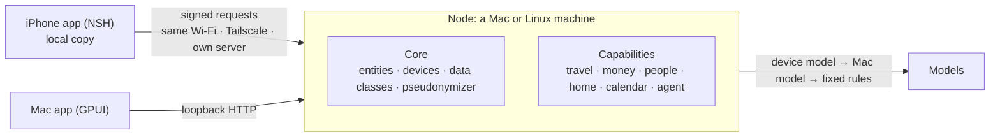

<!-- human-voice: ignore-start rule_of_three -->
<!-- This file enumerates real sets constantly (the four data classes, the capability groups,
     the parts of the stack that are not Rust yet). Several flagged "triads" are four-item lists
     the check reads as three. Shortening them would delete information to move a score, so the
     category is muted here deliberately. Every other check stays live. -->

<h1 align="center">Sjel</h1>

<b>Archived (2026-11-23).</b> Sjel is no longer developed or maintained. The code stays here for reference.

<b>A private layer under the tools you already use. It connects the areas of your life and keeps them on your own machines.</b>

  
  
  
  
  

  <a href="#where-it-stands">Where it stands</a> ·
  <a href="#how-it-works">How it works</a> ·
  <a href="#install">Install</a> ·
  <a href="#measured">Measured</a> ·
  <a href="research/README.md">Research</a> ·
  <a href="PLAN.md">Plan</a>

## What it is

Sjel stores the facts of one person's or one household's life as typed data: people, places,
trips, money, home and calendar. The data stays on hardware the household controls. One native
app on the Mac and the iPhone shows that data, and an assistant works on it.

Sjel has a core and optional capabilities. A capability is a small local service with its own
store and HTTP routes. Public capabilities live in this repository, and private ones may live in a
deployment overlay. Each installation enables the capabilities it needs.

## Why I built it

I lost track. I kept trying tools, for myself and for my AI agents, and nothing held the pieces
together.

It started in high school with Notion, which got me hooked on personal knowledge management. Then
I found Obsidian, and it was my life management system for years. I still kept drifting to
other tools, and every vault migration taught me something about what I actually need. That
experience, plus ideas from Reddit and YouTube, is where this project comes from.

Sjel is a layer under the tools you already use, not a replacement for them. Obsidian keeps one
job, the notes I learn from, with its own sync. Sjel connects the areas of a life and may find connections you didn't
think of. Privacy was part of the design from day one. Not every feature meets that bar yet, and
closing the gap is ongoing work. I try to keep all of it as efficient and light as I know how.

An honest note: much of the text and code here was written with AI. It started clean, then I
wanted features fast
([Mario Zechner on why that goes wrong](https://mariozechner.at/posts/2026-03-25-thoughts-on-slowing-the-fuck-down/)).
What's left has good ideas, some well-built parts and some sloppy ones. I want to clean it up.
Expect AI-polished text throughout, because I trust my drafts more after an AI pass.

## Where it stands

| Surface | Current scope | Open acceptance |
|---|---|---|
| CLI | Checkout-free preview archives for macOS ARM64 and Ubuntu 24.04-class Linux x86-64 and ARM64. | [Clean-user CLI installation](docs/tasks/cli-preview-acceptance.md). |
| Mac | [Native GPUI app](apps/gpui/README.md#native-renderers-shared-models). | [Mac daily workflows](docs/plans/gpui.md#mac-daily-workflows) and [clean-user installation](docs/tasks/distribution-clean-mac.md). |
| iPhone | [NSH app with a local replica](apps/gpui/README.md#workspace-and-the-ios-app). | [Paired-phone navigation](docs/tasks/gpui-phone-navigation.md), [agent sessions](docs/tasks/agent-client-phone.md), [remote terminal](docs/tasks/agent-terminal-phone.md) and [TestFlight delivery](docs/tasks/distribution-testflight.md). |
| Website | [Technical documentation and roadmap](https://larsboes.github.io/Sjel/). | [App screenshots and demo media](docs/tasks/website-demo-media.md). |

[The plan](PLAN.md) sets priorities. The [product guide](docs/product.md) describes the intended
scope, and the [security contract](docs/architecture/security.md) describes the implemented data
and agent access boundaries.

## Two surfaces: calm on the glass, open in the terminal

1. **On the glass.** The native app is for daily life. A phone joins the Mac from a card that
   appears when both are on the same network, and nobody in the household needs a terminal. Node
   setup still needs an operator. The
   [installation workflow](docs/operations/index.md#install-a-shell-only-node) lists the steps.
2. **Under the hood.** Every capability serves a live route manifest (`GET /routes`), speaks typed
   JSON over loopback HTTP, and keeps its state in SQLite. Every workflow runs from the terminal
   too (`sjel`, `sjel capability call`), and local models plug in the same way.

## How it works

1. One node, a Mac or a Linux machine, holds the data and accepts every write. Other devices send
   changes to it. When the phone and the Mac both edit a note, the Mac refuses the phone's write,
   and the phone keeps its text for the user to resolve.
2. A phone pairs once. It signs every request with a key in its Keychain, whichever connection it
   uses.
3. Every value has a data class: Public, Mine, Others (facts about other people) or Secret. A class
   goes up by itself. Only a person, with a written reason, can lower it.
4. Data about other people never reaches a cloud model (`libs/content-item`, `cloud_admission`).
5. Today shows only what still waits for a decision.

## Design rule: clever inside, easy outside

The goal is a system that is easy to use and easy to maintain. The design underneath may be
smart. Using and maintaining it may not require that smartness.

- One way in. A capability is not finished until `sjel` can find it, check its health and call it
  (`sjel capability list`, `sjel capability call`).
- One place per kind of fact. Public code and doctrine live here. Private values and machine state
  live in the overlay. A secret lives in the user's own secret store (the macOS Keychain on a
  Mac), and everything else holds a reference to it.
- No setup step that only its author remembers. If a step must be done by hand, a tool does it
  (`tools/setup-secret.sh`) and `tools/doctor` reports it when it is missing.

## Install

- [CLI preview](docs/operations/index.md#cli-only-coding-installation) covers supported hosts,
  release availability, draft installation, updates and rollback.
- [Shell-only node](docs/operations/index.md#install-a-shell-only-node) covers source setup,
  capability selection and startup checks.
- The app guide covers the [Mac build](apps/gpui/README.md#running-it) and
  [iPhone simulator](apps/gpui/README.md#workspace-and-the-ios-app).

## Measured

Each number names the command that reproduces it.

| What | Result | Reproduce |
|---|---|---|
| Pseudonymizer recall, reversible path | 48/48 (100.0%), gate ≥ 91.7%, measured 2026-09-27 | `cargo run -p sjel-comms --bin comms-redaction-eval -- --pseudonymized <corpus>` |
| Redaction recall, destructive path | 48/48 (100.0%), gate ≥ 91.7%, measured 2026-09-27 | the same command without `--pseudonymized` |
| Feed ranking (bge-m3) | 0.941 pairwise, 0.994 mean nDCG, 6/6 useful top-1 | `bun crates/comms/eval/run-relevance.ts`, result in `crates/comms/eval/results/2026-08-30-bge-m3-ollama.md` |
| Mac app start and memory | First frame under 10 ms, about 100 MB resident | `SJEL_GPUI_FRAMES` and `ps -o rss=`, see `apps/gpui/src/frames.rs` |

The redaction corpus (24 fixtures) lives in the private settings, so its two rows cannot be re-run
from a public clone. The relevance corpus is public
(`crates/comms/eval/relevance-corpus.json`) and needs a local bge-m3. The Mac app numbers
have no recorded date. Offline use and pairing time are not measured yet.

Run `sjel test` and `cargo test --workspace --locked` for current test results. This page does
not establish that the current checkout passes. See [installation footprint](docs/operations/index.md#installation-footprint)
for the measured shell artifacts and what that inventory excludes.

## Structure

A capability is a directory under `capabilities/` with a `service.toml`. `sjel capability list`
shows the ones on this machine.

| Part | Contents |
|---|---|
| Core | `crates/entities`, `crates/devices`, `libs/content-item`, `libs/pseudonymize`, `libs/sjel-server` |
| Apps | `apps/gpui` (Rust: GPUI on the Mac, NSH on the iPhone), `apps/mac` (Swift menu bar and CloudKit relay) |
| Agent | `agent`, `assistant`, `agentbox`, `packs` |
| Travel | `trips`, `transit`, `traveler`, `scouting`, `punctuality`, `sparpreis-watch` (Deutsche Bahn fare alerts) |
| People | `entities-sync`, `entities-google-sync`, `places`, `people-registry` |
| Money | `finance`, `finance-prices` |
| Home | `inventory`, `interior`, `soundscape` |
| Time and knowledge | `calendar`, `projects`, `comms`, `documents`, `knowledge-base`, `vault` |
| Machines | `sjel-status` (the node's HTTP host), `host-patch`, `host-watch`, `host-net`, `macmon`, `backup`, `software` |

## Scope

- **One household, one node.** Each household runs its own Sjel node. Its members use paired
  devices, and one operator runs the node.
- **Devices reach the node directly**, over the same Wi-Fi, Tailscale or the household's own
  HTTPS server. Sjel polls outside services. None of them calls in.
- **The models the devices already have.** A task runs on the device's model, then the Mac's,
  then fixed rules ([product rule 1](CONTRIBUTING.md#product-rules)). A cloud model receives only
  what rule 4 admits.
- **Structured facts and the work on them.** Sjel stores people, places, trips, money, home,
  calendar, projects and tasks. Learning notes stay in Obsidian and photos stay in the photo library.
  Sjel links to them.
- **Other services through their own authorization**, an API token or an OAuth grant, kept in the
  user's secret store.
- **First-party capabilities**, from this repository or the deployment's own overlay.
- **Platforms:** macOS and iOS for the app. The node also runs on Linux.

## Research

[`research/`](research/README.md) collects the studies and benchmarks behind the project,
including the ones that argue against it.

## License

AGPL-3.0-only ([LICENSE](LICENSE)), from 2026-09-26. Earlier releases are MIT. Contributions carry
a DCO sign-off ([CONTRIBUTING.md](CONTRIBUTING.md#license-and-sign-off)).
