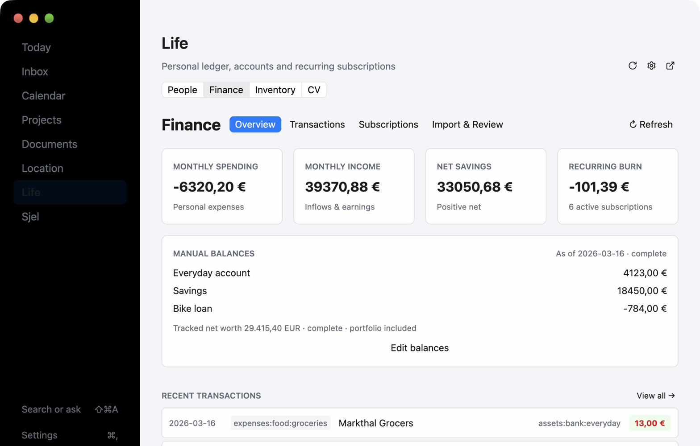
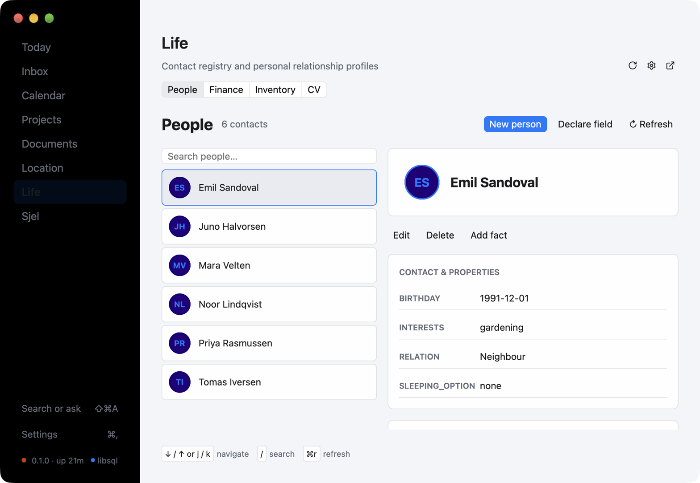
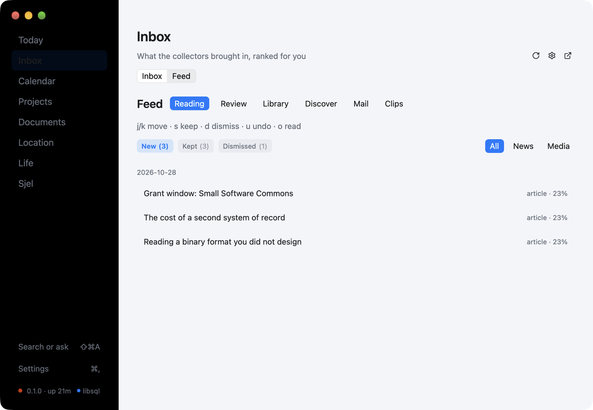
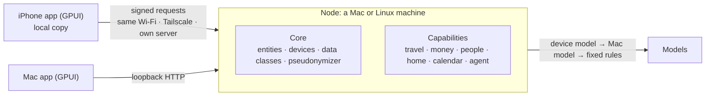

<!-- human-voice: ignore-start rule_of_three -->
<!-- This file enumerates real sets constantly (the four data classes, the capability groups,
     the parts of the stack that are not Rust yet). Several flagged "triads" are four-item lists
     the check reads as three. Shortening them would delete information to move a score, so the
     category is muted here deliberately. Every other check stays live. -->

<h1 align="center">Sjel</h1>

<b>One household's people, places, trips, money, home and calendar, on devices the household owns, with one assistant that works on that data.</b>

  
  

  

  
  &nbsp;
  

The GPUI Mac app on synthetic data from <code>tools/demo-shots</code>.

  <a href="#where-it-stands">Where it stands</a> ·
  <a href="#how-it-works">How it works</a> ·
  <a href="#install">Install</a> ·
  <a href="#measured">Measured</a> ·
  <a href="research/README.md">Research</a> ·
  <a href="PLAN.md">Plan</a>

## What it is

Sjel stores the facts of one person's or one household's life as typed data: people, places,
trips, money, home and calendar. The data stays on hardware the household controls. One native
app on the Mac and the iPhone shows that data, and an assistant works on it.

Sjel has a core and optional capabilities. A capability is a small local service with its own
store and HTTP routes. Public capabilities live in this repository, and private ones may live in a
deployment overlay. Each installation enables the capabilities it needs.

## Why I built it

I lost track. I kept trying tools, for myself and for my AI agents, and nothing held the pieces
together.

It started in high school with Notion, which got me hooked on personal knowledge management. Then
I found Obsidian, and it has been my life management system ever since. I still kept drifting to
other tools, and every vault migration taught me something about what I actually need. That
experience, plus ideas from Reddit and YouTube, is where this project comes from.

Sjel is a layer under the tools you already use, not a replacement for them. Obsidian stays
Obsidian, with its own sync. Sjel connects the areas of a life and may find connections you didn't
think of. Privacy was part of the design from day one. Not every feature meets that bar yet, and
closing the gap is ongoing work. I try to keep all of it as efficient and light as I know how.

An honest note: much of the text and code here was written with AI. It started clean, then I
wanted features fast
([Mario Zechner on why that goes wrong](https://mariozechner.at/posts/2026-03-25-thoughts-on-slowing-the-fuck-down/)).
What's left has good ideas, some well-built parts and some sloppy ones. I want to clean it up.
Expect AI-polished text throughout, because I trust my drafts more after an AI pass.

## Where it stands

Sjel is moving to one native Rust app. Decided 2026-10-22: the
[GPUI](https://github.com/zed-industries/zed/tree/main/crates/gpui) client in
[`apps/gpui`](apps/gpui/README.md) is the one app on macOS and iOS. The SvelteKit and Tauri
dashboard in `dashboard/` retires, and it gets no new features. Linux, Windows and Android come
later from the same code.

| Part | Today |
|---|---|
| Mac app | 21 of the dashboard's 25 main routes are ported. Travel, Map, Inventory and Wishlist are partly ported ([route matrix](docs/plans/gpui.md#1-route-matrix)). |
| iPhone app | The same GPUI code inside a UIKit host, on TestFlight as `Sjel Life`. It pairs with the Mac over Bonjour and keeps a local LibSQL copy that syncs both ways. |
| Dashboard | Still builds and still serves as a fallback. It is deleted after the gates in [`gpui.md` §3](docs/plans/gpui.md#3-what-retiring-the-dashboard-still-takes) pass. |
| Web demo | Goes with the dashboard. A new public page with screenshots of the native app replaces it ([`restructure.md` §4](docs/plans/restructure.md#4-the-public-page)). |
| Capabilities | 27 of the 49 directories in `capabilities/` are Rust crates. Most of the rest are manifests around a timer or an external tool. `knowledge-graph` is a Bun server. |

Not everything becomes Rust. The menu bar companion and the CloudKit relay in `apps/mac` are
Swift, and so is the iOS host that owns the window. The `tools/` scripts are a mix of shell and
TypeScript.

The phone is the current priority ([`PLAN.md`](PLAN.md#priority-1-the-phone-app-used-every-day)).
It should be the daily tool for six areas: the Sjel agent, other coding agents through a terminal
on the Mac, travel, documents, mail and calendar. After that, the repository shrinks into one
workspace with flat `crates/` ([`restructure.md`](docs/plans/restructure.md)).

## Two surfaces: calm on the glass, open in the terminal

1. **On the glass.** The native app is for daily life. A phone joins the Mac from a card that
   appears when both are on the same network, and nobody in the household needs a terminal. Node
   setup still needs an operator. The
   [installation workflow](docs/operations/index.md#install-a-shell-only-node) lists the steps.
2. **Under the hood.** Every capability serves a live route manifest (`GET /routes`), speaks typed
   JSON over loopback HTTP, and keeps its state in SQLite. Every workflow runs from the terminal
   too (`sjel`, `sjel capability call`), and local models plug in the same way.

## How it works

1. One node, a Mac or a Linux machine, holds the data and accepts every write. Other devices send
   changes to it. When the phone and the Mac both edit a note, the Mac refuses the phone's write,
   and the phone keeps its text for the user to resolve.
2. A phone pairs once. It signs every request with a key in its Keychain, whichever connection it
   uses.
3. Every value has a data class: Public, Mine, Others (facts about other people) or Secret. A class
   goes up by itself. Only a person, with a written reason, can lower it.
4. Data about other people never reaches a cloud model (`libs/content-item`, `cloud_admission`).
5. Today shows only what still waits for a decision.

## Design rule: clever inside, easy outside

The goal is a system that is easy to use and easy to maintain. The design underneath may be
smart. Using and maintaining it may not require that smartness.

- One way in. A capability is not finished until `sjel` can find it, check its health and call it
  (`sjel capability list`, `sjel capability call`).
- One place per kind of fact. Public code and doctrine live here. Private values and machine state
  live in the overlay. A secret lives in the user's own secret store (the macOS Keychain on a
  Mac), and everything else holds a reference to it.
- No setup step that only its author remembers. If a step must be done by hand, a tool does it
  (`tools/setup-secret.sh`) and `tools/doctor` reports it when it is missing.

## State

| Feature | State |
|---|---|
| Typed people, places, trips, money, home and calendar, with a source on every value | Built |
| Native Mac app (GPUI) | Built. Most pages are ported. See [Where it stands](#where-it-stands). |
| Native iPhone app (GPUI) with a local copy, paired by device key | Built and on TestFlight. Tabs: Today, Inbox, Calendar, People, Travel. Documents and Mail are planned. Offline timing is not measured. |
| Sjel agent on the phone: sessions, approvals, three access tiers, a command policy | Built, not yet tested on a device ([`agent.md`](docs/plans/agent.md)). |
| Terminal on the Mac from the phone, behind Face ID | Built, not yet tested on a device. |
| Same Wi-Fi, Tailscale and own-server connections | Connection paths implemented. Listener, credentials and deployment setup are required. |
| Pseudonymizer in front of cloud model calls and admitted agent reads | Implemented for `comms` cloud calls and capabilities that admit the agent gate. The [access policy](docs/architecture/security.md#agent-access-policy) controls admission. |
| Data about other people sent to a cloud model pseudonymized, or synced end-to-end encrypted | Target |
| Model selection: device model or local decision engine, with heuristic fallback | Selection and fallback paths implemented. Available models depend on the device and configured services. |
| Small install with optional downloadable capabilities | Release preparation exists for Mac DMGs, node archives and native iOS archives. First-run setup and a clean-user install remain open ([#235](https://github.com/larsboes/Sjel/issues/235)). |
| iCloud connection, encrypted by Sjel | Relay built and tested (`apps/mac`). Nothing syncs through it yet. |

## Install

There is no packaged release yet. To prepare a source-based node on macOS or Linux:

~~~sh
git clone https://github.com/larsboes/Sjel.git
cd Sjel
tools/install.sh
~~~

Setup creates or connects private configuration outside this repository and offers capability
selection. Follow the [shell-only installation workflow](docs/operations/index.md#install-a-shell-only-node)
for prerequisites, authentication, startup and reboot checks. Enabling an optional capability does
not start it or remove unused code from the checkout.

Then build the Mac app:

~~~sh
cd apps/gpui
./install    # ~/Applications/Sjel Desktop.app
~~~

The iPhone app is on TestFlight for invited testers. `apps/gpui/ios/run-sim` runs it in the iOS
Simulator. See [the GPUI README](apps/gpui/README.md#workspace-and-the-ios-app).

## Measured

Each number names the command that reproduces it.

| What | Result | Reproduce |
|---|---|---|
| Pseudonymizer recall, reversible path | 48/48 (100.0%), gate ≥ 91.7%, measured 2026-09-27 | `cargo run -p sjel-comms --bin comms-redaction-eval -- --pseudonymized <corpus>` |
| Redaction recall, destructive path | 48/48 (100.0%), gate ≥ 91.7%, measured 2026-09-27 | the same command without `--pseudonymized` |
| Feed ranking (bge-m3) | 0.941 pairwise, 0.994 mean nDCG, 6/6 useful top-1 | `bun capabilities/comms/eval/run-relevance.ts`, result in `capabilities/comms/eval/results/2026-08-30-bge-m3-ollama.md` |
| Mac app start and memory | First frame under 10 ms, about 100 MB resident, against about 220–300 MB for the Tauri and WKWebView pair | `SJEL_GPUI_FRAMES` and `ps -o rss=`, see `apps/gpui/src/frames.rs` |

The redaction corpus (24 fixtures) lives in the private settings, so its two rows cannot be re-run
from a public clone. The relevance corpus is public
(`capabilities/comms/eval/relevance-corpus.json`) and needs a local bge-m3. The Mac app numbers
have no recorded date. Offline use and pairing time are not measured yet.

Run `sjel test` and `cargo test --workspace --locked` for current test results. This page does
not establish that the current checkout passes. See [installation footprint](docs/operations/index.md#installation-footprint)
for the measured shell artifacts and what that inventory excludes.

## Structure

A capability is a directory under `capabilities/` with a `service.toml`. `sjel capability list`
shows the ones on this machine.

| Part | Contents |
|---|---|
| Core | `capabilities/entities`, `capabilities/devices`, `libs/content-item`, `libs/pseudonymize`, `libs/sjel-server` |
| Apps | `apps/gpui` (Mac and iPhone, Rust and GPUI), `apps/mac` (Swift menu bar and CloudKit relay), `dashboard` (SvelteKit and Tauri, retiring) |
| Agent | `agent`, `assistant`, `agentbox`, `packs` |
| Travel | `trips`, `transit`, `traveler`, `scouting`, `punctuality`, `sparpreis-watch` (Deutsche Bahn fare alerts) |
| People | `entities-sync`, `entities-google-sync`, `places`, `people-registry` |
| Money | `finance`, `finance-prices` |
| Home | `inventory`, `interior`, `soundscape` |
| Time and knowledge | `calendar`, `projects`, `comms`, `documents`, `knowledge-base`, `knowledge-graph`, `vault` |
| Machines | `sjel-status` (the node's HTTP host), `host-patch`, `host-watch`, `host-net`, `macmon`, `backup`, `software` |

## Scope

- **One household, one node.** Each household runs its own Sjel node. Its members use paired
  devices, and one operator runs the node.
- **Devices reach the node directly**, over the same Wi-Fi, Tailscale or the household's own
  HTTPS server. Sjel polls outside services. None of them calls in.
- **The models the devices already have.** A task runs on the device's model, then the Mac's,
  then fixed rules ([product rule 1](CONTRIBUTING.md#product-rules)). A cloud model receives only
  what rule 4 admits.
- **Structured facts and the work on them.** Sjel stores people, places, trips, money, home,
  calendar, projects and tasks. Prose stays in Obsidian and photos stay in the photo library.
  Sjel links to them.
- **Other services through their own authorization**, an API token or an OAuth grant, kept in the
  user's secret store.
- **First-party capabilities**, from this repository or the deployment's own overlay.
- **Platforms:** macOS and iOS for the app. The node also runs on Linux.

## Research

[`research/`](research/README.md) collects the studies and benchmarks behind the project,
including the ones that argue against it.

## License

AGPL-3.0-only ([LICENSE](LICENSE)), from 2026-09-26. Earlier releases are MIT. Contributions carry
a DCO sign-off ([CONTRIBUTING.md](CONTRIBUTING.md#license-and-sign-off)).
