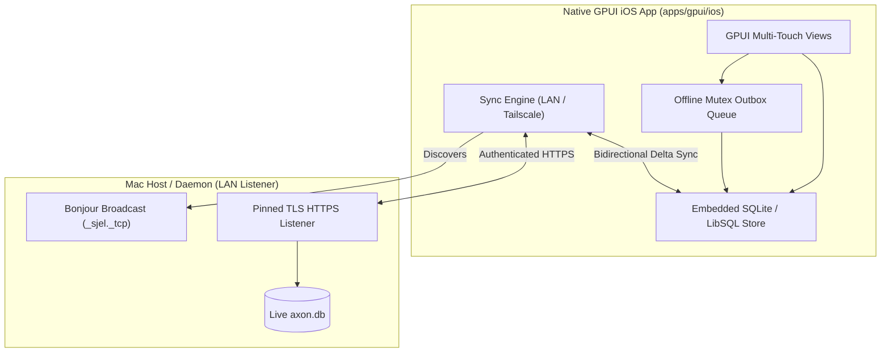

# GPUI Migration & UI/UX Evolution Plan

> **Strategic Mandate (2026-10-22)**: The SvelteKit + Tauri dashboard (`dashboard/`) is the secondary consumer and is retiring. The native GPUI client ([`apps/gpui`](README.md)) is the primary, universal application across macOS desktop, iOS mobile, and future Linux/Windows targets.
> All business rules, data schemas, and network adapters live in shared crates ([`apps/gpui/core`](core/README.md) and [`apps/gpui/ui`](ui/README.md)).

---

## 1. Executive Status Matrix (All 25 Dashboard Routes)

| # | Route | Page / Destination | Status | Desktop Client | iOS Mobile Client | Capability / Source |
|---|---|---|---|---|---|---|
| 1 | `/` | Home (Command Center) | **Ported** | Native GPUI (`Home` + `ContextPage`) | In progress | Sjel Shell / Core |
| 2 | `/context` | Today (Timeline & Focus) | **Ported** (`/` and `/context` are one page) | Native GPUI (`Home` + `ContextPage`) | Planned Tab | `capabilities/context` |
| 3 | `/calendar` | Calendar (Week/Month) | **Ported** | Native GPUI (`CalendarPage`) | Planned Tab | `capabilities/calendar` |
| 4 | `/projects` | Projects, Tasks & Notes | **Ported** | Native GPUI (`Projects`) | Native GPUI Tab | `capabilities/projects` |
| 5 | `/documents` | Documents & PDF Reader | **Ported** | Native GPUI (`Documents`) | Planned Reader | `capabilities/documents` |
| 6 | `/inbox` | Capture Inbox & Triage | **Partially Ported** | Native GPUI (`Inbox`) | Planned Tab | `capabilities/comms` |
| 7 | `/feed` | Comms Feed & Mail Triage | **Partially Ported** | Native GPUI (`Feed`, `Mail`) | Planned | `capabilities/comms` |
| 8 | `/travel` | Trip Planner & Itinerary | **Partially Ported** | Native GPUI (`Travel`) | Native GPUI Tab | `capabilities/travel` |
| 9 | `/map` | Interactive Travel Map | **Partially Ported** | Native GPUI (`Travel::Map`) | Native GPUI Map | `capabilities/travel` |
| 10 | `/finance` | Financial Ledger & Subs | **Ported** | Native GPUI (`FinancePage`) | Planned | `capabilities/finance` |
| 11 | `/inventory` | Household Assets | **Ported** | Native GPUI (`InventoryPage`) | Planned | `capabilities/inventory` |
| 12 | `/wishlist` | Wishlist & Budgeting | **Ported** (Tab) | Native GPUI (`InventoryPage`) | Planned | `capabilities/inventory` |
| 13 | `/interior` | Spatial Layouts & Rooms | **Ported** (Tab) | Native GPUI (`InventoryPage`) | Needs RoomPlan | `capabilities/inventory` |
| 14 | `/people` | People & Contacts CRM | **Ported** | Native GPUI (`PeoplePage`) | Planned | `capabilities/people` |
| 15 | `/software` | App Manager & Decisions | **Ported** | Native GPUI (`Software`) | Desktop Only | `capabilities/software` |
| 16 | `/backup` | Backup Deep Inspection | **Ported** | Native GPUI (`BackupPage`) | Status Only | `capabilities/backup` |
| 17 | `/capabilities`| Capability Manager | **Ported** | Native GPUI (`Capabilities`) | Status Only | Sjel Shell / Daemon |
| 18 | `/settings` | Settings & Shortcuts | **Ported** | Native GPUI (`Settings`) | Native Tab | Local GPUI State |
| 19 | `/systems` | Systems & Host Telemetry | **Ported** | Native GPUI (`SystemsPage`) | N/A | `capabilities/sjel-status`, `macmon` |
| 20 | `/packs` | Packs & Harness Sync | **Ported** | Native GPUI (`PacksPage`) | N/A | `tools/harnesses` |
| 21 | `/self` | Self-Model & Knowledge | **Ported** | Native GPUI (`SelfPage`) | N/A | `self.json` / `graphify` |
| 22 | `/cv` | CV Builder & Applications| **Ported** | Native GPUI (`CvPage`) | N/A | `Packs/cv` / `cv` CLI |
| 23 | `/media` | Media Ingest Ledger | **Ported** | Native GPUI (`MediaPage`) | N/A | `capabilities/media` |
| 24 | `/research` | Local Models & Evals | **Ported** | Native GPUI (`ResearchPage`)| N/A | `research/`, `upstreams.toml`, `systems.toml` |
| 25 | `/setup` | Node Setup & QR Pairing | **Ported** | Native GPUI (`SetupPage`) | Native Scanner | `capabilities/devices`, `capabilities/sjel-status` |

---

## 2. In-Progress & Next Work Packages for Agent Sessions

### ✅ Work Package 0: Systems & Host Telemetry (`/systems`)
- **Status**: Ported (2026-10-23).
- **Shipped**: `apps/gpui/core/src/systems.rs` (payloads and the pure reductions: storage ordering and
  units, the update grouping and apply summary, the trend bars, dated absences, the runtime profile
  line) and `apps/gpui/src/systems.rs` (the page). Six panels, one per owner: macmon's live sample on
  a 3 s clock with a Start button while it is stopped, the runtime profile (selection and On-the-go
  exceptions), the agent's reach (per-capability mode, pending approvals, latest calls), storage
  with the disk's hourly history, updates with one apply button per class, and the hourly host
  watch. `⌘9 › Systems` or `g x`.
- **Not here**: `/api/top-processes` is a Vite dev-server middleware and has no owner on this side,
  so the largest-RAM-users popover stays on the web page until something serves it.

### ✅ Work Package 1: Packs & Harness Deployments (`/packs`)
- **Status**: Ported (2026-10-23).
- **Shipped**: `apps/gpui/core/src/packs.rs` (data models, wire payloads, matrix rows calculation, attention detection, and RPC helpers) and `apps/gpui/src/packs_view.rs` (`PacksPage` with harness summary cards, orphan status alerts, interactive skill-by-harness matrix grid with deploy/sync cell buttons, stray inspections, and filtering). Wired into `route.rs` as `Page::Packs` (`/packs`, `g p`).

### ✅ Work Package 2: Self-Model & Knowledge Architecture (`/self`)
- **Status**: Ported (2026-10-23).
- **Shipped**: `apps/gpui/core/src/self_model.rs` (data models for `self.json` and `/api/sjel-status/self`, coupling degree calculation, isolated unit reductions, and live capability mapping) and `apps/gpui/src/self_view.rs` (`SelfPage` with stats summary, architectural unit cards, liveness dots, interactive inspector for incoming/outgoing compile-time couplings and runtime dependencies, and service start/stop/restart lifecycle controls). Wired into `route.rs` as `Page::SelfModel` (`/self`, `g l`).

### ✅ Work Package 3: CV & Career Applications Ledger (`/cv`)
- **Status**: Ported (2026-10-23).
- **Shipped**: `apps/gpui/core/src/cv.rs` (data models for `master_cv.yaml`, applications, logs, built PDFs staleness, slug generation, filtering, and shell RPC methods `cv()` and `write_cv()`) and `apps/gpui/src/cv_view.rs` (`CvPage` with master info header, profile switcher, language toggles, PDF staleness badge, one-click PDF builds, LinkedIn pull/diff/paste-sheet actions, full applications ledger table with quick status transitions, app build triggers, and live capture form). Wired into `route.rs` as `Page::Cv` (`/cv`, `g y`).

### ✅ Work Package 4: Media Ingest Ledger (`/media`)
- **Status**: Ported (2026-10-23).
- **Shipped**: `apps/gpui/core/src/media.rs` (data models for `MediaStatus`, `MediaVolume`, `MediaIngestRun`, `MediaIngestItem`, `MediaIngestDetail`, byte formatting, leaf run labels, attention sorting, and shell RPC methods `media_status()`, `media_ingests()`, `media_ingest()`, `media_view()`) and `apps/gpui/src/media_view.rs` (`MediaPage` with index totals header, mounted volume breakdown table, recent ingest runs list with status tallies, and full run inspector with disposition filter tabs and item status badges). Wired into `route.rs` as `Page::Media` (`/media`, `g w`).

### ✅ Work Package 5: Research & Local Decision Models (`/research`)
- **Status**: Ported (2026-10-23).
- **Shipped**: `apps/gpui/core/src/research.rs` (data models for `UpstreamRow`, `SystemRow`, `ProjectGroup`, `BenchmarkCase`, `BenchmarkResult`, `BenchmarkRun`, `BenchmarkSuite`, `ResearchArticle`, `ResearchView`, pure single-line TOML parser, upstream and suite grouping, and embedded fallback research view) and `apps/gpui/src/research_view.rs` (`ResearchPage` with 3 core tabs: Articles reader with full markdown document rendering, Projects register with search filter, "Runs alongside" systems table, upstreams grouped by verdict, "Add project to watch" live form backed by `watch_upstream()`, and Benchmarks suites evaluation tables with model latency/accuracy and per-case pass/fail breakdown matrix). Wired into `route.rs` as `Page::Research` (`/research`, `g z`).

### ✅ Work Package 6: Node Setup & Device Pairing (`/setup`)
- **Status**: Ported (2026-10-23). Both ends: the Mac draws the code, the iPhone reads it.
- **Shipped**: `apps/gpui/core/src/setup.rs` (the setup plans and their probes, the listener, the
  one-time challenge, the `sjel-pair/1` payload, the QR matrix, and the pure reductions: the
  verification merge, the step count, the active/revoked partition, the waiting joins, the
  countdown and the short pin) and `apps/gpui/src/setup_view.rs` (`SetupPage` with two tabs:
  **Machine Setup** — probes, plan steps, and one apply form whose credential is piped to the
  tool's stdin and then dropped, never shown again; **Devices** — the Same-Wi-Fi listener, a
  single-use code drawn as a QR `canvas` plus its copyable payload, join requests with the key code
  both screens show, the trusted keys with certificate, trust and last-seen dates, and a two-press
  revoke). Wired into `route.rs` as `Page::Setup` (`/setup`, `g 0`).
- **Phone**: `apps/gpui/ios/host/PairScanner.swift` presents `AVCaptureMetadataOutput` and hands
  the text to `sjel_ios_scanned_pairing`, which makes the same claim the `SJEL_PAIR` launch path
  makes. `UITests/ScanTap.swift` proves a finger reaches it (`ios/run-sim --tap`).
- **Not here**: revoking this device from the phone, and the phone's own copy of the device list.
- **Data Source**: `capabilities/devices`, `capabilities/sjel-status`
- **Target Files**:
  - `apps/gpui/core/src/setup.rs`
  - `apps/gpui/src/setup_view.rs`

---

## 3. Next, before everything below (operator, 2026-10-23)

These come before the roadmap in section 4. The roadmap resumes when they are done.

1. **Ask and Search are one panel, as an overlay.** One input takes a search or a prompt. A mode
   switch offers *Auto*, *Ask* and *Search*; Auto decides from the text, and the panel shows which
   way it went so one keystroke can flip it. ⌘2 (Ask) and ⌘K both reach it.
   - Decided 2026-10-23: **overlay only for now**, in the ⌘K position. The docked right sidebar
     comes with item 2, not before.
   - Decided 2026-10-23: **Search is local and server, streamed.** Local results show at once:
     pages, destinations, and the rows the app already loads (tasks, notes, people, documents,
     inventory, finance). Server results append as they arrive, from a new shell `/api/search`
     that fans out to the capabilities. Today the shell has no cross-capability search (only
     transit's and interior's own `/api/search`), and the app holds no local index.
   - Done 2026-10-23, local stage: `core/src/search.rs` (the Auto rule, the ranking) and
     `src/finder.rs` (the overlay on ⌘K, which replaces the command palette and keeps its pages,
     actions and dashboard destinations as results). Projects, open tasks and notes come from the
     Mac's database. A question streams in place through the shared `Ask` session.
   - Next: the shell's `/api/search`, appended below the local results.
2. **The right sidebar is where Sjel works in view.** A docked panel beside the page is the seat
   of the later adaptive UI, driven by what Sjel is doing: while it runs a task, the operator sees
   it search, open a page and change a value, live, instead of receiving only the result. Build
   the overlay from item 1 so the same view can dock here later, and so a stream of agent steps
   (the Ask turn's tool activity today) can drive navigation in the main column. The soundscape
   panel also slides in from the right edge; how the two share it is decided when this is built.
3. **Soundscape, what the 2026-10-23 pass left.** The phone has no player:
   `core/src/soundscape` is platform-free, so the iOS app needs an output device and a panel, not
   a second engine. The panel's own open state and the mixer disclosure are not kept across
   launches; nothing in the panel persists locally today.

---

## 4. High-Priority UI/UX Improvements Roadmap

A substantial amount of UI/UX craftsmanship is needed to make the native app feel truly tactile, intuitive, and cohesive.

### 🚗 Travel & Map (`/travel`, `/map`) UX Overhaul (Highest Priority)
The current Travel page is functionally capable of reading trips and drawing OpenStreetMap/MapLibre tiles, but the experience is rigid and lacks critical operator workflows:

1. **Native Trip Creation & Booking Authoring**:
   - *Current issue*: You cannot create a trip or add/edit a booking in GPUI; it redirects you to the web dashboard.
   - *Fix*: Add in-app modals:
     - `Create Trip`: Title, primary destination, start date, end date, tag.
     - `Add/Edit Booking`: Transport/hotel/activity type, confirmation code, carrier/provider, check-in/out times, attachment/link.
     - `Add Stage`: Origin, destination, departure/arrival timestamps, seat/cabin assignment.

2. **Unified Visual Itinerary & Timeline**:
   - *Current issue*: Itinerary is currently a plain text list separated from details.
   - *Fix*: Replace with a chronological timeline:
     - Day cards (Day 1: Oct 24, Day 2: Oct 25...).
     - Transport mode icons with color-coded transit pills (✈️ Flight, 🚆 Train / DB ICE, 🏨 Stay, 🚶 Walk, 🚗 Drive).
     - Visual connector lines between sequential stages with layover/connection duration badges.
     - Direct confirmation code copy button (`⌘C` to copy booking PNR).

3. **Interactive Map Polish (`ui/src/travel/map.rs`)**:
   - *Current issue*: Markers are simple numbers; tapping a marker does not pop up a card; stage lines are thin, direct straight lines.
   - *Fix*:
     - Stop pins with categorical glyphs (hotel bed, airport, fork/knife, camera).
     - Tap-to-inspect card: floating bottom sheet or sidebar flyout showing stop name, address, arrival date, and direct action to "Show in Apple Maps" or "Get Directions".
     - Stage curved geodesic paths connecting itinerary stops.
     - Auto-zoom "Fit Entire Trip" button with smooth camera easing.

4. **Live Fare Alerts & Sparpreis Lows**:
   - *Current issue*: Travel fare alerts (from `dashboard/src/lib/travel/fare-alerts.ts`) have no visual home in GPUI.
   - *Fix*: Add a "Fare Alerts" badge strip at the top of an upcoming trip showing price drop notifications, monitored DB train routes, and current lowest ticket price.

5. **Offline Readiness & Cache Health**:
   - *Current issue*: It is unclear whether a trip and its map tiles are cached before getting on an airplane.
   - *Fix*: Display an "Offline Ready" green check badge per trip, indicating:
     - All itinerary items & booking PDFs are saved in local store.
     - Map tiles for the trip bounds (zoom levels 10–15) are pre-fetched and stored on disk.

---

### 📄 Documents & PDF Reader (`/documents`) UI/UX
- **Server-Side Cursor Pagination**: Replace the 7,154-row full JSON payload fetch with chunked `cursor` paging (`/api/documents?cursor=...&limit=100`) so the view mounts instantly without network lag.
- **Multi-Page Reader Thumbnail Strip**: Add an expandable left-hand thumbnail rail to jump directly between pages of multi-page PDFs.
- **PDF Text Search**: Highlight matched query strings directly on the rendered PDF canvas.
- **Drag-and-Drop Ingest**: Allow dragging a PDF directly from macOS Finder into the GPUI window to trigger the import pipeline.

### 📅 Calendar (`/calendar`) UI/UX
- **Time-Slot Grid View**: Supplement the current day list with a 24-hour vertical timeline view (with current time indicator red bar).
- **Drag-to-Reschedule**: Keyboard shortcuts or drag interaction to shift an event by +/- 15 or 30 minutes.
- **Two-Way Sync Status Pill**: Clear indicator of Google / iCloud calendar sync recency and error states.

### 💰 Finance (`/finance`) UI/UX
- **Monthly Burn Visual Chart**: Add a lightweight sparkline/bar chart using GPUI canvas primitives for 6-month spending vs. income trends.
- **Inline Transaction Categorization**: Clicking a transaction's category opens a fast keyboard-navigable category picker (`F` or `Enter`) to reclassify on the fly.

### 👥 People (`/people`) UI/UX
- **Quick-Edit Drawer**: Edit contact notes, phone, email, and company directly without leaving GPUI.
- **Interaction History**: Display notes where this person was mentioned with timestamps.

### 📦 Inventory & Interior (`/inventory`) UI/UX
- **Wishlist Addition Modal**: Fast capture modal to add items with price range, target dimensions, and priority.
- **Interior Layout Viewer**: Interactive 2D floorplan canvas showing occupied room layout zones.

---

## 5. Mobile (iOS Standalone) Convergence Plan

The previous iOS client was wrapped via Tauri ([`dashboard/src-tauri`](../../dashboard/src-tauri)). The target is a 100% native GPUI client on iOS ([`apps/gpui/ios`](ios/README.md)):



1. **Expanding iOS Tab Navigation**:
   - Current tabs: `Projects`, `Travel`, `Settings`.
   - Add tabs:
     - `Today`: Daily context timeline, focus tasks with large tap target checkboxes.
     - `Inbox`: Fast mobile capture field with tag selector (`#buy`, `#look`, `#go`, `#learn`).
     - `Calendar`: Mobile-friendly day view.

2. **Autonomous Offline Store**:
   - Bundle `rusqlite` / `libsql` directly inside the iOS app sandbox.
   - When offline, all reads hit the local SQLite cache.
   - All mobile writes (task completed, capture added, note edited) write to the local store and enqueue a row in the `outbox` table.
   - When `host/Discovery.swift` detects the Mac host on LAN or Tailscale, `sjel_gpui_core::sync` flushes the outbox and pulls down remote changes.

3. **Porting Tauri Native iOS Plugins to Swift / UIKit Bridges**:
   - **Apple RoomPlan LiDAR** (`plugins/roomplan`): Bridge `RoomCaptureView` in Swift to stream room dimensions and walls into GPUI interior layouts.
   - ~~**QR Code Scanner** (`tauri-plugin-barcode-scanner`)~~: shipped in Work Package 6
     (`apps/gpui/ios/host/PairScanner.swift`, `AVCaptureMetadataOutput`).
   - **Local Push Notifications** (`tauri-plugin-notification`): Use `UNUserNotificationCenter` for Sparpreis fare drops and calendar alarms without remote push servers.

---

## 6. Session Collaboration Guidelines

When picking up a work package:
1. **Never touch or stage files under `capabilities/documents/src/`** (reserved for active document classifier session).
2. **Always run unit tests before and after changes**:
   ```sh
   cargo test --manifest-path apps/gpui/core/Cargo.toml
   cargo test --manifest-path apps/gpui/Cargo.toml
   ```
3. **Deploy and verify desktop builds locally**:
   ```sh
   apps/gpui/install
   ```
4. **Follow `attention-control` doctrine**:
   Keep UI clean, low-clutter, fast, keyboard-first, with zero generic AI purple gradient aesthetics.
