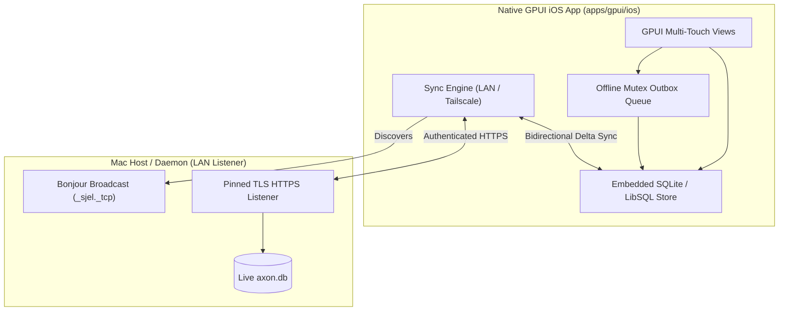

# GPUI Migration & UI/UX Evolution Plan

> **Strategic Mandate (2026-10-22)**: The SvelteKit + Tauri dashboard (`dashboard/`) is the secondary consumer and is retiring. The native GPUI client ([`apps/gpui`](README.md)) is the primary, universal application across macOS desktop, iOS mobile, and future Linux/Windows targets.
> All business rules, data schemas, and network adapters live in shared crates ([`apps/gpui/core`](core/README.md) and [`apps/gpui/ui`](ui/README.md)).

---

## 1. Executive Status Matrix (All 25 Dashboard Routes)

| # | Route | Page / Destination | Status | Desktop Client | iOS Mobile Client | Capability / Source |
|---|---|---|---|---|---|---|
| 1 | `/` | Home (Command Center) | **Ported** | Native GPUI (`Home` + `ContextPage`) | Native GPUI Tab (`Today`, below) | Sjel Shell / Core |
| 2 | `/context` | Today (Timeline & Focus) | **Ported** (`/` and `/context` are one page) | Native GPUI (`Home` + `ContextPage`) | Native GPUI Tab (`Today`: the day off the copy, the tasks and projects off the replica) | `capabilities/context`, `capabilities/projects` |
| 3 | `/calendar` | Calendar (Week/Month) | **Ported** | Native GPUI (`CalendarPage`) | Native GPUI Tab (the replica, writes included; the Mac's copy until the first pull) | `capabilities/calendar` |
| 4 | `/projects` | Projects, Tasks & Notes | **Ported** | Native GPUI (`Projects`) | Native GPUI Tab | `capabilities/projects` |
| 5 | `/documents` | Documents & PDF Reader | **Ported** | Native GPUI (`Documents`) | Planned Reader | `capabilities/documents` |
| 6 | `/inbox` | Capture Inbox & Triage | **Partially Ported** | Native GPUI (`Inbox`) | Native GPUI Tab (capture only: triage stays on the Mac) | `capabilities/comms` |
| 7 | `/feed` | Comms Feed & Mail Triage | **Partially Ported** | Native GPUI (`Feed`, `Mail`) | Planned | `capabilities/comms` |
| 8 | `/travel` | Trip Planner & Itinerary | **Partially Ported** | Native GPUI (`Travel`) | Native GPUI Tab | `capabilities/travel` |
| 9 | `/map` | Interactive Travel Map | **Partially Ported** | Native GPUI (`Travel::Map`) | Native GPUI Map | `capabilities/travel` |
| 10 | `/finance` | Financial Ledger & Subs | **Ported** | Native GPUI (`FinancePage`) | Planned | `capabilities/finance` |
| 11 | `/inventory` | Household Assets | **Ported** | Native GPUI (`InventoryPage`) | Planned | `capabilities/inventory` |
| 12 | `/wishlist` | Wishlist & Budgeting | **Ported** (Tab) | Native GPUI (`InventoryPage`) | Planned | `capabilities/inventory` |
| 13 | `/interior` | Spatial Layouts & Rooms | **Ported** (Tab) | Native GPUI (`InventoryPage`) | Needs RoomPlan | `capabilities/inventory` |
| 14 | `/people` | People & Contacts CRM | **Ported** | Native GPUI (`PeoplePage`) | Native GPUI Tab (`People` \| `Places`, off the copy) | `capabilities/people-registry`, `capabilities/entities`, `capabilities/places` |
| 15 | `/software` | App Manager & Decisions | **Ported** | Native GPUI (`Software`) | Desktop Only | `capabilities/software` |
| 16 | `/backup` | Backup Deep Inspection | **Ported** | Native GPUI (`BackupPage`) | Status Only | `capabilities/backup` |
| 17 | `/capabilities`| Capability Manager | **Ported** | Native GPUI (`Capabilities`) | Status Only | Sjel Shell / Daemon |
| 18 | `/settings` | Settings & Shortcuts | **Ported** | Native GPUI (`Settings`) | Native Tab | Local GPUI State |
| 19 | `/systems` | Systems & Host Telemetry | **Ported** | Native GPUI (`SystemsPage`) | N/A | `capabilities/sjel-status`, `macmon` |
| 20 | `/packs` | Packs & Harness Sync | **Ported** | Native GPUI (`PacksPage`) | N/A | `tools/harnesses` |
| 21 | `/self` | Self-Model & Knowledge | **Ported** | Native GPUI (`SelfPage`) | N/A | `self.json` / `graphify` |
| 22 | `/cv` | CV Builder & Applications| **Ported** | Native GPUI (`CvPage`) | N/A | `cv` CLI |
| 23 | `/media` | Media Ingest Ledger | **Ported** | Native GPUI (`MediaPage`) | N/A | `capabilities/media` |
| 24 | `/research` | Local Models & Evals | **Ported** | Native GPUI (`ResearchPage`)| N/A | `research/`, `upstreams.toml`, `systems.toml` |
| 25 | `/setup` | Node Setup & QR Pairing | **Ported** | Native GPUI (`SetupPage`) | Native Scanner | `capabilities/devices`, `capabilities/sjel-status` |

---

## 2. In-Progress & Next Work Packages for Agent Sessions

### ✅ Work Package 0: Systems & Host Telemetry (`/systems`)
- **Status**: Ported (2026-10-23).
- **Shipped**: `apps/gpui/core/src/systems.rs` (payloads and the pure reductions: storage ordering and
  units, the update grouping and apply summary, the trend bars, dated absences, the runtime profile
  line) and `apps/gpui/src/systems.rs` (the page). Six panels, one per owner: macmon's live sample on
  a 3 s clock with a Start button while it is stopped, the runtime profile (selection and On-the-go
  exceptions), the agent's reach (per-capability mode, pending approvals, latest calls), storage
  with the disk's hourly history, updates with one apply button per class, and the hourly host
  watch. `⌘9 › Systems` or `g x`.
- **Not here**: `/api/top-processes` is a Vite dev-server middleware and has no owner on this side,
  so the largest-RAM-users popover stays on the web page until something serves it.

### ✅ Work Package 1: Packs & Harness Deployments (`/packs`)
- **Status**: Ported (2026-10-23).
- **Shipped**: `apps/gpui/core/src/packs.rs` (data models, wire payloads, matrix rows calculation, attention detection, and RPC helpers) and `apps/gpui/src/packs_view.rs` (`PacksPage` with harness summary cards, orphan status alerts, interactive skill-by-harness matrix grid with deploy/sync cell buttons, stray inspections, and filtering). Wired into `route.rs` as `Page::Packs` (`/packs`, `g p`).

### ✅ Work Package 2: Self-Model & Knowledge Architecture (`/self`)
- **Status**: Ported (2026-10-23).
- **Shipped**: `apps/gpui/core/src/self_model.rs` (data models for `self.json` and `/api/sjel-status/self`, coupling degree calculation, isolated unit reductions, and live capability mapping) and `apps/gpui/src/self_view.rs` (`SelfPage` with stats summary, architectural unit cards, liveness dots, interactive inspector for incoming/outgoing compile-time couplings and runtime dependencies, and service start/stop/restart lifecycle controls). Wired into `route.rs` as `Page::SelfModel` (`/self`, `g l`).

### ✅ Work Package 3: CV & Career Applications Ledger (`/cv`)
- **Status**: Ported (2026-10-23).
- **Shipped**: `apps/gpui/core/src/cv.rs` (data models for `master_cv.yaml`, applications, logs, built PDFs staleness, slug generation, filtering, and shell RPC methods `cv()` and `write_cv()`) and `apps/gpui/src/cv_view.rs` (`CvPage` with master info header, profile switcher, language toggles, PDF staleness badge, one-click PDF builds, LinkedIn pull/diff/paste-sheet actions, full applications ledger table with quick status transitions, app build triggers, and live capture form). Wired into `route.rs` as `Page::Cv` (`/cv`, `g y`).

### ✅ Work Package 4: Media Ingest Ledger (`/media`)
- **Status**: Ported (2026-10-23).
- **Shipped**: `apps/gpui/core/src/media.rs` (data models for `MediaStatus`, `MediaVolume`, `MediaIngestRun`, `MediaIngestItem`, `MediaIngestDetail`, byte formatting, leaf run labels, attention sorting, and shell RPC methods `media_status()`, `media_ingests()`, `media_ingest()`, `media_view()`) and `apps/gpui/src/media_view.rs` (`MediaPage` with index totals header, mounted volume breakdown table, recent ingest runs list with status tallies, and full run inspector with disposition filter tabs and item status badges). Wired into `route.rs` as `Page::Media` (`/media`, `g w`).

### ✅ Work Package 5: Research & Local Decision Models (`/research`)
- **Status**: Ported (2026-10-23).
- **Shipped**: `apps/gpui/core/src/research.rs` (data models for `UpstreamRow`, `SystemRow`, `ProjectGroup`, `BenchmarkCase`, `BenchmarkResult`, `BenchmarkRun`, `BenchmarkSuite`, `ResearchArticle`, `ResearchView`, pure single-line TOML parser, upstream and suite grouping, and embedded fallback research view) and `apps/gpui/src/research_view.rs` (`ResearchPage` with 3 core tabs: Articles reader with full markdown document rendering, Projects register with search filter, "Runs alongside" systems table, upstreams grouped by verdict, "Add project to watch" live form backed by `watch_upstream()`, and Benchmarks suites evaluation tables with model latency/accuracy and per-case pass/fail breakdown matrix). Wired into `route.rs` as `Page::Research` (`/research`, `g z`).

### ✅ Work Package 6: Node Setup & Device Pairing (`/setup`)
- **Status**: Ported (2026-10-23). Both ends: the Mac draws the code, the iPhone reads it.
- **Shipped**: `apps/gpui/core/src/setup.rs` (the setup plans and their probes, the listener, the
  one-time challenge, the `sjel-pair/1` payload, the QR matrix, and the pure reductions: the
  verification merge, the step count, the active/revoked partition, the waiting joins, the
  countdown and the short pin) and `apps/gpui/src/setup_view.rs` (`SetupPage` with two tabs:
  **Machine Setup** — probes, plan steps, and one apply form whose credential is piped to the
  tool's stdin and then dropped, never shown again; **Devices** — the Same-Wi-Fi listener, a
  single-use code drawn as a QR `canvas` plus its copyable payload, join requests with the key code
  both screens show, the trusted keys with certificate, trust and last-seen dates, and a two-press
  revoke). Wired into `route.rs` as `Page::Setup` (`/setup`, `g 0`).
- **Phone**: `apps/gpui/ios/host/PairScanner.swift` presents `AVCaptureMetadataOutput` and hands
  the text to `sjel_ios_scanned_pairing`, which makes the same claim the `SJEL_PAIR` launch path
  makes. `UITests/ScanTap.swift` proves a finger reaches it (`ios/run-sim --tap`).
- **Not here**: revoking this device from the phone, and the phone's own copy of the device list.
- **Data Source**: `capabilities/devices`, `capabilities/sjel-status`
- **Target Files**:
  - `apps/gpui/core/src/setup.rs`
  - `apps/gpui/src/setup_view.rs`

### ✅ Work Package 7: the phone's Calendar tab, off the Mac's read-only copy
- **Status**: Native iOS tab (2026-10-23). Shipped to TestFlight as build 1363. Read-only when it
  shipped; it has written the replica since Work Package 8, so read this package for how the copy
  is fetched, not for what the tab does now.
- **Shipped**: `apps/gpui/core/src/mirror.rs` (the manifest, the digest- and byte-checked fetch that
  stages and renames into place, the rebuild request, and the day read; 8 tests against a fake Mac
  and a real SQLite copy) and `apps/gpui/ui/src/calendar.rs` (one day, seven day chips with a dot on
  every day an entry covers, entry rows at `Density::Mobile`, the copy's built-at line, and a
  Refresh that asks the host rather than reaching the network itself). `apps/gpui/ios/src/lib.rs`
  carries the third tab, opens the copy on disk at launch, and fetches a newer one when the pairing
  answers or Refresh is tapped.
- **Why the copy and not the replica**: the copy is one file the Mac builds atomically and serves
  with a digest, so two more table sets cost the Mac nothing and the phone one fetch. It is
  read-only by intent; writes stay in the replica, which covers projects.
- **Data Source**: `sjel mirror build`, `GET /api/sjel-status/mirror` (+ `/rebuild`)
- **Target Files**:
  - `apps/gpui/core/src/mirror.rs`
  - `apps/gpui/ui/src/calendar.rs`
  - `apps/gpui/ios/src/lib.rs`
- **Next**: People and Places are a page away, because `places_*` and `entities_*` are already in
  the phone's table set. The pages that write need the replica's second domain, which is the same
  shape as `core/src/sync.rs` per capability.
  *(Shipped in Work Package 9; the tables the page needed, `entities_values` and `places_people`,
  were not in the set yet and were added there.)*
### ✅ Work Package 8: the calendar joins the replica, and the phone's tab writes
- **Status**: Shipped (2026-10-23). The tab reads and writes the replica; the Mac's copy is the
  fallback until the first pull.
- **Shipped**:
  - `apps/gpui/core/src/store.rs` — the replica's second domain: a `calendar_entries` table, a
    `_replica_meta` cursor per domain, and a `domain` column on `_offline_mutations` with the
    migration that defaults an old log to `projects`.
  - `apps/gpui/core/src/sync.rs` — `push` per domain (one refused calendar write cannot hold up a
    note), `calendar_save` (a phone-minted id creates, anything else changes, and a 404 re-creates
    rather than losing the edit), `calendar_delete`, and `pull_calendar`: a change feed read from a
    cursor, tombstones applied, an id with an unsent write skipped, and the cursor moved only after
    everything in the answer has been applied.
  - `apps/gpui/core/src/data/repo.rs` — `Repo::fetch_calendar` answers from the replica with the
    full entry (id, kind, place, notes, source), plus `save_calendar_entry`,
    `delete_calendar_entry`, and `has_calendar`.
  - `apps/gpui/core/src/calendar.rs` — `Draft::entry`, so the Mac's form body and the phone's replica
    write agree about what a field means.
  - `apps/gpui/ui/src/calendar.rs` — two sources, one page: the store answers once
    `Repo::has_calendar` is true, the Mac's copy until then, and the title line says which one drew
    the day. The **New** form (title, all-day or 09:00–10:00, commitment) writes one entry on the
    open day; a row's **⋯** asks, and a second tap deletes. Both are absent over a copy.
  - `apps/gpui/ios/src/lib.rs` — hands the page the replica `Repo` when the store opens, reloads it
    after every sync, and treats **Refresh** as a sync when there is a store.
- **Why writes are thin on purpose**: a timed entry made here is 09:00–10:00 on the open day and is
  corrected on the Mac, which has the room for a time picker. Guessing hours on a phone is worse
  than two taps on a keyboard.
- **Tests**: 14 new (6 in `sync.rs`, 1 in `store.rs`, 5 in `data/repo.rs`, 1 in `calendar.rs`, 1 in
  `ui/src/calendar.rs`); `cargo test -p sjel-gpui-core -p sjel-gpui-ui` is 248 + 30, all green.
- **Target Files**:
  - `apps/gpui/core/src/{store,sync,calendar}.rs`
  - `apps/gpui/core/src/data/repo.rs`
  - `apps/gpui/ui/src/calendar.rs`
  - `apps/gpui/ios/src/lib.rs`
- **Next**: the same shape per capability. Each remaining table set needs a feed and a table before
  its page can leave the copy, and the copy's table set shrinks as they move.

### ✅ Work Package 9: People and Places off the copy
- **Status**: Shipped (2026-10-23). One new tab, two registers, read-only over the Mac's copy.
- **Shipped**:
  - `tools/sjel-cli/src/mirror.rs` — the phone set gains `entities_values` (612 rows: phones,
    emails, birthday, last_contact, company, relation) and `places_people` (the operator's decision
    for a person's name), because a copy without them drew 294 names and no contact card.
  - `apps/gpui/core/src/people.rs` — `Person::from_record` now accepts the keys the registry
    actually writes. `capabilities/entities/src/google.rs` writes `emails` and `phones` (plural,
    array of strings) while the parser looked for `email` and `phone`, so **every** contact card
    was missing its email and phone, on the Mac too (`apps/gpui/src/people_view.rs`). Fixed in the
    shared core, so both clients gained the rows.
  - `apps/gpui/core/src/places.rs` (new) — `Place`, `PersonLink`, `places_of`, `people_at`,
    `filter_places`, and the `name_key` join (re-used from `libs/links`, not copied). A dismissed
    link is not a link.
  - `apps/gpui/core/src/mirror.rs` — `Mirror::people` answers all three tables in one read
    (`PeopleCopy`), a left join so a person with no values is still a row, values parsed out of the
    JSON text the registry stores, and empty lists rather than an error on a copy that predates them.
  - `apps/gpui/ui/src/people.rs` (new) — one tab with a `People` | `Places` switch, one search field
    for both sides, initials rows at `Density::Mobile`, a contact card (email, phone, custom fields,
    the linked places) and a place card (kind, where, coordinates, the names linked to it), with the
    source line naming the copy and a Refresh that asks the host for a newer one.
  - `apps/gpui/ios/src/lib.rs` — `Tab::People`, `SJEL_TAB=people`, and the same copy the Calendar
    tab reads: one fetch feeds both. `SJEL_REGISTER=places` and `SJEL_PERSON=Ada` open the other
    register and a card at launch, for the screenshots `run-sim` takes.
- **Verified on a simulator** (`ios/run-sim`, seeded with the built copy): the People list (294
  names, 11 with a company line), a person's card (both phone numbers, the birthday as a custom
  row, "no places linked"), the Places list grouped by kind (253 rows) and a place's card (kind,
  `Amsterdam, NL`, coordinates). Three defects found and fixed there: the card's back link sat
  below the content where a long card would push it off screen (it is now at the top), the title
  said "Person" where the card already carried the name (it now stays `People`), and the
  `COORDINATES` label wrapped inside its column (`COORDS`, 92 px).
- **Why read-only**: `places_person_places` holds the operator's review and the registry's writes
  are `/api/people/decide`. A phone that cannot reach the Mac would offer controls that have to be
  refused, so it offers none.
- **Tests**: 7 new in core (1 `people`, 4 `places`, 2 `mirror`), 4 in `ui/src/people.rs`.
- **Target Files**:
  - `apps/gpui/core/src/{people,places,mirror}.rs`
  - `apps/gpui/ui/src/people.rs`
  - `apps/gpui/ios/src/lib.rs`
  - `tools/sjel-cli/src/mirror.rs`
- **Next**: the same shape per capability. Each remaining table set needs a feed and a table before
  its page can leave the copy, and the copy's table set shrinks as they move. The contact registry's
  writes (a note ref, a value, a link decision) are the replica's third domain when the tab stops
  being read-only.

### ✅ Work Package 10: Today lands, and the bar changes shape
- **Status**: Shipped (2026-10-24). `Today` is the page the phone opens on.
- **Why now**: `mobile_tab_bar` (`ui/src/nav.rs`) draws one row with `justify_around` and a 64 px
  floor per item, so five items need 320 px of the 375 pt of the narrowest current iPhone and a
  sixth needs 384. The bar was full, and `Today` plus `Inbox` could not both be added to it.
- **Decided 2026-10-24**: `Today` becomes the landing tab and `Projects` folds into it; the bar is
  `Today | Calendar | People | Travel`, `Settings` sits behind Today's gear with a `← Today` row of
  its own, and `Inbox` takes the fifth slot when it ships. `Travel` kept its slot because it is the
  one page with a full map and a phone is the device carried on the trip.
- **Shipped**:
  - `core/src/today.rs` (new) — the reduction, with no GPUI in it: the day's entries with the clock's
    marks (`Now`, and one `Next`; an all-day entry is never next because it is already under way), the
    open tasks ordered by the operator's priority then due date and capped at five with a count for
    the rest, and the projects those tasks are filed under with their progress. 12 tests.
  - `ui/src/today.rs` (new) — the page: the headline and one summary line, one line naming the source
    and its age, one line for what is queued and whether this launch is connected, then THE DAY, UP
    NEXT (a 44 pt checkbox per task, `Overdue` as a word rather than a colour) and PROJECTS with a
    progress bar and a row that opens the project. Ticking a task writes the replica optimistically
    and puts the row back if the write fails.
  - `apps/gpui/ios/src/lib.rs` — `Tab::Today` as the default, the four-item bar, `Tab::Projects` and
    `Tab::Settings` reached from Today, `SJEL_TAB=projects` kept, and `SJEL_DAY` freezing the landing
    page's day the way it freezes the calendar's.
  - `apps/gpui/ios/host/UITests/TodaySwipe.swift` (new) — drags the page up and attaches the frames:
    a screenshot cannot show that a finger scrolls a GPUI surface, and PROJECTS is below the fold.
- **A bug in shared core, found by the page**: `ProjectRecord` (`core/src/shell.rs`) dropped the
  capability's own `project` field, so `Board` could not tell which project a record was filed under
  and the first folder of the path is not the answer — the vault files `Archive/Soma/Tasks/Reopen.md`
  under `Soma`. 22 of the copy's 62 task rows would have been filed wrong, on the phone and in the
  sync's pull. The field travels now, the replica queries read the column, and `filed_under`
  (`core/src/sync.rs`) prefers it over the path.
- **Verified on a simulator** (`ios/run-sim`, replica seeded from the copy): the landing page on
  2026-10-24, one day earlier with `SJEL_DAY=2026-10-20` (one entry, `all day`), and after a drag the
  PROJECTS list, whose numbers were checked against the replica row by row — Soma 10 of 21,
  Washing Machine 1 of 8, Credential Stack 2 of 7, Hearth 4 of 8, Home-Lab 0 of 4, Life-Plan 4 of 8,
  in open-task order. Settings and Projects were screenshotted on their own tabs, and the Calendar
  tab still draws the copy it drew before.
- **Tests**: 12 new in core `today`, 1 in `sync`; 3 in `ui/src/today.rs`. core 268, ui 37, app 81.
- **Target Files**:
  - `apps/gpui/core/src/{today,shell,store,sync}.rs`
  - `apps/gpui/ui/src/today.rs`
  - `apps/gpui/ios/src/lib.rs`
  - `apps/gpui/ios/host/UITests/TodaySwipe.swift`
- **Next**: `Inbox` — the fifth slot, and the second write path — which cannot queue offline before
  #244's blocked-write recovery: a capture that cannot reach the Mac must keep its text, say why, and
  retry when discovery finds the host again.

### ✅ Work Package 11: the queue goes around a refused record (#244)
- **Status**: Shipped (2026-10-24). #244's acceptance checks are met.
- **Why**: `push` stopped at the first write the Mac refused, so one duplicate note title or one
  archived project held every later write in the queue, and no view named the record or the reason.
  A phone shown only a queue count that will not drain has nothing to act on.
- **Shipped**:
  - `core/src/sync.rs` — a refusal names its record ([`Refusal`]: path and the Mac's words), a
    refusal blocks that record and no other, and the queue keeps draining behind it. A queued row
    this build cannot parse is stepped over as a fault here rather than reported as the Mac's
    opinion. `Report::refused` carries them and `summary` says how many.
  - `core/src/store.rs` — `_sync_refusals`, one row per record, written when the Mac refuses and
    cleared when that record goes through, so the band outlives the launch that heard it and
    disappears when the problem does. A refusal is never a lost write: the record and its queued
    mutation stay exactly where they were.
  - `core/src/data/board.rs` — `Blocked { path, title, kind, reason }`, joined from the refusals and
    the replica's rows so a page can name the note rather than a path.
  - `ui/src/projects.rs` — the band above the project list: the count, each record with its kind,
    the Mac's reason in the Mac's words, "Saved here and still queued. Nothing was lost or renamed.",
    `Open` per record and one `Try again`. Nothing renames, deletes or edits a record to make a
    refusal go away: a duplicate title and an archived project are the operator's decision.
  - `apps/gpui/ios/src/lib.rs` — `ProjectsEvent::Retry` runs the sync the writes were queued for; a
    phone with no Mac says so instead of pressing a dead button.
- **Verified on a simulator**: two refusals seeded into the replica — one archived project, one
  duplicate title, the second with no record behind it — drew as two rows, the first with the note's
  own title, the second falling back to its path, and the header counting two.
- **Tests**: 3 new in `sync` (a duplicate title keeps its text, queued count and reason; an archived
  project is refused while the next write still goes; a refusal is cleared when the write lands) and
  1 in `ui/src/projects.rs` (the page holds what the sync reported and drops it when cleared).
  core 271, ui 38, app 81.
- **Target Files**:
  - `apps/gpui/core/src/{sync,store}.rs`
  - `apps/gpui/core/src/data/board.rs`
  - `apps/gpui/ui/src/projects.rs`
  - `apps/gpui/ios/src/lib.rs`
- **Next**: `Inbox` — the fifth slot and the second write path — which can now queue offline.

### ✅ Work Package 12: Inbox, the fifth slot
- **Status**: Shipped (2026-10-24). The bar is five items and `Today | Inbox | Calendar | People |
  Travel` is the shape `mobile_tab_bar` holds at its 64 px floor.
- **Why**: a phone is a capture device first (`research/offline-on-the-phone.md`), and it had no
  field for the thought in hand. It also had no second write path: only the calendar could write, so
  the outbox had one consumer.
- **Shipped**:
  - `core/src/capture.rs` — `Draft`, one typed line read the way the capability reads it: `#buy` in
    the text sets the tag (the chip wins over the hashtag, because the last thing touched is the one
    meant), a lone link becomes the URL rather than the text, an unknown `#word` stays in the text,
    and the preview says where it will land. `route_for`/`suggested_tag` are the one rule the Mac's
    triage and the phone's preview share, lifted out of `Capture` so both call the same code.
  - `core/src/store.rs` — the `captures` table and `DOMAIN_CAPTURES`: a capture is written here
    first, its own id is `capture:local:<n>`, and `rekey_capture` keeps the Mac's id once it lands.
  - `core/src/sync.rs` — a third push, `capture_new`: one `POST /comms/captures` carrying text, url
    and tag, with the capability deciding the id, the tag rule and where the capture goes. Nothing
    the phone minted is trusted, and a capture is never sent twice: it has no update path, because
    nothing on the phone edits one.
  - `ui/src/inbox.rs` (new) — the field, the four chips, the preview, `Keep`, and what was kept:
    newest first, with `#tag`, the route ("To wishlist"), and the state — `On the Mac`, `Waiting for
    the Mac`, or the Mac's refusal on the row it belongs to rather than in the projects band, which
    names records and would have shown a capture's local id.
  - `apps/gpui/ios/src/lib.rs` — `Tab::Inbox` in the fifth slot, the store handed to the page when it
    opens, a reload after every sync, and `InboxEvent::Wrote` starting one.
  - `apps/gpui/ios/host/UITests/InboxCapture.swift` (new) — taps `#buy` and `Keep`: a chip that takes
    the tag and a card that says what is missing when the field is empty. Typing is deliberately not
    driven from XCUITest, which waits for a keyboard the simulator may never raise; a check that
    hangs is worse than one that covers less, and the keystroke path is covered by
    `core::capture`'s and the store's tests.
- **Not here**: triage. Routing a capture into a wishlist item, a feed source or a place is the
  Mac's; the phone says where it will go and stops. Reading the Mac's own captures back is also not
  here — the list is what this phone captured, which is the honest thing to draw without a pull.
- **Verified on a simulator**: the empty card, a chip taken (`#buy` in accent), `Keep` with an empty
  field answering "Type what you want to keep, or paste a link.", and two seeded captures drawn with
  their tags, routes and states — `Linen shirt 49,90 €` `#buy` → To wishlist, waiting; `youtube.com`
  `#look` → To feed, on the Mac — plus, with a seeded refusal, the Mac's reason wrapped inside the
  row instead of running off the card.
- **Tests**: 2 new in `capture` (a typed line becomes a draft; an empty line is not a capture), 2 in
  `sync` (a capture typed offline reaches the Mac and keeps its id; a refused capture is kept and
  named), 1 in `store` (queued once each, newest first, landed after a rekey) and 3 in
  `ui/src/inbox.rs` (no store is empty and loaded; the count comes from the rows; the preview answers
  the chip). core 276, ui 41, app 81.
- **Target Files**:
  - `apps/gpui/core/src/{capture,store,sync}.rs`
  - `apps/gpui/ui/src/inbox.rs`
  - `apps/gpui/ios/src/lib.rs`
  - `apps/gpui/ios/host/UITests/InboxCapture.swift`
- **Next**: reading the Mac's captures back (shipped in Work Package 13), then the soundscape player,
  notifications and RoomPlan, in that order.

### ✅ Work Package 13: the Mac's captures join the phone's
- **Status**: Shipped (2026-10-24). The tab is the inbox, not this phone's half of it.
- **Why**: the capture pull was the other half of WP12. A list that hides what was captured on the Mac
  is a list of what this phone did, and a person looking for a thought they had at their desk would
  not find it.
- **Shipped**:
  - `core/src/store.rs` — the `captures` table gains the Mac's columns (`status`, `routed_to`,
    `client`), with `add_missing_capture_columns` for a device that ran the capture-only build;
    `upsert_pulled_capture` matches on the Mac's id, so a capture typed here and then landed is one
    row rather than two — matched on `remote_id` and not on the primary key, because the row keeps the
    id it was typed under. `settle_capture` takes the whole answer a create returns (id, tag, status,
    route), which is what stops the next pull reading that capture as news. `rekey_capture` now moves
    the queued write with the id, the way a calendar entry's does; without it a retry would create the
    capture twice.
  - `core/src/sync.rs` — `pull_captures`: one `GET /comms/captures`, no cursor, because the capability
    has no change feed for captures and there are hundreds at most. A capture the Mac does not have is
    left alone rather than deleted: this page is where the person's own writing lives. The count is
    what changed, not how many the Mac holds, so a quiet sync stays quiet. A capability that is down
    is not an error for the rest of the sync.
  - `ui/src/inbox.rs` — the state line in the Mac's own terms: `Waiting for the Mac`, `On the Mac`,
    `Done on the Mac`, `Dismissed on the Mac`. Saying "on the Mac" for all three would show a finished
    thought as if it were still in the inbox.
- **Verified on a simulator**: the migration added the three columns to a table written by the
  previous build, and a list mixing this phone's captures with the Mac's drew `Linen shirt 49,90 €`
  `#buy` → To wishlist, waiting · `youtube.com` `#look` → To feed, on the Mac · `Sort the tax
  paperwork` → Done on the Mac · `arxiv.org` `#learn` → To feed, on the Mac.
- **Tests**: 1 new in `sync` (the Mac's captures join this phone's, nothing is doubled, a second sync
  finds nothing new) and 1 in `ui/src/inbox.rs` (the state line follows the Mac's triage). core 277,
  ui 42, app 81.
- **Target Files**:
  - `apps/gpui/core/src/{store,sync}.rs`
  - `apps/gpui/ui/src/inbox.rs`
- **Next**: the soundscape player (an output device in `ios/host`, the panel over `core/src/soundscape`,
  and the two settings that do not persist today), then local notifications, then RoomPlan.

### ✅ Work Package 14: sound on the phone
- **Status**: Shipped (2026-10-24). The drawer opens from Today, and the device is the host's.
- **Why**: `core/src/soundscape` was already platform-free for exactly this, and the phone had no
  player: the Mac's `apps/gpui/src/audio.rs` owns a CPAL stream, which is the Mac's device and not
  the phone's.
- **Decided 2026-10-24**: the device lives in Swift, not in Rust. `AVAudioEngine` and the audio
  session are Apple's own and are what `host/` already knows how to set up; CPAL on iOS would have
  meant getting `AVAudioSession` right from Rust anyway. The contract between the halves is one call:
  the node asks for N frames into two buffers and Rust renders exactly N.
- **Shipped**:
  - `ios/host/Audio.swift` (new) — the session (`.playback` with `.mixWithOthers`: a focus soundscape is
    played *with* whatever else the phone is doing, not instead of it), an `AVAudioSourceNode` at
    48 kHz stereo, and `sjel_ios_audio_start`, which answers `ok:<device>:<rate>` or `err:<why>`.
  - `ios/src/audio.rs` (new) — the drawer's two halves ([`Control`], [`Visual`]) from the first frame,
    the [`Engine`] born on the first render because it needs the device's rate, and
    `sjel_ios_soundscape_render`, which renders one interleaved block and splits it into the node's two
    buffers. `SJEL_GPUI_NO_AUDIO=1` is honoured, the way the Mac's own switch is.
  - `ui/src/soundscape.rs` (new) — the drawer: transport with the state in words (`lofi · 9 voices ·
    playing`), the six presets, volume, a live meter from the analyser's bands, and the mixer as five
    layers. A value is a row of ten cells, not a track to measure: a thumb on a phone wants an exact
    tap. The meter asks for one frame in five, because the analyser's own release is a tenth of a
    second and a phone pays for every frame.
  - `ui/src/theme.rs` — `SoundscapePrefs` beside `appearance.json`: open state, mixer disclosure, preset
    and volume. `playing` is deliberately not kept — a phone that starts making sound by itself is a
    different thing from one that remembers its settings.
  - `apps/gpui/ios/src/lib.rs` — the drawer over the page (right edge, not a sixth tab), opened by the
    note in Today's header or by `SJEL_SOUNDSCAPE=1`, with the device taken when it opens and paused
    when it closes.
  - `apps/gpui/ios/host/UITests/SoundscapeTap.swift` (new) — play, play again, and the mixer.
- **Verified on a simulator**: the drawer with the session open (`Speaker · 48000 Hz`); playing at
  `lofi · 13 voices · playing` with the meter drawn from the analyser's bands, and at 9 voices in a
  second run; the two-way transport (playing then paused); the mixer opening on five layers; and the
  preset, volume and both disclosures restored on the next launch.
- **Not verified, and not claimed**: sound from a real iPhone's speaker — there is no device here — and
  the simulator's audio route is not stable across repeated XCUITest launches: one run showed
  `playing · 0 voices` with a flat meter, which is the drawer telling the truth about a device that
  stopped pulling frames rather than a panel that lied.
- **Tests**: 2 in `ui/src/soundscape.rs` (the drawer carries its settings into the conductor and
  remembers the next change; a preset key is a key, not a label), 1 in `ui/src/theme.rs` (the settings
  keep their shape, and a damaged file is not a half-applied panel) and 1 in `ios/src/audio.rs` (the
  drawer's halves exist before any device does). core 277, ui 45, ios 1, app 81.
- **Target Files**:
  - `apps/gpui/ios/src/audio.rs`, `apps/gpui/ios/host/Audio.swift`
  - `apps/gpui/ui/src/soundscape.rs`, `apps/gpui/ui/src/theme.rs`
  - `apps/gpui/ios/src/lib.rs`, `apps/gpui/ui/src/today.rs`
- **Next**: local notifications (shipped in WP15), then RoomPlan, then the right sidebar that the
  drawer's edge is waiting for.

### ✅ Work Package 15: the phone's own lock screen
- **Status**: Shipped (2026-10-24). Local only, and the number on the card is the system's.
- **Why**: a phone is the device you carry when an entry starts, and the replica already holds what
  would earn a reminder — the calendar's next weeks and the open tasks. Nothing here needs a server:
  there is no `registerForRemoteNotifications`, no device token and no push service in the plan.
- **Decided 2026-10-24 (operator)**: **what fires** is calendar entries plus tasks with a due date.
  Fare alerts are deferred — they exist only as dashboard TypeScript over `sparpreis-watch`
  (`dashboard/src/lib/travel/fare-alerts.ts`) and the phone has no read path for them, so including
  them here would have doubled the package. **Where the switch lives** is the Settings page, not a
  drawer off Today: a permission is a decision, and the soundscape drawer took the right edge because
  that is something you play.
- **Shipped**:
  - `core/src/notify.rs` (new) — the platform-free rule. A timed entry fires its lead (`At start`,
    `10 min`, `1 hour`) before it starts; an all-day entry at `08:00` on the day it covers, because
    subtracting ten minutes from "all day" means nothing; a task at `09:00` on its due date, for the
    same reason. `possible` blocks nothing, so it earns nothing — a reminder a person learns to swipe
    away is worse than none. Stable ids (`cal:<entry id>`, `task:<path>`) mean a re-plan replaces a
    request instead of scheduling a second one beside it, and `reconcile` hands back only what left
    the list. The cap is 60 against iOS's 64, and `Plan::dropped` says how many it left out rather
    than letting a shortened list pass for the whole of it.
  - `ios/src/notify.rs` (new) — the bridge: the whole list in, `State` out, and `SJEL_GPUI_NO_NOTIFICATIONS=1`
    honoured the way `SJEL_GPUI_NO_AUDIO` is. `apply` compares against the last list it sent, so a
    rebuild that changed nothing does not ask the notification centre to replace what it already
    holds. `ready()` is called once the view exists, because a tap launches the app and the response
    arrives while the window is still being built.
  - `ios/host/Notifications.swift` (new) — `UNUserNotificationCenter`: the prompt (asked when the
    switch is turned on, never at launch), `UNCalendarNotificationTrigger` from the epoch seconds Rust
    sends (a wall-clock moment, not a countdown, so a request is still right after a day asleep), the
    delegate that shows a banner while the app is open, and a tap's link. `report()` answers with
    `getPendingNotificationRequests`' own count and `nextTriggerDate()`, which is why the line on the
    card cannot claim more than the system holds.
  - `ui/src/theme.rs` — `NotifyPrefs` beside `appearance.json` and `soundscape.json`: the switch and
    the lead. What is *scheduled* is never read from the file; a lead key this build does not know
    falls back to the default instead of a wrong number of minutes.
  - `ios/src/lib.rs` — the reminder card at the top of Settings (a switch, the system's own answer,
    the three lead chips, the way back from a refusal through iOS Settings, and the cap's own
    admission), rebuilt when the replica opens, after a write, after a pull and when the scene becomes
    active (`sjel_ios_became_active`, from `App.swift`) — a phone in a pocket moves through days
    without the app running. A tap opens the day it announced on the Calendar tab.
  - `ios/host/UITests/NotificationsTap.swift` (new) — the switch, the system prompt answered, and off
    again.
- **Verified on a simulator**: the prompt answered from a tap and the card reading
  `Allowed · Thu 31 Dec 09:00 · Decide master program` — a task out of this phone's replica, planned
  by the rule, accepted by the notification centre and read back from `nextTriggerDate()` — then
  `Off · nothing is announced` after the second tap.
- **Not verified, and not claimed**: the banner being delivered, and a tap on it opening the day.
  Both need a reminder whose minute is about to happen, and this simulator's replica holds no
  calendar entry it may write (its calendar change feed has never been read: "The calendar was not
  read"), so nothing can be made to land inside the next minute. The trigger the system accepted does
  resolve to the moment the card shows, which is what `nextTriggerDate()` proves; delivery itself is
  Apple's half. Also not claimed: a real iPhone, and a reminder that fires while the phone is off.
- **Tests**: 5 in `core/src/notify.rs` (the lead off a timed start and the all-day hour; what earns
  nothing — `possible`, past, done, undated; the cap keeping the soonest and admitting the rest; a
  rebuild cancelling only what left; the summary and a link's day), 1 in `ui/src/theme.rs` (the
  settings keep their shape, and an unknown lead is not a wrong number of minutes) and 1 in
  `ios/src/notify.rs` (the host's answer read as the system gave it). core 282, ui 46, ios 2, app 81.
- **Target Files**:
  - `apps/gpui/core/src/notify.rs`, `apps/gpui/ios/src/notify.rs`
  - `apps/gpui/ios/host/Notifications.swift`, `apps/gpui/ios/host/App.swift`
  - `apps/gpui/ui/src/theme.rs`, `apps/gpui/ios/src/lib.rs`
  - `apps/gpui/ios/host/UITests/NotificationsTap.swift`
- **Next**: RoomPlan (LiDAR room capture into the interior layouts), then the right sidebar that the
  drawer's edge is waiting for.

---

## 3. Next, before everything below (operator, 2026-10-23)

These come before the roadmap in section 4. The roadmap resumes when they are done.

1. **Ask and Search are one panel, as an overlay.** One input takes a search or a prompt. A mode
   switch offers *Auto*, *Ask* and *Search*; Auto decides from the text, and the panel shows which
   way it went so one keystroke can flip it. ⌘2 (Ask) and ⌘K both reach it.
   - Decided 2026-10-23: **overlay only for now**, in the ⌘K position. The docked right sidebar
     comes with item 2, not before.
   - Decided 2026-10-23: **Search is local and server, streamed.** Local results show at once:
     pages, destinations, and the rows the app already loads (tasks, notes, people, documents,
     inventory, finance). Server results append as they arrive, from a new shell `/api/search`
     that fans out to the capabilities. Today the shell has no cross-capability search (only
     transit's and interior's own `/api/search`), and the app holds no local index.
   - Done 2026-10-23, local stage: `core/src/search.rs` (the Auto rule, the ranking) and
     `src/finder.rs` (the overlay on ⌘K, which replaces the command palette and keeps its pages,
     actions and dashboard destinations as results). Projects, open tasks and notes come from the
     Mac's database. A question streams in place through the shared `Ask` session.
   - Done 2026-10-23, server stage: `GET /api/sjel-status/search`
     (`capabilities/sjel-status/src/status/search.rs`) reads the shared database read-only: events,
     people, documents, inventory, subscriptions, trips, and mail subject and sender. It returns
     five rows per source, each with a `sjel://` link. The finder appends them 180 ms after typing
     pauses.
   - Open: `LIKE` folds ASCII case only ("Ä" does not find "ä"), and document text is not
     searched, only titles. An FTS5 index fixes both when it matters.
2. **The right sidebar is where Sjel works in view.** A docked panel beside the page is the seat
   of the later adaptive UI, driven by what Sjel is doing: while it runs a task, the operator sees
   it search, open a page and change a value, live, instead of receiving only the result. Build
   the overlay from item 1 so the same view can dock here later, and so a stream of agent steps
   (the Ask turn's tool activity today) can drive navigation in the main column. The soundscape
   panel also slides in from the right edge; how the two share it is decided when this is built.
3. **Soundscape, what the 2026-10-23 pass left.** ~~The phone has no player:
   `core/src/soundscape` is platform-free, so the iOS app needs an output device and a panel, not
   a second engine. The panel's own open state and the mixer disclosure are not kept across
   launches; nothing in the panel persists locally today.~~ Shipped for the phone in Work Package
   14: `AVAudioSourceNode` pulls the frames, and `SoundscapePrefs` keeps the open state, the mixer
   disclosure, the preset and the volume. The Mac still has its own panel; one panel for both
   belongs to item 2's right edge.
4. **The phone's next two moves (operator, 2026-10-24).** `Today` becomes the landing tab and
   `Projects` folds into it as a list, because `mobile_tab_bar` is full at five items and the phone
   opens on tasks more often than on the project list. Then `Inbox` — capture, writing to the
   replica through the outbox — because the calendar is the only write path today and a phone is a
   capture device first.
   - Done 2026-10-24: `Today` landed (Work Package 10), with `Projects` and `Settings` behind it.
   - Done 2026-10-24: `Inbox` landed (Work Package 12), in the fifth slot.
   - Decided 2026-10-24: the bar becomes `Today | Inbox | Calendar | People | Travel`, and
     `Settings` moves behind Today's header, with a banner on Today while the phone holds no copy
     or no pairing. Travel keeps a slot because it is the one page with a full map and a phone is
     the device you carry on the trip; Settings is opened when something is wrong, which is the
     moment a banner on the landing tab is the better affordance. Reversible in one line.
   - `Inbox` cannot queue offline before #244's blocked-write recovery: a capture that cannot
     reach the Mac keeps its text, says why, and retries when discovery finds the host again.
   - Done 2026-10-24: the soundscape player (Work Package 14) and local notifications (Work Package
     15, calendar entries and tasks; fare alerts stay unclaimed until the phone has a read path for
     them).
   - Still unclaimed after these: RoomPlan, and the right sidebar of item 2.

---

## 4. High-Priority UI/UX Improvements Roadmap

A substantial amount of UI/UX craftsmanship is needed to make the native app feel truly tactile, intuitive, and cohesive.

### 🚗 Travel & Map (`/travel`, `/map`) UX Overhaul (Highest Priority)
The current Travel page is functionally capable of reading trips and drawing OpenStreetMap/MapLibre tiles, but the experience is rigid and lacks critical operator workflows:

1. **Native Trip Creation & Booking Authoring**:
   - *Current issue*: You cannot create a trip or add/edit a booking in GPUI; it redirects you to the web dashboard.
   - *Fix*: Add in-app modals:
     - `Create Trip`: Title, primary destination, start date, end date, tag.
     - `Add/Edit Booking`: Transport/hotel/activity type, confirmation code, carrier/provider, check-in/out times, attachment/link.
     - `Add Stage`: Origin, destination, departure/arrival timestamps, seat/cabin assignment.

2. **Unified Visual Itinerary & Timeline**:
   - *Current issue*: Itinerary is currently a plain text list separated from details.
   - *Fix*: Replace with a chronological timeline:
     - Day cards (Day 1: Oct 24, Day 2: Oct 25...).
     - Transport mode icons with color-coded transit pills (✈️ Flight, 🚆 Train / DB ICE, 🏨 Stay, 🚶 Walk, 🚗 Drive).
     - Visual connector lines between sequential stages with layover/connection duration badges.
     - Direct confirmation code copy button (`⌘C` to copy booking PNR).

3. **Interactive Map Polish (`ui/src/travel/map.rs`)**:
   - *Current issue*: Markers are simple numbers; tapping a marker does not pop up a card; stage lines are thin, direct straight lines.
   - *Fix*:
     - Stop pins with categorical glyphs (hotel bed, airport, fork/knife, camera).
     - Tap-to-inspect card: floating bottom sheet or sidebar flyout showing stop name, address, arrival date, and direct action to "Show in Apple Maps" or "Get Directions".
     - Stage curved geodesic paths connecting itinerary stops.
     - Auto-zoom "Fit Entire Trip" button with smooth camera easing.

4. **Live Fare Alerts & Sparpreis Lows**:
   - *Current issue*: Travel fare alerts (from `dashboard/src/lib/travel/fare-alerts.ts`) have no visual home in GPUI.
   - *Fix*: Add a "Fare Alerts" badge strip at the top of an upcoming trip showing price drop notifications, monitored DB train routes, and current lowest ticket price.

5. **Offline Readiness & Cache Health**:
   - *Current issue*: It is unclear whether a trip and its map tiles are cached before getting on an airplane.
   - *Fix*: Display an "Offline Ready" green check badge per trip, indicating:
     - All itinerary items & booking PDFs are saved in local store.
     - Map tiles for the trip bounds (zoom levels 10–15) are pre-fetched and stored on disk.

---

### 📄 Documents & PDF Reader (`/documents`) UI/UX
- **Server-Side Cursor Pagination**: Replace the 7,154-row full JSON payload fetch with chunked `cursor` paging (`/api/documents?cursor=...&limit=100`) so the view mounts instantly without network lag.
- **Multi-Page Reader Thumbnail Strip**: Add an expandable left-hand thumbnail rail to jump directly between pages of multi-page PDFs.
- **PDF Text Search**: Highlight matched query strings directly on the rendered PDF canvas.
- **Drag-and-Drop Ingest**: Allow dragging a PDF directly from macOS Finder into the GPUI window to trigger the import pipeline.

### 📅 Calendar (`/calendar`) UI/UX
- **Time-Slot Grid View**: Supplement the current day list with a 24-hour vertical timeline view (with current time indicator red bar).
- **Drag-to-Reschedule**: Keyboard shortcuts or drag interaction to shift an event by +/- 15 or 30 minutes.
- **Two-Way Sync Status Pill**: Clear indicator of Google / iCloud calendar sync recency and error states.

### 💰 Finance (`/finance`) UI/UX
- **Monthly Burn Visual Chart**: Add a lightweight sparkline/bar chart using GPUI canvas primitives for 6-month spending vs. income trends.
- **Inline Transaction Categorization**: Clicking a transaction's category opens a fast keyboard-navigable category picker (`F` or `Enter`) to reclassify on the fly.

### 👥 People (`/people`) UI/UX
- **Quick-Edit Drawer**: Edit contact notes, phone, email, and company directly without leaving GPUI.
- **Interaction History**: Display notes where this person was mentioned with timestamps.

### 📦 Inventory & Interior (`/inventory`) UI/UX
- **Wishlist Addition Modal**: Fast capture modal to add items with price range, target dimensions, and priority.
- **Interior Layout Viewer**: Interactive 2D floorplan canvas showing occupied room layout zones.

---

## 5. Mobile (iOS Standalone) Convergence Plan

The previous iOS client was wrapped via Tauri ([`dashboard/src-tauri`](../../dashboard/src-tauri)). The target is a 100% native GPUI client on iOS ([`apps/gpui/ios`](ios/README.md)):



1. **Expanding iOS Tab Navigation**:
   - Current tabs: `Today` (the day off the copy, the tasks and projects off the replica), `Inbox`
     (capture into the replica, queued for the Mac), `Calendar` (replica, read and write; the Mac's
     copy until the first pull), `People` (contacts and places, read-only over the copy), `Travel`. `Projects` is the list a project row on Today
     opens, and `Settings` — the pairing — is behind Today's gear.
   - Add tabs:
     - ~~`Today`: Daily context timeline, focus tasks with large tap target checkboxes.~~ shipped in
       Work Package 10, which is also where the bar lost `Projects` and `Settings`.
     - ~~`Inbox`: Fast mobile capture field with tag selector (`#buy`, `#look`, `#go`, `#learn`).~~
       shipped in Work Package 12, which is what the fifth slot was kept for.
     - ~~`Calendar`: Mobile-friendly day view.~~ shipped in Work Package 7; a writing tab since Work
       Package 8, when the calendar joined the replica.
     - ~~`People` / `Places`: two registers, one tab.~~ shipped in Work Package 9.
   - **The bar is full at five.** `mobile_tab_bar` (`ui/src/nav.rs`) draws one row with
     `justify_around` and a 64 px floor per item: five items need 320 px, a sixth needs 384 px,
     which is wider than the 375 pt of the narrowest current iPhone. `Today` took the slot `Projects`
     gave up (Work Package 10) and `Inbox` takes the fifth, so a seventh page needs a different bar
     rather than a seventh item.

2. **Autonomous Offline Store**:
   - Bundle `rusqlite` / `libsql` directly inside the iOS app sandbox.
   - When offline, all reads hit the local SQLite cache.
   - All mobile writes (task completed, capture added, note edited) write to the local store and enqueue a row in the `outbox` table.
   - When `host/Discovery.swift` detects the Mac host on LAN or Tailscale, `sjel_gpui_core::sync` flushes the outbox and pulls down remote changes.

3. **Porting Tauri Native iOS Plugins to Swift / UIKit Bridges**:
   - **Apple RoomPlan LiDAR** (`plugins/roomplan`): Bridge `RoomCaptureView` in Swift to stream room dimensions and walls into GPUI interior layouts.
   - ~~**QR Code Scanner** (`tauri-plugin-barcode-scanner`)~~: shipped in Work Package 6
     (`apps/gpui/ios/host/PairScanner.swift`, `AVCaptureMetadataOutput`).
   - **Local Push Notifications** (`tauri-plugin-notification`): Use `UNUserNotificationCenter` for Sparpreis fare drops and calendar alarms without remote push servers.

---

## 6. Session Collaboration Guidelines

When picking up a work package:
1. **Never touch or stage files under `capabilities/documents/src/`** (reserved for active document classifier session).
2. **Always run unit tests before and after changes**:
   ```sh
   cargo test --manifest-path apps/gpui/core/Cargo.toml
   cargo test --manifest-path apps/gpui/Cargo.toml
   ```
3. **Deploy and verify desktop builds locally**:
   ```sh
   apps/gpui/install
   ```
4. **Follow `attention-control` doctrine**:
   Keep UI clean, low-clutter, fast, keyboard-first, with zero generic AI purple gradient aesthetics.
