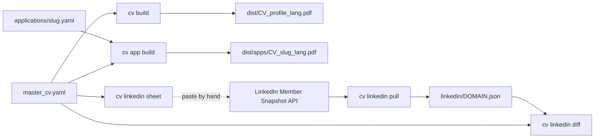

# cv

One master CV, tagged and bilingual, built into job-specific PDF variants. Replaces two prior
attempts that never landed anywhere permanent: a LaTeX/`awesome-cv.cls` system driven by
`\ifx\cvtarget\swe ... \fi` macro chains, and a later React + Gemini-API rebuild (dashboard +
live preview + JD-tailoring call).

## Verdict

**Build (CLI), adopt Typst underneath.** The actual job is small: filter a personal content
file by a profile tag, render it. Typst does the templating *and* the selection logic itself
(array `.filter()` over the parsed data) — no separate compiled glue needed, and no build step
(this repo compiles the capabilities that share Rust types across a serde boundary; `cv` has no
such cross-capability dependency — see `CONTRIBUTING.md#cargo-and-bun-are-the-build-path`, which already
establishes that interpreted tools here are invoked directly).

## Considered and declined

- **LaTeX (`awesome-cv.cls` + `\cvtarget`/`\cvlang` macros).** Worked, but every new
  target/language pair meant another set of `tex/sections/<lang>/<target>/*.tex` files and more
  conditional macro branches in the preamble. Config-in-`\ifx`-chains is exactly the "clunky"
  problem this capability exists to fix.
- **The React + Gemini rebuild.** A full dashboard (inline editor, live A4 preview, style/theme
  picker, localStorage history, a save endpoint, a Gemini JD-tailoring call) for what turned out
  to be a much smaller actual requirement: one file, tag-filtered, built from a CLI. The
  HTML/CSS print view and a from-JD generation flow are real ideas worth revisiting, but as a
  later phase over this foundation, not the v1 shape. Reviving them would also mean an upstream
  Gemini-API dependency this capability doesn't currently need — deterministic tag filtering
  covers the actual ask ("one master file is enough to manage").

## What this is

- `master_cv.schema.yaml` — documents the data shape: profile tags (`profiles: [...]`) on
  experience entries, education entries, individual bullets, and skill categories (omitted =
  always included); bilingual text as `{en: ..., de: ...}` instead of bare strings. Plus
  `sections:`, an open list for everything the four fixed sections cannot hold — each renders
  whichever of `entries` / `bullets` / `prose` it carries. That is one generic shape on
  purpose: a named section per topic would mean editing `cv.typ` every time a CV grows a
  heading, which is what happened when a master turned up carrying Hackathons, Soft Skills,
  Community and Interests with nowhere to put them (2026-08-05).

  One trap worth keeping: every string reaches Typst as a plain string, so `*bold*` in the
  YAML prints its own asterisks. Bullets take a separate `label` for the bold part.
- `templates/cv.typ` — the single Typst template. Reads the master file, filters by
  `--input profile=<x> --input lang=<y>`, renders.
- `cv` — bash launcher (`build`, `--all`, `list-profiles`), resolves `$SJEL_PERSONAL_ROOT` via
  `tools/lib/paths.sh`.

The actual content (`master_cv.yaml`, real name/employer/contact info) and every rendered PDF
live only in `axon-overlay/data/cv/` — never in this repo. This directory ships templates and
tooling only; nothing here is a personal-data file.

## Applications, LinkedIn and the dashboard



- **One page by default.** The master is an append-only superset. Each item may carry a
  `priority` (1 keeps longest, 3 drops first). `cv build` drops priority 3, then 2, until the CV
  fits its `page_limit`, and fails when priority-1 items alone do not fit. `general` has no
  limit: it is the full CV and the reference for LinkedIn. The page count comes from the
  template itself (`typst eval 'query(<pages>)…'`), so no PDF tool is needed.
- **Applications.** One file per application overrides `title` and `summary` and carries a
  status log, so the same files are the application tracker. Shape: the tail of
  `master_cv.schema.yaml`.
- **LinkedIn is read-only.** The Member Data Portability API (EU/EEA and Switzerland only) has
  no write path. `cv linkedin pull` reads the token from the keychain item
  `sjel-linkedin-dma`; create it with the OAuth token generator and scope
  `r_dma_portability_self_serve` (learn.microsoft.com/linkedin/dma/member-data-portability/member-data-portability-member).
  Updating the profile stays manual, from `cv linkedin sheet`.
- **Dashboard.** `/cv` drives the same verbs through `GET|POST /api/sjel-status/cv`
  (`capabilities/sjel-status/src/status/cv.rs`). The inline PDF preview works in the browser
  only; the Tauri bridge carries text bodies.

`capabilities/cv/check` runs every verb against a throwaway overlay built from the schema.

## Run it

Requires `typst` and `yq` on PATH (`brew install typst yq`); `jq` and `curl` for applications, status and LinkedIn — `cv` checks both up front and
errors clearly if either is missing.

```bash
capabilities/cv/cv build --profile swe --lang en   # -> axon-overlay/data/cv/dist/
capabilities/cv/cv build --all                     # full profile x lang matrix
capabilities/cv/cv list-profiles                    # tags in use, read from master_cv.yaml
capabilities/cv/cv app new acme --company Acme --role "Platform Engineer" --profile swe
capabilities/cv/cv app build acme                  # -> dist/apps/CV_acme_en.pdf
capabilities/cv/cv app status acme applied "via portal"
capabilities/cv/cv linkedin pull && capabilities/cv/cv linkedin diff
```

Config: copy `master_cv.schema.yaml`'s shape into
`$SJEL_PERSONAL_ROOT/data/cv/master_cv.yaml` and fill in real content — nothing personal is
stored in Sjel.
