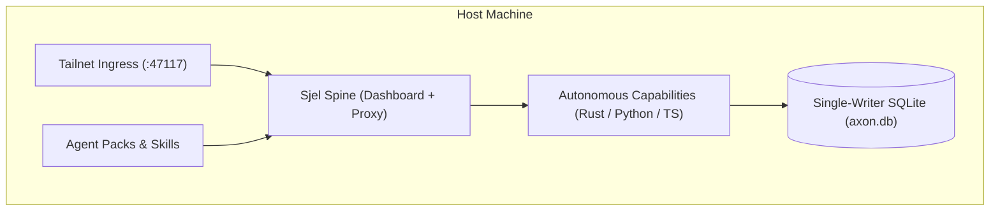

# Sjel Technical Documentation

Sjel is a private operating environment structured as a lean core with autonomous capabilities, packs, and strict boundary isolation.

## Reading Paths

| Audience | Start Here | Key Topics |
| :--- | :--- | :--- |
| **Architects & Core Devs** | [Architecture Overview](architecture/index.md) | Spine vs. Capabilities, SQLite single-writer, Tailnet gate |
| **Capability Authors** | [Capability Manifests](capabilities/manifest.md) | `service.toml` schema, port allocation, IPC conventions |
| **Operators & SRE** | [Operations Guide](operations/index.md) | `doctor` diagnostics, launchd/systemd persistence, backups |

## Documentation Sections

- **[Architecture](architecture/index.md)**: High-altitude design, component boundaries, storage patterns, and security guarantees.
- **[Capabilities](capabilities/index.md)**: Service manifest schemas (`service.toml`), lifecycle management, and data freshness contracts.
- **[Operations](operations/index.md)**: Host diagnosis (`tools/doctor`), persistence orchestration, and verification procedures.
