# Optional feature manager

Settings owns the user's installed Sjel features. The manager is an ongoing package surface, not
a first-run wizard. It lets a user discover, install, update, disable, enable, and uninstall
features while keeping capability health and service controls in the Capabilities view.

## Product model

- A **capability** is a bounded service or data owner under `capabilities/`.
- A **feature** is the user-facing package. It can contain a capability, a native GPUI surface,
  configuration, credentials, and links to other Sjel areas. One feature may require other
  capabilities.
- A **package** is one release artifact for a feature on a specific platform. It is never an
  arbitrary script or an in-process plugin. Package code runs behind Sjel's existing process and
  data boundaries.
- **Settings → Features** is the package manager. **Sjel → Capabilities** remains the live
  service view: enabled state, health, start and stop.

The interface has three searchable views:

1. **Recommended**: locally justified suggestions with the reason visible beside each one.
2. **Explore**: the official catalog, categories, search, compatibility, requirements, data
   access, publisher, version, and release notes.
3. **Installed**: installed, disabled, running, update available, or blocked, with per-feature
   configuration and lifecycle actions.

The Settings search covers preferences, shortcuts, credentials, and catalog entries. A result
opens the owning section or feature detail. Ask and other pages can link to a provider or feature
detail without owning a second configuration form.

## Self-awareness and recommendations

Recommendations are computed on the device from feature metadata and Sjel's local state. They are
specific and inspectable: each one says what signal matched and what the feature would add. Signals
may include a user request for an unavailable capability, a disabled dependency, or an existing
local data source that has no installed feature surface.

GPUI currently matches recommendation topics against the latest in-memory Ask prompt that was not
sent to a cloud provider. It displays the matched topic as its reason, skips installed packages,
and lets the user dismiss that feature/topic suggestion. Dismissals are stored locally in Sjel's
config directory; prompt text is neither persisted nor sent to the catalog service.

Do not upload usage history to rank features. Do not install or enable a feature automatically.
The user can dismiss a suggestion; the manager records that choice locally and stops repeating the
same suggestion until its evidence changes. A recommendation is guidance, not an assertion that
the user needs the feature.

Each catalog entry declares recommendation topics and prerequisites. Matching and ranking stay
deterministic and local. A recommendation must name its evidence, such as “You asked to plan a trip;
Travel is available but not installed.”

## Lifecycle

```mermaid
stateDiagram-v2
  [*] --> Available
  Available --> Installing: user confirms
  Installing --> InstalledDisabled: verified package staged
  Installing --> Available: failure and rollback
  InstalledDisabled --> Enabled: user enables
  Enabled --> InstalledDisabled: user disables
  Enabled --> Running: user starts or opens feature
  Running --> Enabled: user stops
  InstalledDisabled --> Uninstalling: user confirms
  Enabled --> Uninstalling: stop, persistence removal, dependency check
  Running --> Uninstalling: stop, persistence removal, dependency check
  Uninstalling --> [*]: package removed; user data retained
```

Install verifies the trusted release metadata, digest, platform, exact runtime compatibility,
package contents, prerequisites, and declared data access before activation. It stages the package,
then uses the single capability registry writer to enable the dependency closure. Starting services
is a separate, visible choice unless the user selected “Install and start”. Failures leave the prior
installation intact and show the failed step.

Disable stops services and removes persistence before changing the enabled set. Uninstall also
checks dependents and removes only files owned by a verified package receipt. It retains capability
data by default. Deleting data is a separate action with its own consequence and confirmation.
Updates use the same staging and compatibility checks as install; they do not overwrite a running
package in place.

## Trust and release contract

The release catalogue is the source for package identity, version, platform, prerequisites, asset,
size, and SHA-256. Explore reads only the latest public release metadata and package assets from the
official Sjel GitHub repository. It does not send prompts, local activity, or recommendation signals.
A catalog is actionable only when its release is cleared for users and its source is trusted. A
checksum downloaded beside an untrusted archive is not proof of authenticity.
The runtime and package versions must match exactly unless a reviewed compatibility contract
replaces that rule.

The installer must target a writable placed runtime. It must refuse a source checkout and a
read-only app bundle. The UI must show when package management is unavailable in the current
runtime and offer the supported placement/relaunch path when one exists.

Package metadata must declare display name, purpose, category, publisher, supported platforms,
capabilities included, prerequisites, data classes accessed, credential requirements, recommendation
topics, version, and release notes. Missing declarations make a package unlisted. The installer
records the trusted archive digest, package metadata, and each owned file hash in `sjel-package.json`
inside the staged capability directory. `sjel distribution list --json` reads those receipts and
reports whether each payload still matches. A receipt is published with the package files by the
same directory rename; packages without receipts are not listed. Upgrades and uninstall can use the
owned file list to refuse modified or ambiguous files.

## Implementation order

1. Extend the release catalogue and package schema with complete feature metadata and readiness.
2. Add installed-package receipts, safe status, update, disable, and uninstall operations to the
   packaged runtime CLI. Preserve capability data and honor dependent packages.
3. Add a GPUI feature manager with Recommended, Explore, and Installed views; search, detail,
   confirm, loading, failure, and rollback states.
4. Add local recommendation signals and dismissal state. Keep recommendation rules deterministic
   and show their evidence.
5. Add contextual links from Ask and other feature entry points to Settings. Keep API keys and
   account grants in Accounts & keys.
6. Rehearse fresh install, package install, update, disable, uninstall, dependency refusal, and
   recovery in a clean packaged runtime before exposing installation in a public release.

The Obsidian plugin manager is a useful discovery and lifecycle reference. Sjel packages remain
trusted, release-built capabilities; the analogy does not imply loading arbitrary third-party code
inside the app process.
