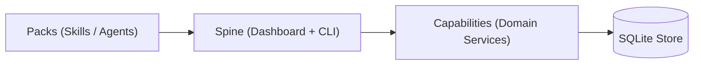

# Architecture Overview

Sjel organizes system responsibilities into three concrete nouns with strict directional coupling.

## Architectural Nouns

### 1. The Spine
The central orchestrator and developer surface.
- **Components**: Sjel Dashboard (SvelteKit UI on port 47117), reverse proxy, `sjel-cli`, and host diagnostics (`doctor`).
- **Invariants**: Serves as the UI shell and ingress router. Holds no domain state directly; proxies to capabilities and queries status.

### 2. Capabilities
Autonomous domain services providing discrete functions (e.g. `comms`, `finance`, `transit`, `entities`).
- **Contract**: Declared via `service.toml`.
- **Runtime**: Native Rust binaries, background processes, or containers.
- **Isolation**: Communicate over localhost HTTP or Unix domain sockets. Never directly modify another capability's storage.

### 3. Packs
Modular AI assistant skills, personas, and harnesses.
- **Harnesses**: Claude Code, Codex, Pi, OpenCode.
- **Content**: Portable Markdown skills, system prompts, deliberation flows, and agent role definitions.

## Boundary Invariants

1. **Downward Dependency**: Packs depend on the Spine; the Spine depends on Capabilities; Capabilities depend on shared libraries (`libs/*`). Dependencies never flow backward.
2. **Single Store Responsibility**: Shared persistent state resides in SQLite with WAL mode. Writers hold immediate transactions; readers read concurrently.
3. **Public Core / Private Overlay**: The Sjel repository contains strictly public engine code and documentation. All user data, private keys, and machine configurations live in the private overlay or Vaultwarden.
