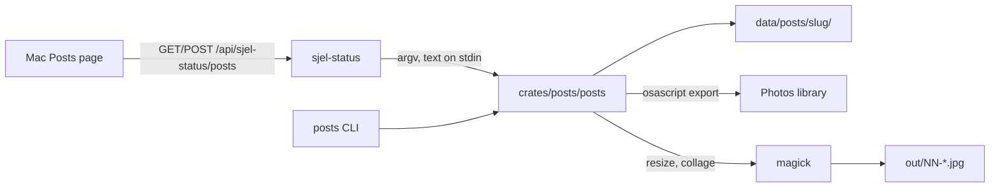

# Post drafts

Posts joins text revisions, ordered media, mentioned people and an event. Existing photo and
design applications remain the editing surface beyond a two-photo collage. The implementation
owner is `crates/posts`.

Each private post folder contains:

| Path | Content |
|---|---|
| `post.md` | Current text; TOML front matter between `+++` lines with title, state, event and URL |
| `revisions/` | The previous text, numbered, one file per text save |
| `media.toml` | Ordered `[[item]]` slots: a Photos media item ID, or a collage of two IDs |
| `out/` | Numbered exports in slot order, replaced as a whole on each export |

States are sketch, draft, ready and published. Post data lives under the active overlay, never
in the public repository. Entities owns people and skills. The CV LinkedIn reader is prior art;
its shared ownership must be resolved before adding an importer.

## Media

- Photos are added from the current selection in the Photos app, so no client types an ID.
- Export runs Photos' own `export` for each item, which downloads iCloud originals and applies
  edits. The library is only read.
- Single photos are resized to a 2400 px long edge. Collages use a named layout: `pair` (two
  portrait cells side by side) or `stack` (two landscape cells). Cells have rounded corners and
  a soft shadow. Accents are `none`, `pixels` or `lowpoly`, drawn in two opposite corners.
- Export writes into `out.staging/` and replaces `out/` only when every slot succeeded.

## Verification

`crates/posts/check` runs every verb against a throwaway overlay through `SJEL_OVERLAY_ROOT`.
`POSTS_CHECK_PHOTOS="<id> <id>"` adds a real Photos export into that throwaway overlay.

A published post needs explicit owner approval. No source change or release authorizes a post.
The [post tasks](../plans/posts.md) own open implementation and acceptance.
