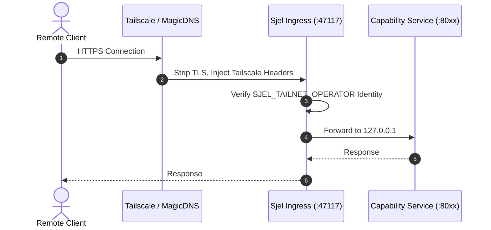

# Security & Access Control

Sjel enforces boundary isolation across local loopback, the Tailnet overlay, and LAN-connected devices.

## Security Invariants

### 1. Loopback Binding Only
All capability HTTP services bind exclusively to `127.0.0.1`. Binding to `0.0.0.0` or public network interfaces is forbidden and verified by `tools/doctor`.

### 2. Tailnet Identity Ingress Gate
Remote access is mediated entirely by Tailscale:
- The Sjel dashboard and reverse proxy listen on `127.0.0.1:47117`.
- Tailscale serves TLS on the MagicDNS hostname.
- Requests pass through an identity gate checking `Tailscale-User-Login` against the authorized `SJEL_TAILNET_OPERATOR` email.
- Unauthenticated or unauthorized headers are immediately rejected with `403 Forbidden`.

### 3. LAN Listener & Key Pairing
Local area network clients (e.g. native iOS companions) connect to Sjel via a dedicated LAN listener:
- Requires ed25519 device key pairing.
- Every HTTP request must carry a cryptographic signature verifying device possession.

### 4. Zero Secrets in Repository
No credentials, private keys, API tokens, or personal identifiers may be committed to the Sjel repository. Secrets are stored in Vaultwarden or injected via environment variables at runtime.
