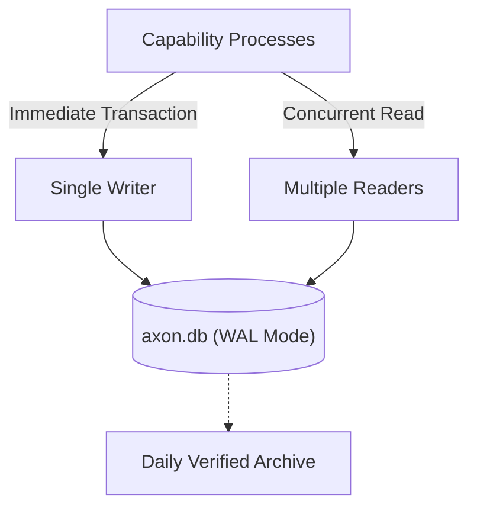

# Storage Architecture

Sjel maintains a unified, single-file SQLite database for shared relational state alongside capability-isolated assets.



## Database Specifications

- **Engine**: SQLite 3 with Write-Ahead Logging (`PRAGMA journal_mode = WAL;`).
- **Synchronous Level**: `PRAGMA synchronous = NORMAL;`.
- **Busy Timeout**: 5,000 ms.
- **Location**: Defined by `SJEL_DB_PATH` or defaulting to `<overlay>/data/axon/axon.db`.

## Transaction Rules

### Immediate Write Locking
SQLite allows multiple concurrent readers but exactly one writer. To eliminate deadlock cycles, any transaction intending to mutate data MUST begin with `BEGIN IMMEDIATE`:

```rust
// libs/sjel-store/src/lib.rs pattern
let mut conn = pool.acquire()?;
let tx = conn.transaction_with_behavior(TransactionBehavior::Immediate)?;
```

No capability outside `libs/sjel-store` may issue a raw deferred transaction (`BEGIN DEFERRED`). Enforced by automated repo gates.

## Path Indirection & State Mounts

All persistent host paths accessed by capabilities must resolve through `paths.sh` or declared state mounts in `systems.toml`.
- Hardcoded filesystem paths outside the repository root are strictly forbidden.
- Capability-specific data (e.g. photos, raw logs) lives under designated state mounts declared in the active machine overlay.
