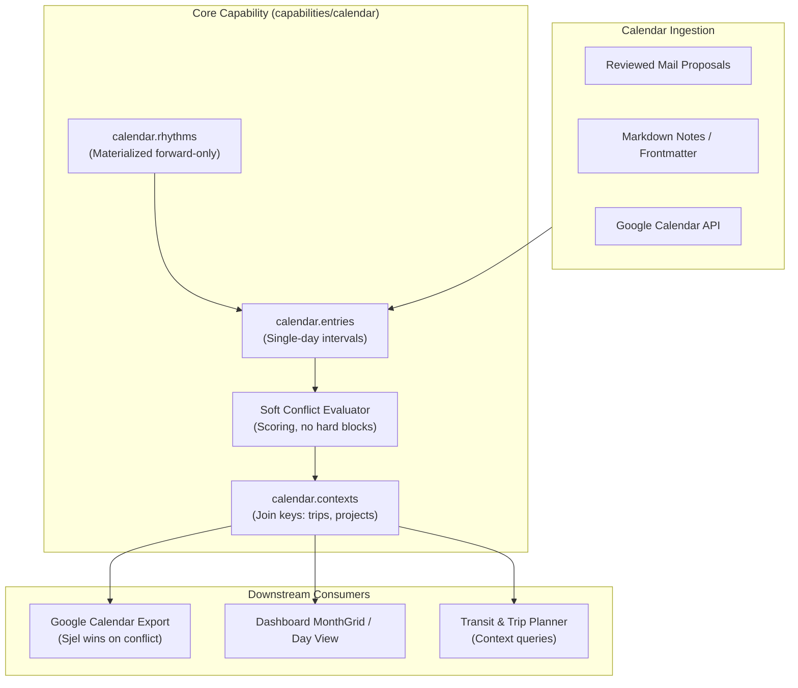
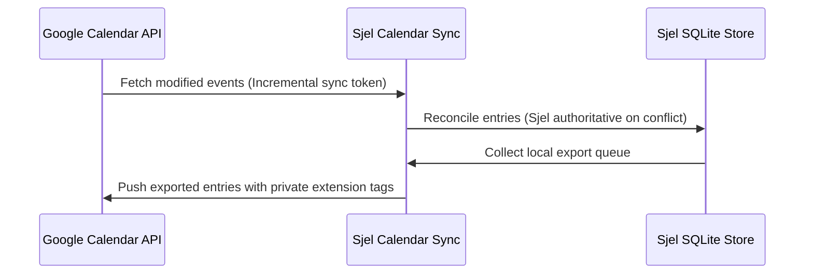

# Calendar Architecture & Contracts

Technical reference manual for Sjel's temporal scheduling, materialized rhythms, and external calendar synchronization.

## 1. Temporal Data Model

The calendar data model splits into four core tables in SQLite:

| Table | Purpose | Concurrency & Integrity Invariants |
| :--- | :--- | :--- |
| `calendar.entries` | Scheduled events, tasks, and appointments. | Bounds enforced to single day intervals. Cross-midnight events split at `00:00`. |
| `calendar.rhythms` | Recurring habits and schedules. | Materialized forward-only (up to 90 days). Never backfilled retroactively. |
| `calendar.contexts` | Associations joining entries to trips, places, or projects. | Weak references; deleting an entry cascades contexts. |
| `calendar.google_exports` | Remote sync state tracking etags and remote event IDs. | Tracks external mutations to prevent sync loops. |

## 2. Materialized Forward-Only Rhythms

Rhythms (recurring events such as weekly syncs or gym sessions) follow strict materialization doctrine:

- **Forward-Only**: Rhythms materialize instances forward from the current execution timestamp up to a fixed horizon (default 90 days).
- **Zero Retroactive Mutation**: Modifying a rhythm never alters past materialized entries. Historical journal accuracy is strictly preserved.
- **Detached Instances**: Once materialized, editing an individual instance marks it as overridden without breaking the parent recurrence rule.

## 3. Conflict Evaluation Doctrine

Traditional calendars refuse overlapping events or force hard constraints. Sjel employs soft conflict scoring:

- **Verdicts Over Blockers**: Double-booking is permitted and flagged with a soft conflict verdict score (`none`, `soft`, `hard`).
- **Context-Aware Weighting**: Travel buffers and flight connections score higher conflict weights than flexible task deadlines.

## 4. Google Calendar Synchronization

Two-way synchronization runs via `capabilities/calendar/src/google_sync.rs`:

- **Conflict Policy**: When an external edit conflicts with a local change, **Sjel wins**. Sjel local state overwrites Google Calendar.
- **Loop Prevention**: Outbound exports write a unique sync fingerprint into Google extended properties, preventing re-import.
- **Privacy Floor**: Entries marked `c3` (Secret) are never exported to external calendar providers.
