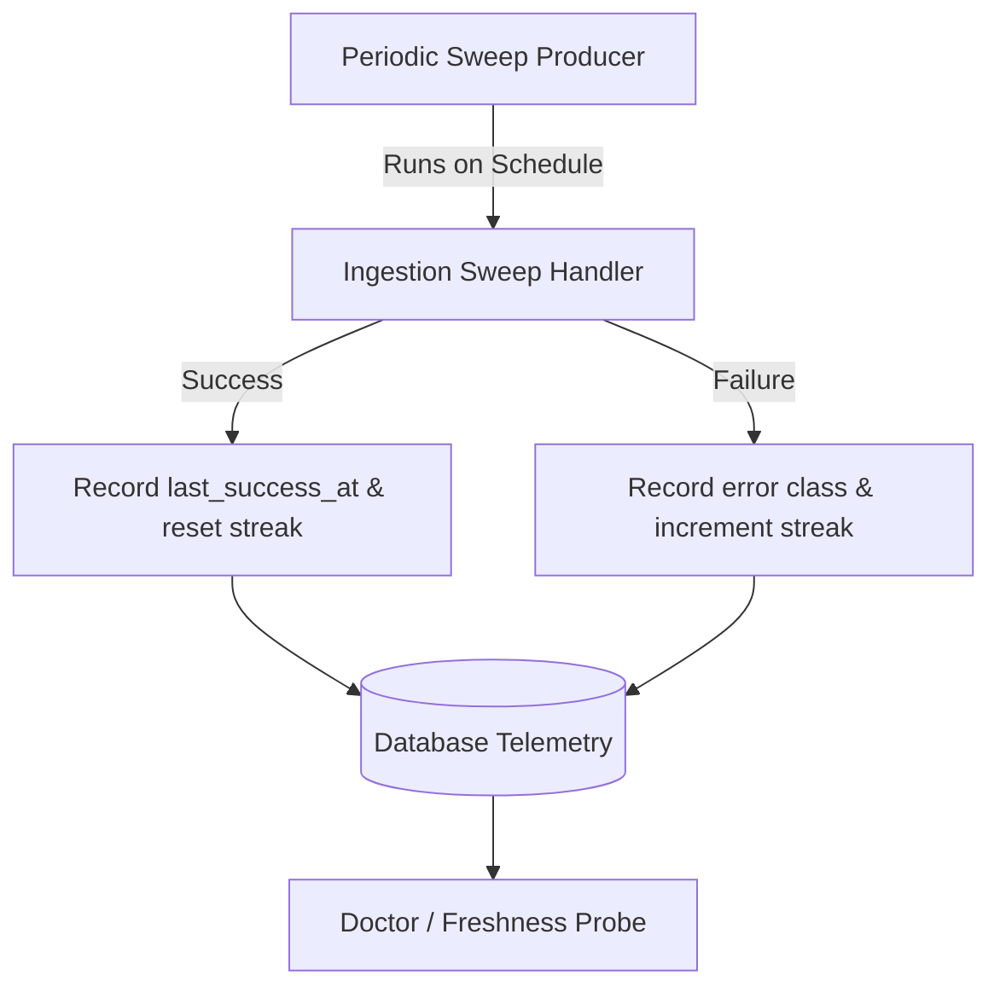

# Freshness, Health & Sweep Contracts

Capabilities that ingest asynchronous data declare freshness contracts to ensure stalled ingestion pipelines are detected immediately.



## Freshness Contracts

Declared under `[freshness]` in `service.toml`:

```toml
[freshness]
max_age = "24.0h"
query = "SELECT max(created_at) FROM items"
```

The system evaluates freshness by querying the latest record timestamp and comparing it against `max_age`. If data age exceeds the threshold, `tools/doctor` raises a bad check.

## Sweep Invariants

### 1. Distinct Run vs. Success
A producer sweep that executes but fails must record failure telemetry (`record_sweep_failure`) without updating `last_success_at`. This preserves stale detection if an ingest loop crashes continuously.

### 2. Error Classification
Failures are categorized into explicit error classes (e.g. `auth_refusal`, `network_timeout`, `parse_error`) with consecutive failure counters to differentiate transient hiccups from persistent upstream breakages.

### 3. Health Probe Standard
All HTTP capabilities must expose `GET /health`. The endpoint returns `200 OK` with JSON payload `{"status":"ok"}` when healthy and responsive.
