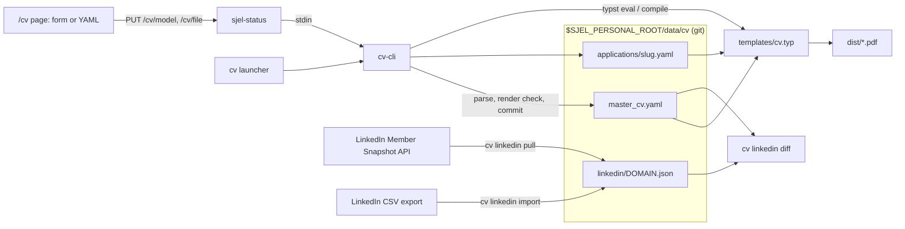

# CV

Technical reference for `capabilities/cv`: one master file, filtered by profile and priority,
rendered by Typst, edited from the dashboard, compared with LinkedIn.

## Components

| Path | Role |
|---|---|
| `capabilities/cv/src/model.rs` | Typed master and application. Unknown keys are parse errors. |
| `capabilities/cv/src/lib.rs` | Auto-fit build, applications, checked writes, status. |
| `capabilities/cv/src/linkedin.rs` | Snapshot pull, CSV-export import, diff, paste sheet. Read-only. |
| `capabilities/cv/templates/cv.typ` | Filtering by profile, priority, pin and hide; the layout. |
| `capabilities/cv/cv` | Launcher on PATH. Rebuilds `cv-cli` when a source is newer, then execs it. |
| `capabilities/cv/check` | Every verb against a throwaway overlay built from the schema. |
| `capabilities/sjel-status/src/status/cv.rs` | HTTP surface for the dashboard. Owner-only. |
| `dashboard/src/lib/cv/` | Form editor components. |

## Selection

An item is rendered when all of these hold, in order:

1. Its `id` is not in the application's `hide`. An `id` in `pin` skips rules 2 and 3.
2. Its `profiles` list is empty or contains the active profile.
3. Its `priority` for the active profile is at or below the build's keep level.

`priority` is `1`, `2`, `3`, or `{default: n, <profile>: n}`. An absent priority is 1.

## Page limit

`page_limit` maps a profile to a page count; absent means 1, and 0 means no limit. `build`
asks the template for its page count (`typst eval 'query(<pages>)…'`) at keep 3, then 2, then
1, and compiles at the first level that fits. Priority-1 items that do not fit fail the build
with the page count. `general` has no limit: it is the full CV and the reference for LinkedIn.

## Writes

`cv edit put` (raw YAML) and `cv model put` (typed JSON) share one path:

1. Parse into the typed model. Rejects unknown keys, a missing `default` title or summary, a
   priority outside 1..=3, and duplicate ids.
2. Render the candidate with Typst. Rejects anything the template cannot render.
3. Rename atomically over the old file, keeping its mode.
4. Commit only that file in the overlay's git (`cv: edit data/cv/…`).

An identical write is a no-op and makes no commit. `model put` writes normalized YAML, so YAML
comments do not survive it. Provenance lives in each item's `source` field.

## HTTP

| Route | Verb |
|---|---|
| `GET /api/sjel-status/cv` | `cv status --json` |
| `POST /api/sjel-status/cv` | build, build-all, app-new, app-build, app-status, linkedin-* |
| `GET` / `PUT /api/sjel-status/cv/file` | `cv edit get` / `put` |
| `GET` / `PUT /api/sjel-status/cv/model` | `cv model get` / `put` |
| `GET /api/sjel-status/cv/pdf?name=` | A PDF listed by status; nothing else is served |

## LinkedIn

The Member Data Portability API is read-only and EU/EEA/CH only. Two sources fill the same
snapshot at `data/cv/linkedin/`, in the same row shape:

| Verb | Source | Needs |
|---|---|---|
| `cv linkedin pull [DOMAIN...]` | Member Snapshot API | a keychain token |
| `cv linkedin import <dir>` | an extracted "Get a copy of your data" CSV export | nothing |

`pull` reads the token from keychain item `sjel-linkedin-dma` per call and passes it to curl on
stdin. `import` reads `Profile.csv`, `Positions.csv`, `Education.csv`, `Skills.csv`,
`Languages.csv` and `Organizations.csv`, and takes About from `Profile Summary.csv`, which the
export keeps separate and often leaves empty. Both write `PULLED_ON` and `SOURCE`, so `diff`
names the date and origin it compared. Neither commits to the overlay's git.

A CSV export is a snapshot from a manual download, not a live read, and its domains do not all
match [`DOMAINS`]: it carries no certifications, projects or honors. `import` is the fallback
while `pull`'s token is unset up; open work: `ISA.md` (cv).
