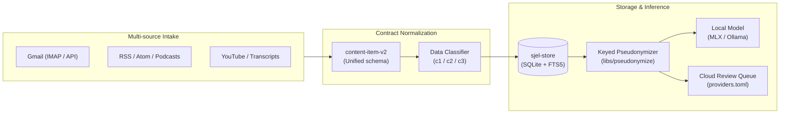
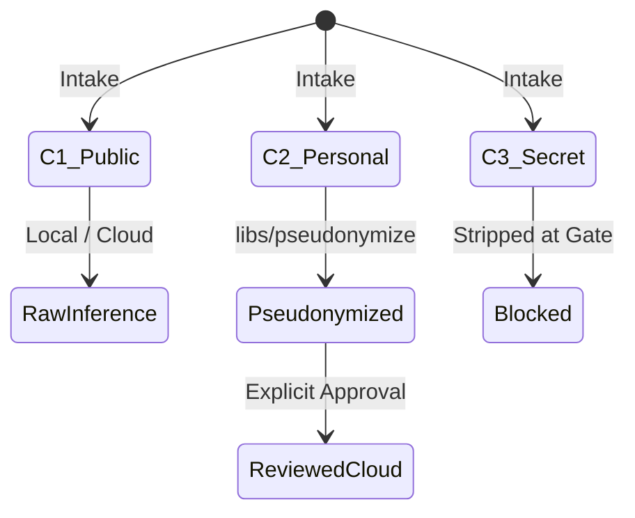

# Feed & Communications Architecture

Technical reference manual for Sjel's multi-source communications intake, feed ingestion, and privacy-preserving inference pipeline.

## 1. Unified Content Schema (`content-item-v2`)

Every communication proposal and feed entry normalizes into the `content-item-v2` structure before persistence or rendering in the dashboard:

| Field | Type | Invariant |
| :--- | :--- | :--- |
| `schema_version` | `"content-item-v2"` | Constant discriminator. |
| `source` | `ContentSource` | Enum: `gmail`, `rss`, `podcast`, `youtube`, `scouting`. |
| `id` | `string` | Deterministic content hash or upstream identifier. |
| `title` | `string` | Human-readable title or email subject. |
| `data_class` | `DataClass` | Derived classification: `c1` (Public), `c2` (Personal), `c3` (Secret). |
| `mail` | `MailContentExtension \| null` | Optional mail envelope extension (category, sync status, actions). |
| `cloud_processing` | `CloudProcessingState` | Staging, redaction receipts, and model invocation status. |

## 2. Privacy & Redaction Ladder

Sjel enforces strict data-boundary tiers across all model invocations per Product Rule 4:

1. **c1 (Public / Ephemeral)**:
   - Newsletters, public announcements, and general RSS feeds.
   - Eligible for local ranking and direct model summarization.
2. **c2 (Personal / Identifiable)**:
   - Personal correspondences, order confirmations, and flight tickets.
   - Verbatim data NEVER leaves the host. All outbound cloud processing requires local pseudonymization via `prepare_pseudonymized`.
   - Real entity names (`PERSON`, `ORG`, `LOCATION`) are deterministically hashed to keyed tokens (`<PERSON_k3x9qa>`).
3. **c3 (Secret / High Sensitivity)**:
   - Passcodes, financial balances, session cookies, and live location links.
   - Filtered out entirely at the gate level; never admitted to agent or cloud payloads.

## 3. Gmail Mutation Boundary

Mail proposals follow a staged review pattern with fail-safe boundaries:

- **Read-Only Ingestion**: Sweeps fetch envelope headers and parse bodies into ephemeral structures without modifying remote state.
- **Explicit Operator Actions**: `archive`, `trash`, and `restore` mutations require explicit operator triggers from the UI or signed CLI calls.
- **Agent Restriction**: Agent bearer tokens admit `GET` and `HEAD` only; mail write actions are unconditionally rejected by `libs/sjel-server` with `403 Forbidden`.
