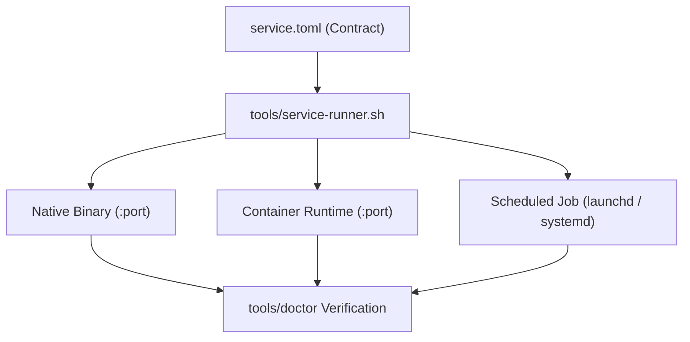

# Capabilities Overview

Capabilities are autonomous software units packaged as independent modules in `capabilities/<name>`.

## Capability Types

Capabilities declare their execution type in `service.toml`:

| Type | Manifest `kind` | Description | Typical Use Cases |
| :--- | :--- | :--- | :--- |
| **Process** | `process` | Native daemon listening on an assigned loopback port | Web APIs, REST endpoints, proxy adapters |
| **Container** | `container` | OCI container managed by Docker or Podman | Third-party services, sandboxed environments |
| **Scheduled** | `process` (with `schedule`) | Periodic batch task executed on a timer | Feed sweeps, price crawlers, backup routines |
| **Data** | `data` | Passive storage unit declaring backup contracts | Knowledge base mounts, media archives |

## Reference Guides

- **[Service Manifest Reference](manifest.md)**: Complete TOML schema specification for `service.toml`.
- **[Contracts & Health](contracts.md)**: Freshness contracts, heartbeat requirements, and sweep semantics.
- **[Feed & Communications](feed-and-comms.md)**: Intake pipeline, `content-item-v2`, and privacy redaction ladder.
- **[Calendar Architecture](calendar.md)**: Materialized forward-only rhythms and two-way Google Calendar synchronization.
- **[CV](cv.md)**: Typed master file, priority auto-fit to one page, form editor, LinkedIn snapshot diff.
- **[Travel & Routing](travel.md)**: Multi-modal journey planning, intent drafting, and reservation parsing.
