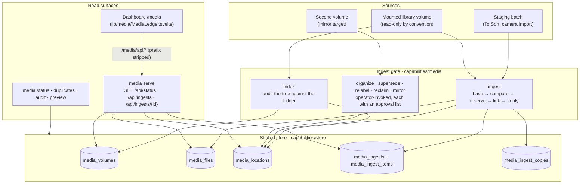

# Media Ledger & Ingest Gate Architecture

Technical reference manual for `capabilities/media`: the exact-byte ingest gate, the volume
integrity ledger, and the read-only HTTP surface the dashboard's `/media` page reads. The operator
workflow — every verb, its guards and its flags — is in [`capabilities/media/README.md`](../../capabilities/media/README.md).

## 1. The ledger

Six tables in the shared SQLite store (opened through `sjel_store`, created on first use by
`Ledger::open`). A file and its location commit in one transaction, so a crashed indexer cannot
leave an orphaned digest.

| Table | Holds | Key |
| :--- | :--- | :--- |
| `media_volumes` | One mounted volume: label, first and last seen | `uuid` |
| `media_files` | One digest: the bytes that exist, once | `digest` |
| `media_locations` | One indexed path on one volume | `(uuid, relpath)` |
| `media_ingests` | One ingest run and its disposition counts | `id` |
| `media_ingest_items` | One path's disposition inside a run, with the reason | `(ingest_id, relpath)` |
| `media_ingest_copies` | Incoming directory ownership, target volume UUID and canonical library root | `(ingest_id, relpath)`; unique incoming name |

Two invariants make the ledger answer *"where do these bytes live"* rather than *"what did the last
run look like"*. A digest's `size` is written once and any later row that disagrees is refused
(`digest … has conflicting sizes`), so one digest cannot describe two different files. And a
location row is **kept** when a path disappears from disk: an undeclared absence stays visible as an
audit disagreement until `reconcile` witnesses the same digest at another path on the same volume.

## 2. Disposition of every path

An ingest run records one row per path it considered, whatever happened to it. This is the contract
that lets a run finish and still say what it could not take.

| Disposition | Means |
| :--- | :--- |
| `imported` | Bytes were new, reserved a destination path, linked and verified |
| `duplicate` | The digest is already indexed; the staged copy was left alone |
| `resumed` | An earlier unverified attempt at the same path and digest was completed |
| `refused` | The path is unusable before any byte moves: a symlink, a non-regular file, a non-UTF-8 name, an unreadable file, a traversal |
| `failed` | The attempt began and errored; the destination is not verified |

A refusal is per path, never per run. One unusable path in a batch names itself and its reason and
returns the rest their disposition (`files_with_refusals`, `staged_hashes`); the strict `files`
walk remains for the verbs that cannot proceed without a complete tree. Ingest reports each refusal
as a durable `refused` item and the run still completes.

### Interrupted ingest recovery

An applying ingest holds an OS file lock in the library parent's `.media-incoming` directory.
Another applying ingest using that incoming area is refused, including one with a different source
or volume UUID. Process exit releases the lock. A dry run inspects without taking a write lock or
cleaning temporary files.

On retry, the copy journal limits cleanup to the same canonical staging and library paths and
volume UUID. Recovery rechecks the original's digest before removing a journal-owned incoming
directory containing only its regular `copy` file, or nothing. It then recopies or verifies the
reserved final path. Acceptance requires a regular file with matching size and SHA-256 and stable
metadata during verification; destination symlinks are refused. Earlier verified items survive a
later interruption.

The CLI report's `incoming_unresolved` array names entries whose ownership or contents cannot be
verified. These entries remain in place, block staging prune, and cause a nonzero CLI exit.
This includes older unjournaled copies, unfamiliar directory contents, changed originals, and an
empty directory left by a crash before its journal entry. Historical reservations without target
ownership also require inspection. Before pruning, ingest re-enumerates and rehashes the complete
staging file set; changed or added files refuse prune. The producer must stop writing during
ingest because this check is not a filesystem snapshot. The journal supports checked retries across SQLite and
filesystem boundaries; it cannot make those boundaries one atomic transaction or protect against
external filesystem edits and storage failure.

## 3. The HTTP surface

`media serve` starts a process capability on port **8102** ([`service.toml`](../../capabilities/media/service.toml)).
It is read-only by construction: every handler calls a `Ledger` reader, so nothing reachable over
the port can move a file, drop a row, or change a library byte. The verbs that act on the library
stay operator-invoked commands with their own approval lists and are not exposed.

| Method & path | Answers |
| :--- | :--- |
| `GET /health` | Liveness. Answers before the inbound gate, as every capability's does |
| `GET /routes` | The route manifest (`libs/route-manifest`) |
| `GET /api/status` | Distinct digests, indexed paths, and every volume with its path and byte counts |
| `GET /api/ingests` | The 20 most recent runs, newest first, with each run's disposition counts |
| `GET /api/ingests/{id}` | One run and the disposition of every path it considered (404 if unknown) |

**Auth and mounting.** The surface sits behind the shared inbound credential every capability uses
(`libs/sjel-server`), so a request without it answers `401`; `/health` is the one exception. The
capability declares `proxy_api_only`, so the shell proxies only `/media/api` with the prefix
stripped and keeps `/media` as its own page. A reader reaches the routes above as
`/media/api/status` and never dials the port.

**Nothing is derived at rest.** The surface renders what the ledger holds at request time; there is
no cache and no materialized view, so it cannot disagree with the tables a verb wrote. A slow query
runs on `spawn_blocking` rather than stalling the listener.

## 4. Invariants

- **Exact bytes, never a guess.** A row is written from a SHA-256 digest computed on this machine.
- **Nothing is deleted.** `supersede` and `reclaim` rename into quarantine and journal the move
  before it happens; reclaiming the space is a separate declared step.
- **The surface cannot write.** Read-only handlers, an unauthenticated caller refused, and the
  acting verbs absent from the router.
- **A partial answer says so.** `complete: false` and a named `issues` list travel with the report
  that carries them, so a plan that had to skip a file cannot read as a clean run.
