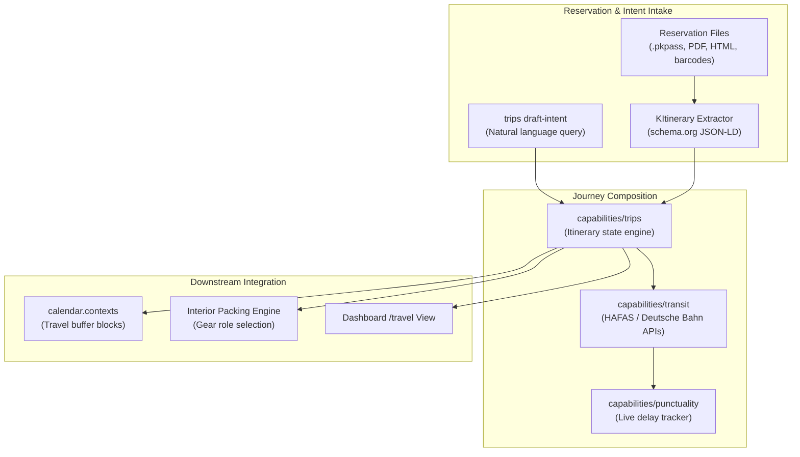

# Travel & Multi-Modal Routing Architecture

Technical reference manual for Sjel's journey planning, multi-modal transit coordination, and reservation document intake.



## 1. Intent-Driven Trip Drafting

Travel plans can originate from natural language intent strings executed through `sjel trip draft-intent`:

```text
"weekend in Paris under 200 euro by train"
```

1. **Query Parsing**: The intent string parses into structured origin, destination, budgetary ceiling, and mode constraints.
2. **Search Deadline**: Constraint solvers enforce a strict 30-second execution deadline across remote route providers.
3. **Structured Plan**: Emits an unbooked draft itinerary containing departure/arrival windows, transfer thresholds, and fare estimates.

## 2. Reservation Intake & KItinerary Integration

External travel confirmations normalize into structured JSON-LD events:

| Format | Parsing Engine | Target Schema |
| :--- | :--- | :--- |
| **Apple Wallet PKPass** | `kpkpass` / `libkitinerary-bin` | `schema.org/TrainReservation` or `FlightReservation` |
| **Confirmation Email** | Comms extractor + KItinerary | `schema.org/LodgingReservation` |
| **Barcode / Aztec** | Vision barcode reader | Raw UIC 918.3 ticket payload |

- **Safe Extraction**: Parsing occurs locally inside sandboxed container workers or native CLI tools.
- **Deduplication**: Upstream booking references (`PNR`, ticket numbers) serve as idempotency keys.

## 3. Packing & Inventory Role Separation

Travel integrates with `capabilities/inventory` through explicit item roles decided in Q58:

- **`kind = piece`**: General items owned by the household (e.g. clothing in a wardrobe).
- **`kind = gear`**: Active items designated for transport and packing lists.
- **Pack Lists**: Seven destination-aware columns (weight, packing slot, charger requirements) materialize during trip finalization.

## 4. Backend fragility

The rail side rests on reverse-engineered bahn.de profiles; the air side on an open channel. Four measured facts decide what may be trusted.

- **`dbweb` (`bahn.de/web/api`) is the shakier profile.** db-vendo-client rates it "less stable" with aggressive blocking; the sibling `db` profile lost DNS in May 2026, and `dbnav` is rated more stable but carries open 403 issues of its own. A second backend is the highest-value defensive change here, not an optimization — it shipped as the `dbnav` profile.
- **There is no authorized German rail *fare* API at any price.** No DB product returns prices, which is why reverse-engineering is defensible for rail and has no excuse for flights, where `mcp.kiwi.com` answers unauthenticated.
- **`mcp.kiwi.com` publishes no rate limit, quota, SLA or acceptable-use policy**, and whether persisted results are permitted is unconfirmed. Cache aggressively; treat withdrawal as a matter of when.
- **Expedia's connector has real data bugs** (USD returned for a EUR user, GBP bag fees, a DUS departure labelled "Cologne", `seats_left: 0` on bookable results). Second opinion only, never a source of truth.
- **No cancelled train has been observed live**, so `originCancelled`/`destinationCancelled` remain vocabulary rather than a proven signal; they are fixture-tested only.

## 5. What not to build

Each of these was tempting, and the reason it was cut still holds.

| Idea | Why not |
| :--- | :--- |
| A Google Flights scraper | The bahn.de failure mode with worse odds; the tracker's cookie-consent wall has been open since May 2026 |
| A browser extension re-running searches in the background | The "only reading a page I opened" position ends once the extension issues the fetch; robots.txt disallows the path |
| Self-hosting MOTIS or OpenTripPlanner for rail+air | Solves the half that already works and imports the half that does not: a MUC→FCO air query returns four itineraries routed via Sardinia |
| Duffel | Search is free only up to a 1500:1 search-to-book ratio this operator will never meet |
| SerpApi or Bright Data | €300–500 a year to price-check six flights, and residential proxying contradicts the privacy constraint |
| Applying to Skyscanner, Kiwi Tequila or Travelpayouts | All three decline individuals |
| Anything on Amadeus Self-Service | Reported dead since July 2026 |
| A bespoke rail price-watch daemon | Drops exist but are rare and unquantified; nothing bigger than the one scheduled watch is justified |

Cut from the earlier roadmaps for the same reason — machinery ahead of the record it would read: a read-only cross-capability context endpoint on Trips (a CLI covers it), comms' approved-booking-intent choreography copied into trips (nothing leaves the machine, and `expected_updated_at` covers the stale read), a traveler profile whose honest answer would be `insufficient_data` for a year, model-written risk sentences and day-plan permutations over a `day` column nothing maintains, and auto-intake of booking confirmations before `extract` has been run against real tickets.

## 6. Open questions and known gaps

- **Dated pre-trip obligations: one home or two?** `tasks` calls a due date a bound on a task; `calendar` calls `deadline` a dated action. Shipping producers into both gives two inboxes with no rule for which to read.
- **May the buy step stay manual forever?** Whether bahn.de mints a constructible from/to/time URL is unverified (BetterBahn *parses* a `vbid` it did not construct). If not: paste the link back for parsing, or a plain retype.
- **Dated work rail or discovery?** The NL-intent draft, the foreign-language event adapter and the day-plan permutation only pay off in the discovery mode ("somewhere warm in October, under 300 euro"), which may be roughly annual.
- **Is a bun CLI an acceptable permanent agent surface?** If an assistant must talk only HTTP, the cross-capability composition has to move into a capability.
- **No parquet-reader test.** punctuality's 29 unit tests cover hour and weekend maths and never open a file, so the one component that parses someone else's binary format is untested. It needs a committed miniature fixture; the real monthly files are private and 100+ MB.

The dated design snapshots these facts came from (`Packs/travel/design/`, 2026-08-11 and 2026-08-12) were retired on 2026-10-15, once their still-live content was here and their open items were in [ISA.md](../../ISA.md).
