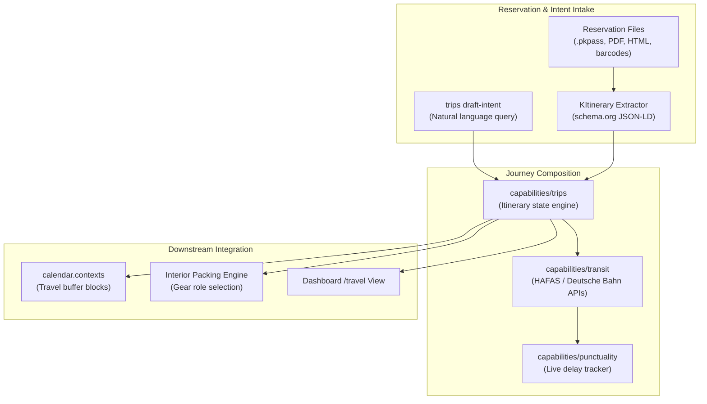

# Travel & Multi-Modal Routing Architecture

Technical reference manual for Sjel's journey planning, multi-modal transit coordination, and reservation document intake.



## 1. Intent-Driven Trip Drafting

Travel plans can originate from natural language intent strings executed through `sjel trip draft-intent`:

```text
"weekend in Paris under 200 euro by train"
```

1. **Query Parsing**: The intent string parses into structured origin, destination, budgetary ceiling, and mode constraints.
2. **Search Deadline**: Constraint solvers enforce a strict 30-second execution deadline across remote route providers.
3. **Structured Plan**: Emits an unbooked draft itinerary containing departure/arrival windows, transfer thresholds, and fare estimates.

## 2. Reservation Intake & KItinerary Integration

External travel confirmations normalize into structured JSON-LD events:

| Format | Parsing Engine | Target Schema |
| :--- | :--- | :--- |
| **Apple Wallet PKPass** | `kpkpass` / `libkitinerary-bin` | `schema.org/TrainReservation` or `FlightReservation` |
| **Confirmation Email** | Comms extractor + KItinerary | `schema.org/LodgingReservation` |
| **Barcode / Aztec** | Vision barcode reader | Raw UIC 918.3 ticket payload |

- **Safe Extraction**: Parsing occurs locally inside sandboxed container workers or native CLI tools.
- **Deduplication**: Upstream booking references (`PNR`, ticket numbers) serve as idempotency keys.

## 3. Packing & Inventory Role Separation

Travel integrates with `capabilities/inventory` through explicit item roles decided in Q58:

- **`kind = piece`**: General items owned by the household (e.g. clothing in a wardrobe).
- **`kind = gear`**: Active items designated for transport and packing lists.
- **Pack Lists**: Seven destination-aware columns (weight, packing slot, charger requirements) materialize during trip finalization.
