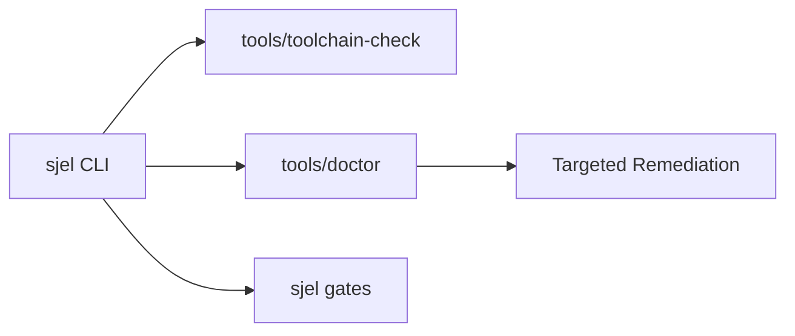

# Operations & Host Maintenance

Operating Sjel requires strict adherence to host invariants, toolchain verification, and automated diagnostic suites.



## Daily Operations Workflow

### 1. Toolchain Verification
Before backups, audits, or major builds, verify host dependencies:

```bash
tools/toolchain-check
tools/toolchain-check --workflow backup
```

### 2. Comprehensive Diagnostics
Run the diagnostic suite:

```bash
tools/doctor
```

`doctor` executes over 25 automated checks covering:
- Machine identity and overlay paths.
- Scheduled producers and launchd exit statuses.
- SQLite database integrity (`PRAGMA integrity_check;`).
- Data freshness contracts.
- Port collisions and unauthorized external bindings.
- AI assistant harness sync and deployed pack statuses.

## Operations Guides

- **[Doctor Diagnostics](doctor.md)**: Deep dive into the check suite, classifications, and troubleshooting.
- **[Service Persistence](persistence.md)**: Management of `launchd` and `systemd` daemon units.
