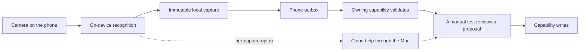

# Scanning: one capture pipeline on the phone

The iPhone captures things from the physical world and hands each capture to the capability that
owns it. RoomPlan is the first scanner, and it is nearly done. The other targets reuse its shape
instead of building a second pipeline.

Targets (decided 2026-10-25): rooms, grocery barcodes, receipts, owned objects including
clothing, and paper documents.

## 1. The shape every scanner follows

RoomPlan already proves this flow (`libs/roomplan-contract`, `capabilities/interior`,
`apps/gpui/ios/host`):

Rules that carry over from RoomPlan:

1. Capture works offline. The capture stays on the phone until the Mac accepts it, and it can be
   revisited after upload and after a restart.
2. Recognition runs on the device first: Apple VisionKit and Vision for barcodes, text and
   documents, RoomPlan for rooms.
3. A capture is a proposal. Only the owning capability writes, and only after the user
   reviews it. A model never writes a record directly.
4. Cloud help is opt-in per capture. The request goes through the Mac, which alone holds the
   provider key. The phone never holds a provider key.

**Prior art on the phone.** `apps/gpui/ios/host/PairScanner.swift` already reads QR codes with
`AVCaptureMetadataOutput`. The same API reads EAN and UPC barcodes.

**Proposed: one capture host.** Lift the camera, consent and outbox parts out of the RoomPlan host
into one Swift capture host with modes. Each mode emits a typed draft, in the way
`roomplan-capture/v1` does. Do this after RoomPlan passes device validation, so the extraction
starts from working code.

## 2. Targets

| Target | Recognition | Owner | Exists today | Missing |
|---|---|---|---|---|
| Rooms | RoomPlan | `interior` | Most of the flow, see §3 | Device validation, Gemini |
| Paper documents | `VNDocumentCameraViewController` | `documents` | Hash-verified PDF library, import | The phone mode and an upload route |
| Owned objects and clothing | Photo plus barcode | `inventory` | Intake from a link (`inventory add <url>`) | Intake from the object ("not built", `capabilities/inventory/README.md`). Clothing fields such as size, colour and season. |
| Grocery barcodes | EAN/UPC on device, then a product lookup | `inventory`, `pantry` domain (P1) | Nothing | The pantry domain, a product source |
| Receipts | Text recognition on device | `finance` | Candidate review in GPUI (Work Package 24) | Receipt to candidate. A link from grocery lines to pantry restock. |

**Product lookup.** A barcode alone names no product. Open Food Facts is the obvious source. It
needs an `upstreams.toml` review (licence and data quality) first. The request carries only the
barcode, which is c0.

## 3. Rooms (RoomPlan)

`capabilities/interior` owns measurements, clearances, layouts and placement writes. The phone
captures with Apple RoomPlan ([Apple's guide](https://developer.apple.com/documentation/roomplan)).

**Built.**

- `roomplan-capture/v1` drafts and parametric USDZ, archived offline on the phone, with
  idempotent upload receipts and retries. The capability refuses a different payload under an
  existing draft ID.
- Shared Interior page on Mac and iPhone: measured room polygon, walls, openings, fixtures,
  current placements, named layouts with solver verdicts, scan history and comparison.
- USDZ preview in Quick Look on both devices. Remote revisions download into the phone archive.
- Live `CapturedRoom` snapshots stream into the shared history, throttled and on device only.
- Room histories and scan membership. Wall alignment reports. Confirmed links from a scan object
  to an owned inventory item. A reviewed, solver-checked, revision-guarded move with append-only
  history.
- Deterministic layout proposals: search, solver findings, access paths, direct sun. A reviewed
  result is saved as a new layout without moving current placements.
- Legacy migration: the old Tauri app stages each capture in its Files folder, and GPUI imports
  it after checking ID, size and hash. Conflicting IDs are never replaced.

**Open.**

1. **Device validation (Q-RP4).** On a LiDAR iPhone with real Tauri scans: capture quality,
   alignment against the measured flat, and the Files export and import. Simulator checks cannot
   cover this. This also gates the Tauri deletion in [`gpui.md`](gpui.md#3-what-retiring-the-dashboard-still-takes).
2. **Gemini interior ideas.** Groundwork exists in `capabilities/assistant/src/main.rs`: a typed
   request and response, a per-request consent flag, bounded JPEG and geometry checks, paid-role
   admission, a daily usage ledger. Missing: the route, the provider review, a paid role pointed
   at the existing `inference-gemini` keychain credential, the phone consent and frame sampling
   UI, and the mapping into Interior proposals. No Gemini request has been sent.
   The key is the same `inference-gemini` item Settings stores. What differs is billing: Google
   serves the paid tier only when billing is enabled on the Cloud project behind the key, and the
   RoomPlan code admits only a role with `billing_mode = "prepaid_credit"`. Enabling billing is a
   later step and a spending decision. Until then this item waits.

**Consent rules (settled).** Scans stay local unless the user opts in for that scan. The
choices are `Local only`, `Analyze selected still`, and `Enable live guidance for this scan`.
Live guidance is off by default and stops with the scan. It samples one low-resolution frame at
most every 15 seconds, at most four per scan. Each still analysis needs a fresh action. The phone
sends the frame and bounded pseudonymized geometry to the Mac, and the Mac calls Gemini. Sampled
frames are not stored or archived. A failed request does not interrupt capture. Paid Gemini
service only. Every model idea is validated by the Interior solver and saved only by the
user. These limits are starting values, to tune after device use.

**Done when.** Scan offline, reopen the app, revisit, sync later, compare with a prior scan,
find a moved piece, approve or reject the placement, and see `interior` recheck the layout. With
Gemini on, nothing leaves without that scan's consent.

## 4. Order

Proposed. Each step is useful alone.

1. RoomPlan device validation (§3 open item 1).
2. Extract the capture host from the RoomPlan code.
3. Paper documents. The owner exists, and VisionKit does the recognition.
4. Objects and clothing into inventory intake.
5. Grocery barcodes into the pantry, into the `pantry` domain (P1).
6. Receipts into finance candidates, then the link to pantry restock.
7. Gemini interior ideas (§3 open item 2).

## 5. Decisions

All decided 2026-10-25.

| # | Question | Decision |
|---|---|---|
| P1 | Who owns pantry stock? | A `pantry` domain inside `inventory`. Stock has quantities, expiry and depletion, which owned objects do not. Split it out only if it grows its own lifecycle. |
| P2 | Product lookup source | Open Food Facts, after an `upstreams.toml` review, with a local cache so a known barcode needs no network. |
| P3 | Does a receipt line update the pantry automatically? | No. It proposes a restock that the user confirms, the same as every other capture. |
