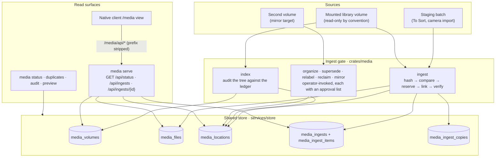

# Media Ledger & Ingest Gate Architecture

Technical reference manual for `crates/media`: the exact-byte ingest gate, the volume
integrity ledger, private local attachment library, and HTTP surface. The operator
workflow — every verb, its guards and its flags — is in [`crates/media/README.md`](../../../crates/media/README.md).

## 1. The ledger

Media-prefixed tables in the shared SQLite store (opened through `sjel_store`, created on first use by
`Ledger::open`). A file and its location commit in one transaction, so a crashed indexer cannot
leave an orphaned digest.

| Table | Holds | Key |
| :--- | :--- | :--- |
| `media_volumes` | One mounted volume: label, first and last seen | `uuid` |
| `media_files` | One digest: the bytes that exist, once | `digest` |
| `media_locations` | One indexed path on one volume | `(uuid, relpath)` |
| `media_ingests` | One ingest run and its disposition counts | `id` |
| `media_ingest_items` | One path's disposition inside a run, with the reason | `(ingest_id, relpath)` |
| `media_ingest_copies` | Incoming directory ownership, target volume UUID and canonical library root | `(ingest_id, relpath)`; unique incoming name |
| `media_attachments` | A verified local original's digest, byte length and import time | `sha256` |
| `media_attachment_sources` | Each observed source filename and its first-seen time | `(sha256, filename)` |

Local attachments are separate from `media_files` and `media_locations`: mounted-volume counts,
audit and ingest do not treat local attachments as volume copies. Perceptual and geotag tables
remain owned by their existing indexing commands; local attachment intake does not populate them.

Two invariants make the ledger answer *"where do these bytes live"* rather than *"what did the last
run look like"*. A digest's `size` is written once and any later row that disagrees is refused
(`digest … has conflicting sizes`), so one digest cannot describe two different files. And a
location row is **kept** when a path disappears from disk: an undeclared absence stays visible as an
audit disagreement until `reconcile` witnesses the same digest at another path on the same volume.

## 2. Disposition of every path

An ingest run records one row per path it considered, whatever happened to it. This is the contract
that lets a run finish and still say what it could not take.

| Disposition | Means |
| :--- | :--- |
| `imported` | Bytes were new, reserved a destination path, linked and verified |
| `duplicate` | The digest is already indexed; the staged copy was left alone |
| `resumed` | An earlier unverified attempt at the same path and digest was completed |
| `refused` | The path is unusable before any byte moves: a symlink, a non-regular file, a non-UTF-8 name, an unreadable file, a traversal |
| `failed` | The attempt began and errored; the destination is not verified |

A refusal is per path, never per run. One unusable path in a batch names itself and its reason and
returns the rest their disposition (`files_with_refusals`, `staged_hashes`); the strict `files`
walk remains for the verbs that cannot proceed without a complete tree. Ingest reports each refusal
as a durable `refused` item and the run still completes.

### Interrupted ingest recovery

An applying ingest holds an OS file lock in the library parent's `.media-incoming` directory.
Another applying ingest using that incoming area is refused, including one with a different source
or volume UUID. Process exit releases the lock. A dry run inspects without taking a write lock or
cleaning temporary files.

On retry, the copy journal limits cleanup to the same canonical staging and library paths and
volume UUID. Recovery rechecks the original's digest before removing a journal-owned incoming
directory containing only its regular `copy` file, or nothing. It then recopies or verifies the
reserved final path. Acceptance requires a regular file with matching size and SHA-256 and stable
metadata during verification; destination symlinks are refused. Earlier verified items survive a
later interruption.

The CLI report's `incoming_unresolved` array names entries whose ownership or contents cannot be
verified. These entries remain in place, block staging prune, and cause a nonzero CLI exit.
This includes older unjournaled copies, unfamiliar directory contents, changed originals, and an
empty directory left by a crash before its journal entry. Historical reservations without target
ownership also require inspection. Before pruning, ingest re-enumerates and rehashes the complete
staging file set; changed or added files refuse prune. The producer must stop writing during
ingest because this check is not a filesystem snapshot. The journal supports checked retries across SQLite and
filesystem boundaries; it cannot make those boundaries one atomic transaction or protect against
external filesystem edits and storage failure.

## 3. The HTTP surface

`media serve` starts a process capability on port **8102** ([`service.toml`](../../../crates/media/service.toml)).
Mounted-volume routes are read-only. The attachment intake writes only to the private local
attachment root and its metadata tables. Verbs that move or organize mounted-library files stay
operator-invoked commands with their own approval lists and are not exposed.

| Method & path | Answers |
| :--- | :--- |
| `GET /health` | Liveness. Answers before the inbound gate, as every capability's does |
| `GET /routes` | The route manifest (`libs/route-manifest`) |
| `GET /api/status` | Distinct digests, indexed paths, and every volume with its path and byte counts |
| `GET /api/ingests` | The 20 most recent runs, newest first, with each run's disposition counts |
| `GET /api/ingests/{id}` | One run and the disposition of every path it considered (404 if unknown) |
| `POST /api/attachments?filename=<name>&sha256=<digest>` | Store raw bytes, at most 128 MiB. Returns `{attachment, created}` with 201 for a new original, 200 for existing verified bytes |
| `GET /api/attachments/{sha256}` | Verify the original and return `{attachment: {sha256, byte_len, filenames}}`; 404 if no metadata exists |

The upload requires a single visible filename, not a path, and a 64-character lowercase SHA-256
that matches the submitted bytes. Unknown query fields are refused. Unsafe names or mismatched
digests return 422; oversized bodies return 413. Apple binary-plist payloads starting with
`bplist00` return 422 with an unsupported-placeholder reason, even under a media filename.
This narrow signature check is not general media decoding or proof that arbitrary submitted
bytes are usable media. A missing, corrupt or symlinked recorded original
is an internal failure (500), never a successful lookup or an overwrite. Lookup returns metadata
only; there is no arbitrary-path intake or raw-content download route.

**Auth and mounting.** The surface requires the deployment credential through
`crates/sjel-server`, with no agent-token admission. Requests without it return 401 when a token
is configured, or 403 when none is configured; shared liveness exemptions remain. The capability
declares `proxy_api_only`, so the shell proxies `/media/api` with the prefix stripped and keeps
`/media` as its own page. Ordinary ledger reads use `/media/api/status`. The shell proxy buffers
requests up to 8 MiB; import therefore submits raw attachments directly to the loopback media
listener, using the deployment credential. `SJEL_MEDIA_URL` selects an alternate loopback HTTP
origin when needed; media's declared default port is the fallback.

**The HTTP surface does not cache or materialize derived data.** It renders ledger contents at
request time, so its response reflects the tables written by each verb. A slow query runs on
`spawn_blocking` rather than stalling the listener.

### Local attachment storage and retry contract

`media serve` requires a private overlay and opens `<overlay>/data/media/attachments` with mode
0700. Each original is named by its SHA-256, without a filename extension. Intake verifies the
submitted digest, writes a create-new temporary file with mode 0600, syncs and rehashes it, changes
its mode to 0400, then publishes with an atomic no-clobber hard link. An existing path must be a
regular file with the expected size and hash. Symlink roots, symlink ancestors and symlink
originals are refused. No API replaces or deletes a stored original.

After verification and directory sync, metadata and source filename provenance commit together
in the shared SQLite store. Repeated uploads with another filename add provenance without
copying the original again. A crash after publication but before the metadata transaction may
leave an orphan original; resubmitting the same bytes verifies and registers it. A crash during
temporary writing may leave a hidden `.upload-*` file; it is not an attachment, is never reported
present, and is not overwritten by a later upload. There is no automatic temporary-file cleanup.
The filesystem and SQLite do not form one transaction. The root must remain private and must not
be modified by external filesystem writers; these checks do not provide a filesystem snapshot
against a same-user process concurrently replacing directories or originals.

`media attach --file /absolute/path/screenshot.png [--db PATH]` is the single-file owner CLI.
It uses the same overlay attachment library directly, without a running listener. It reads only a
bounded regular source, refuses symlink path components, checks file identity, size and mtime
around the read, and leaves the source untouched. Import additionally compares source size and
mtime with its plan and rechecks before HTTP upload. `.pvt` live-photo folder components are
routed individually; no bundle reconstruction is performed. Provenance is currently filename-only,
not a relative source path.

Intake performs no content extraction, EXIF indexing, cloud call, mounted-volume ingest, or
source removal. Source filenames are the minimum provenance; no arbitrary source path is
accepted. Original bytes and filename metadata stay in the local overlay. These originals are
not a backup and are not automatically mirrored to mounted drives.

Isolated coverage is exercised by `tools/cargo-hermetic test -p sjel-media -p sjel-import --locked`:
raw-upload authentication and size limits, deduplication with multiple filenames, interrupted
handover retries, orphan registration, corrupt originals, path and symlink refusal, and credential
exclusions before import descent and CSV header inspection, binary-plist placeholder refusal,
single-file intake and `.pvt` component routing. Real Downloads/Inbox intake and app
acceptance require a separate operator run; synthetic tests do not establish that acceptance.

## 4. Invariants

- **Exact bytes, never a guess.** A row is written from a SHA-256 digest computed on this machine.
- **Nothing is deleted.** `supersede` and `reclaim` rename into quarantine and journal the move
  before it happens; reclaiming the space is a separate declared step.
- **Only attachment intake writes over HTTP.** It stores verified local originals without replacing
  paths. Mounted-volume write verbs remain absent from the router; operator credentials gate both.
- **A partial answer says so.** `complete: false` and a named `issues` list travel with the report
  that carries them, so a plan that had to skip a file cannot read as a clean run.
