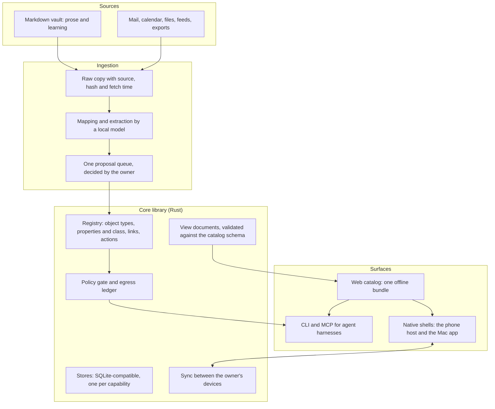

# What Sjel is

This page states the product: what Sjel is, which problems it must solve, what it builds and what
it leaves to other tools, and the architecture that follows. The order of work is in
[`PLAN.md`](../../PLAN.md).

## In one paragraph

Sjel is a private model of one person's or one household's life and work. It holds typed facts
with a source and a data class on hardware the owner controls. Its main job is the
combination: it connects facts that live in separate tools, shows what the connection reveals,
and lets the owner manage the result in one place. It is useful on its own data, and other tools
are its sources. Every domain is a module that the owner adds or removes, and the class of each
value decides which model may read it.

## Where the need comes from

1. Daily life runs through many separate tools, and each keeps its own copy of the data
   ([`research/why-sjel.md`](../../research/why-sjel.md)).
2. No single tool sees the connection between a mail, a calendar entry, a payment, a place and a
   person. The owner makes that connection by hand, or not at all.
3. Assistants are useful in proportion to the context they receive. Handing them everything
   sends facts about other people to a cloud provider.
4. Every earlier attempt by the author ended in a migration: Notion, then Obsidian, then several
   vault layouts ([`README.md`](../../README.md#why-i-built-it)). The lesson was that the notes
   tool was never the problem. The missing part was the layer under the tools.

## What Sjel must solve

| # | Problem | Sjel's answer | Check |
|---|---|---|---|
| 1 | Facts are spread over tools | One registry of object types, properties, links and actions | A question that needs three sources is answered from one place |
| 2 | Connections are made by hand | Links and extraction across sources, proposed by a local model and decided by the owner | A mail that concerns a project appears on that project without a manual step |
| 3 | Privacy needs constant attention | Every value has a data class, and the class decides which provider reads it | `comms egress-log --audit` reports zero violations ([`PLAN.md`](../../PLAN.md#success-measures)) |
| 4 | Every person needs different views | Views are data, composed from a fixed catalog | A saved view renders on the phone and the Mac without new code |
| 5 | Agents need the same facts | One contract serves the CLI, MCP and the views | A capability is finished only when `sjel` can find it, check it and call it |
| 6 | External tools change fast | A dated verdict for every external project, re-checked on a stated condition | [`upstreams.toml`](../../upstreams.toml) has no row without a verdict |

## What Sjel builds, ingests and links to

Sjel's value has two sources: the core, and the connection of data from many tools. The second
source sometimes requires Sjel to hold data or logic that an existing tool also has. The rule
below decides each case. It applies to every capability, new or existing.

| Verdict | When | Sjel's part |
|---|---|---|
| Build | The function is the join itself, or no tool exists, or no tool can respect the data classes | A capability with its own store |
| Ingest | A tool does the job well and its results feed a join | A connector, a raw copy with its source, and a mapping into the registry |
| Link out | A tool does the job well and the result needs no join | A link, and nothing stored |

Build and ingest are the product. Link out is the fallback for a job that adds nothing to the
model.

Three examples under this rule:

- Notes are written in Obsidian. Sjel indexes their properties and links.
- Photos stay in a photo library such as Immich. Sjel ingests place and date for the map.
- A trip joins mail, calendar, places, people and money. No single tool holds that join, so Sjel
  builds it. Hotel and train search stay with the booking sites.

A capability that fails the rule shrinks to a connector or a link. The audit of the existing
capabilities against this rule is open work.

## Principles

1. **Evaluate continuously, migrate rarely.** Sjel tracks new technology as a standing task.
   Each external project has a dated verdict and the condition that reopens it. A migration
   starts only after a measurement on Sjel's own data shows a gain, and at most one migration
   runs at a time.
2. **The class travels with the value.** A derived value takes the highest class of its inputs.
   A class rises by itself, and only a person lowers it, with a written reason.
3. **Screens come from the typed data** ([Product rule 6](../../CONTRIBUTING.md#product-rules)).
   A hand-built screen needs a reason that the catalog cannot meet.
4. **One way in.** The CLI, MCP tools and views read the same contract.
5. **Built for one owner first.** The design keeps a second household possible: a core that runs
   with no capability enabled, and nothing that only the author can set up.

## Architecture

### The core

The core is the registry, the stores, the policy gate, the view documents, sync and the `sjel`
CLI. It runs with no capability enabled. Everything else is an optional capability that declares
its object types, properties, links and actions in its manifest. Response schemas, MCP tool
descriptions, TypeScript types and the generic views derive from that declaration.

### Tiers

The core is a library, so it runs inside the phone app as well as inside a service.

| Tier | Adds |
|---|---|
| iPhone alone | Local store, capture, views, a small on-device model |
| Mac | Ingestion while the Mac is awake, the CLI, agent harnesses, a larger local model |
| Home server | Ingestion and alerts at all times, a large local model for data about other people |
| Hosted relay | Encrypted sync and backup as a paid convenience. Not designed yet |

### The vault

Prose lives in one folder of Markdown files, and the files are the authority for their text.
Any editor works on them: Obsidian today, and a reader and editor inside Sjel's web catalog. Each top folder has a default data class, and frontmatter can only raise it. Facts about
other people and secrets stay in Sjel's stores, and a note refers to them by link. An agent reads
prose from the files and reads facts through Sjel. A Sjel search returns the path of a matching
note, and the agent opens it when the class allows.

### Views

A view is a document that names catalog components and binds them to read routes. No
model-written code runs. The catalog is a small set of Svelte components, built into one bundle
with no network access. The bundle renders in a browser, in a web view inside the native shells,
and inside agent harnesses that support MCP Apps.

Adaptive views arrive in three levels, each built on the one before:

1. **Derived.** An object list and an object view come from the registry, with no model.
2. **Saved.** A model composes a view once. The owner keeps it, and it reloads without a model.
3. **Live.** An agent composes a view for one request inside a conversation.

The model of typed objects, links, governed actions and screens derived from them follows the
[Palantir Foundry Ontology](https://www.palantir.com/docs/foundry/ontology/overview), scaled to
one owner.

## The audited list

[`upstreams.toml`](../../upstreams.toml) records every external project Sjel uses, watches or
rejected, with a verdict, a reason and the condition that reopens the verdict. The list is part
of the product: it tells a reader which tool Sjel recommends for a job and why Sjel did not
build that job itself. Publishing it as a page of this site, grouped by job, is open work.

## What Sjel is not

- A replacement for a mail client, a calendar, a notes editor or a photo library.
- A general agent harness. Agents reach Sjel through its contracts.
- A hosted service. Every tier before the hosted relay works without one.
